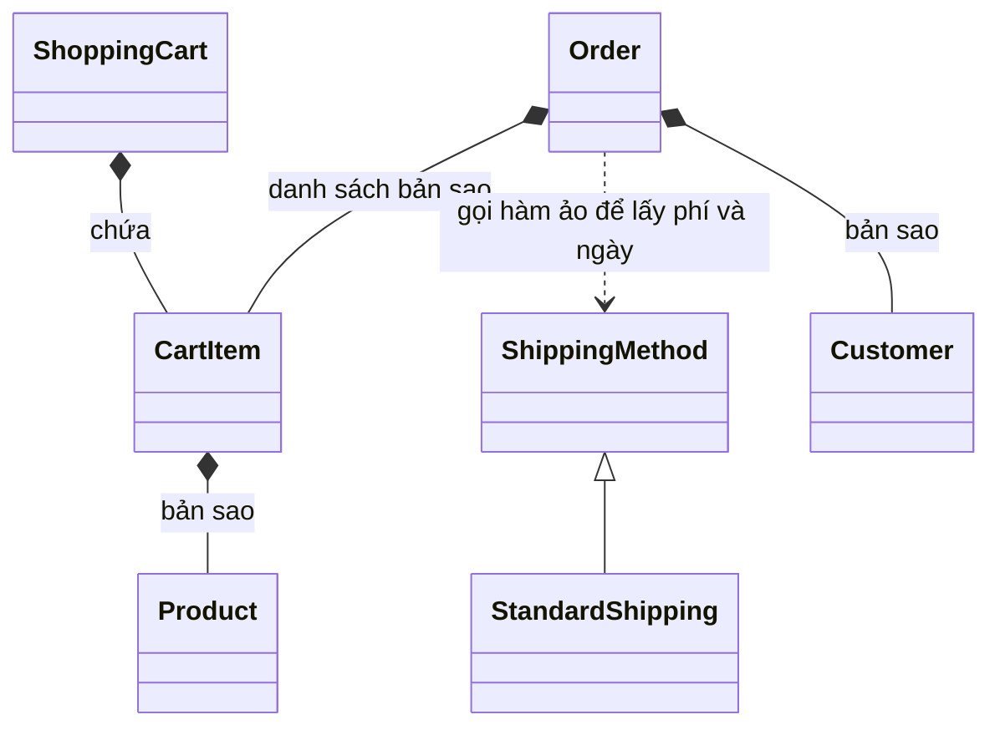

# ÔN TẬP VÀ VẤN ĐÁP OOP TỪ SOURCE MINISHOP

Cập nhật ngày **17/11/2026**, sau khi làm gọn code và menu.
Tài liệu bám danh mục 7 chương bạn đã cung cấp; không khẳng định đã trực tiếp
đọc lại các PDF giáo trình.

**Commit nền:** `353aad1492f7723e2e59ee2893011251b560175c`.
Working tree có thay đổi chưa commit; các đoạn dưới là source thực tế đang làm việc.
Số dòng và SHA-256 cuối tài liệu giúp đối chiếu đúng phiên bản.

Tài liệu nhóm các kiến thức liên quan thành **22 mục học**, có minh chứng của cả
**7 chương**. Đây không phải cam kết đã dùng mọi kỹ thuật nhỏ trong giáo trình.

## Mục lục

- [Bảng tra cứu nhanh](#tra-cuu)
- [Phần 1 – Tổng quan](#tong-quan)
- [Phần 2 – Bảy chương](#bay-chuong)
  - [Chương 1 – Tổng quan lập trình hướng đối tượng](#chuong-1)
  - [Chương 2 – Lớp và đối tượng](#chuong-2)
  - [Chương 3 – Quá tải toán tử](#chuong-3)
  - [Chương 4 – Kế thừa](#chuong-4)
  - [Chương 5 – Đa hình](#chuong-5)
  - [Chương 6 – Khuôn mẫu (Template)](#chuong-6)
  - [Chương 7 – Thư viện khuôn mẫu STL](#chuong-7)
- [Phần 3 – Chưa áp dụng và giới hạn](#chua-ap-dung)
- [Phần 4 – Ôn theo thành viên](#thanh-vien)
- [Phần 5 – Tự kiểm tra](#tu-kiem-tra)
- [Phần 6 – Demo, kiểm thử và phiên bản](#demo)
- [Phần 7 – Đáp án tự kiểm tra](#dap-an)

<a id="tra-cuu"></a>
## Bảng tra cứu nhanh

| Chương | Kiến thức | File | Hàm/Class | Trạng thái |
| --- | --- | --- | --- | --- |
| 1 | [K01 – Class, object và các phương thức](#k01) | [main.cpp:284](../main.cpp#L284) | main() | Đã áp dụng |
| 1 | [K02 – Đóng gói và che giấu dữ liệu](#k02) | [Product.h:8](../Product.h#L8) | Product | Đã áp dụng |
| 1 | [K03 – Trừu tượng hóa và quan hệ chứa đối tượng](#k03) | [ShoppingCart.h:9](../ShoppingCart.h#L9) | ShoppingCart | Đã áp dụng |
| 2 | [K04 – Constructor có tham số và danh sách khởi tạo](#k04) | [Product.cpp:6](../Product.cpp#L6) | Product::Product | Đã áp dụng |
| 2 | [K05 – Constructor mặc định và tham số mặc định](#k05) | [CartItem.h:11](../CartItem.h#L11) | CartItem | Đã áp dụng |
| 2 | [K06 – Getter const và tham chiếu const](#k06) | [Product.cpp:24](../Product.cpp#L24) | Product::getName / getPrice | Đã áp dụng |
| 2 | [K07 – this và bản sao dữ liệu đơn hàng](#k07) | [Order.cpp:87](../Order.cpp#L87) | Constructor Order ba tham số | Đã áp dụng |
| 2 | [K08 – Thành phần static constexpr](#k08) | [ShippingMethod.h:18](../ShippingMethod.h#L18) | StandardShipping | Đã áp dụng |
| 2 | [K09 – Destructor mặc định, RAII và destructor ảo](#k09) | [ShippingMethod.h:4](../ShippingMethod.h#L4) | ShippingMethod | Đã áp dụng |
| 2 | [K10 – Tách header/source và quá tải constructor](#k10) | [Order.h:26](../Order.h#L26) | Order | Đã áp dụng |
| 3 | [K11 – Tự quá tải operator== cho Product](#k11) | [Product.cpp:32](../Product.cpp#L32) | Product::operator== | Đã áp dụng |
| 4 | [K12 – Lớp cha, lớp con và kế thừa public](#k12) | [ShippingMethod.h:15](../ShippingMethod.h#L15) | StandardShipping : ShippingMethod | Đã áp dụng |
| 4 | [K13 – Protected constructor và thứ tự khởi tạo](#k13) | [ShippingMethod.h:4](../ShippingMethod.h#L4) | ShippingMethod | Đã áp dụng |
| 5 | [K14 – Abstract class, pure virtual và override](#k14) | [ShippingMethod.h:9](../ShippingMethod.h#L9) | ShippingMethod | Đã áp dụng |
| 5 | [K15 – Late binding qua tham chiếu lớp cha](#k15) | [Order.cpp:87](../Order.cpp#L87) | Order::Order ba tham số | Đã áp dụng |
| 6 | [K16 – Function template tự định nghĩa](#k16) | [ProductFile.cpp:10](../ProductFile.cpp#L10) | parsePositiveInteger<T> | Đã áp dụng |
| 6 | [K17 – Dùng template với hai kiểu dữ liệu](#k17) | [ProductFile.cpp:45](../ProductFile.cpp#L45) | loadProductsFromFile | Đã áp dụng |
| 7 | [K18 – Vector, push_back và truy cập phần tử](#k18) | [ProductFile.cpp:47](../ProductFile.cpp#L47) | loadProductsFromFile | Đã áp dụng |
| 7 | [K19 – Range-based for và tham chiếu khi duyệt](#k19) | [ShoppingCart.cpp:69](../ShoppingCart.cpp#L69) | ShoppingCart::getSubtotal | Đã áp dụng |
| 7 | [K20 – Thuật toán find_if, lambda và iterator kết quả](#k20) | [ShoppingCart.cpp:11](../ShoppingCart.cpp#L11) | ShoppingCart::addProduct | Đã áp dụng |
| 7 | [K21 – Iterator và erase khi giảm về 0](#k21) | [ShoppingCart.cpp:41](../ShoppingCart.cpp#L41) | ShoppingCart::decreaseQuantity | Đã áp dụng |
| 7 | [K22 – empty và clear của vector](#k22) | [ShoppingCart.cpp:89](../ShoppingCart.cpp#L89) | ShoppingCart::isEmpty / clear | Đã áp dụng |

Các từ khóa dùng sẵn từ thư viện không tự chứng minh nhóm đã viết kỹ thuật đó.
Ví dụ, operator== tự viết nằm ở Product; vector là template có sẵn, còn
parsePositiveInteger là function template nhóm tự định nghĩa.

<a id="tong-quan"></a>
## PHẦN 1 – TỔNG QUAN MINISHOP

### Chức năng và vai trò lớp

MiniShop đọc sản phẩm, cho khách tìm/xem, thêm và chỉnh giỏ, nhập thông tin,
xem trước rồi xác nhận đơn. Đơn có ngày đặt thực tế, ngày giao dự kiến,
phí giao và tổng thanh toán; có thể lưu hóa đơn TXT.
Chức năng sáng tạo đang giữ: tìm theo tên, sửa giỏ và lưu TXT.
Menu có mục 1–6 và 0 để thoát.

| Lớp | Hiểu đơn giản |
| --- | --- |
| Product | Một sản phẩm có mã, tên và giá; kiểm tra dữ liệu và so sánh mã |
| Customer | Một khách có tên, điện thoại và địa chỉ hợp lệ |
| CartItem | Một sản phẩm cùng số lượng; tính thành tiền |
| ShoppingCart | Danh sách các dòng giỏ; thêm/tăng/giảm/xóa, tính tổng |
| Order | Bản sao khách và giỏ lúc đặt; ngày giờ, phí, tổng và hóa đơn |
| ShippingMethod | Giao tiếp lấy phí và số ngày giao |
| StandardShipping | Giao thường, phí 30.000 VND và thời gian 3 ngày |

ProductFile.cpp chứa các hàm tự do đọc file/chuyển số, không phải lớp quản lý mới.
main.cpp dùng các hàm thông thường để làm menu; không bắt buộc mọi hàm đều là
phương thức của một lớp.

### Quan hệ giữa các lớp



### Theo dõi một lần mua hàng

1. [main.cpp:290](../main.cpp#L290): đọc file thật vào vector<Product>.
2. [main.cpp:178](../main.cpp#L178): menu thêm gửi Product vào giỏ.
   Giỏ tìm cùng mã bằng find_if và operator==; có rồi thì tăng, chưa có thì thêm dòng.
3. [main.cpp:202](../main.cpp#L202): tăng/giảm/xóa bằng các phương thức public.
4. [main.cpp:252](../main.cpp#L252): tạo khách sau khi nhập đủ thông tin.
5. [main.cpp:255](../main.cpp#L255): tạo bản xem trước, không xóa giỏ/ghi file.
6. [main.cpp:265](../main.cpp#L265): sau xác nhận tạo đơn chính thức, rồi clear giỏ.
7. [main.cpp:275](../main.cpp#L275): nếu chọn lưu mới ghi TXT.

### Đọc file và các phép tính cần nhớ

- Mỗi dòng products.txt là id|name|price. Bộ đọc dùng getline, template chuyển số,
  constructor Product kiểm tra tên/giá; vòng lặp phát hiện mã trùng.
- File rỗng trả danh sách rỗng. Dòng trống trong file có dữ liệu là dòng sai.
  Thiếu file/sai dữ liệu làm main báo lỗi và thoát mã 1, không tự sinh catalog.
- Tiền dùng long long, tính theo VND; không đổi qua float/double.
- Thành tiền = giá × số lượng; tiền hàng = tổng thành tiền;
  thanh toán = tiền hàng + phí. Kiểm tra tràn trước khi thay đổi giỏ.
- Ngày đặt theo time(nullptr). Ngày giao dùng localtime/mktime để cộng ngày lịch,
  xử lý qua tháng/năm. Múi giờ theo máy đang chạy.
- getReceiptText tạo một nội dung dùng chung cho Console và TXT.
  Lỗi lưu TXT không hủy đơn đã xác nhận.

<a id="bay-chuong"></a>
## PHẦN 2 – PHÂN TÍCH SOURCE THEO 7 CHƯƠNG

<a id="chuong-1"></a>
## Chương 1 – Tổng quan lập trình hướng đối tượng

<a id="k01"></a>
### K01 – Class, object và các phương thức

**A. Kiến thức thuộc chương nào?**

Chương 1 – Tổng quan lập trình hướng đối tượng.

**B. Vị trí trong source**

- File: [main.cpp:284](../main.cpp#L284).
- Class/hàm/phạm vi: `main()`.
- Đoạn trích: dòng 284–295 của bản làm việc này.

**C. Đoạn code minh họa – trích nguyên văn**

```cpp
int main() {
    vector<Product> products;
    ShoppingCart cart;

    cout << "Chao mung ban den voi MiniShop!\n";
    try {
        products = loadProductsFromFile("products.txt");
    } catch (const exception& error) {
        cerr << "[LOI] Khong tai duoc danh sach san pham: "
             << error.what() << "\nHay kiem tra products.txt va chay lai.\n";
        return 1;
    }
```

**D. Giải thích từng phần**

- ShoppingCart là tên lớp, cart là một đối tượng cụ thể. products là vector chứa nhiều đối tượng Product.
- main gọi hàm đọc file, giữ một giỏ và đưa các đối tượng vào từng chức năng menu. Không cần dùng new để tạo các biến này.

**E. Được sử dụng trong chương trình ở đâu?**

Chạy ngay khi mở EXE; menu truyền cart vào các hàm thêm, sửa và đặt hàng.

Vị trí gọi hoặc sử dụng giao tiếp: [main.cpp:307](../main.cpp#L307).

**F. Câu hỏi vấn đáp**

1. **ShoppingCart và cart khác nhau thế nào?**

   ShoppingCart là kiểu, cart là đối tượng có dữ liệu giỏ cụ thể.

2. **products có phải một Product không?**

   Không. Nó là danh sách chứa nhiều Product.

**G. Ghi nhớ nhanh**

> Class là bản thiết kế; object là một đối tượng đang được dùng.

<a id="k02"></a>
### K02 – Đóng gói và che giấu dữ liệu

**A. Kiến thức thuộc chương nào?**

Chương 1 – Tổng quan lập trình hướng đối tượng.

**B. Vị trí trong source**

- File: [Product.h:8](../Product.h#L8).
- Class/hàm/phạm vi: `Product`.
- Đoạn trích: dòng 8–22 của bản làm việc này.

**C. Đoạn code minh họa – trích nguyên văn**

```cpp
class Product {
private:
    int id;
    string name;
    long long price;

public:
    // Nem invalid_argument neu id/gia <= 0 hoac ten chi co khoang trang.
    Product(int id, const string& name, long long price);
    int getId() const;
    const string& getName() const;
    long long getPrice() const;
    // Hai san pham cung ma duoc xem la cung mot mat hang.
    bool operator==(const Product& other) const;
};
```

**D. Giải thích từng phần**

- id, name, price nằm trong private: code ngoài lớp không được gán trực tiếp.
- Constructor và getter trong public cung cấp cách tạo và đọc sản phẩm. Không có setter tùy ý làm dữ liệu đang hợp lệ thành sai.

**E. Được sử dụng trong chương trình ở đâu?**

Bộ đọc tạo Product; màn hình và giỏ lấy thông tin qua getter.

Vị trí gọi hoặc sử dụng giao tiếp: [main.cpp:130](../main.cpp#L130).

**F. Câu hỏi vấn đáp**

1. **Có viết product.price = -1 trong main được không?**

   Không, price là private.

2. **Vì sao không thêm setter cho mọi thuộc tính?**

   Project chưa cần sửa sản phẩm; giữ dữ liệu hợp lệ qua constructor là đủ.

**G. Ghi nhớ nhanh**

> Private giữ dữ liệu; public cho biết cách sử dụng lớp.

<a id="k03"></a>
### K03 – Trừu tượng hóa và quan hệ chứa đối tượng

**A. Kiến thức thuộc chương nào?**

Chương 1 – Tổng quan lập trình hướng đối tượng.

**B. Vị trí trong source**

- File: [ShoppingCart.h:9](../ShoppingCart.h#L9).
- Class/hàm/phạm vi: `ShoppingCart`.
- Đoạn trích: dòng 9–24 của bản làm việc này.

**C. Đoạn code minh họa – trích nguyên văn**

```cpp
class ShoppingCart {
private:
    vector<CartItem> items;

public:
    // Them moi voi SL 1; neu trung id thi tang SL 1.
    void addProduct(const Product& product);
    // Tra false neu khong tim thay id; true khi da thay doi.
    bool increaseQuantity(int productId);
    bool decreaseQuantity(int productId);
    bool removeProduct(int productId);
    const vector<CartItem>& getItems() const;
    long long getSubtotal() const;
    long long getTotalQuantity() const;
    bool isEmpty() const;
    void clear();
```

**D. Giải thích từng phần**

- Người dùng lớp chỉ cần gọi addProduct/removeProduct/getSubtotal; không phải tự sửa vector bên trong. Đó là cách trừu tượng hóa thao tác của giỏ.
- Giỏ chứa các CartItem; mỗi CartItem chứa Product theo giá trị. Đây là quan hệ has-a. Order cũng chứa bản sao Customer và danh sách CartItem.

**E. Được sử dụng trong chương trình ở đâu?**

Menu thao tác qua giao tiếp public của giỏ; không truy cập items trực tiếp.

Vị trí gọi hoặc sử dụng giao tiếp: [main.cpp:227](../main.cpp#L227).

**F. Câu hỏi vấn đáp**

1. **ShoppingCart có phải lớp con của CartItem không?**

   Không. Giỏ chứa nhiều CartItem, không kế thừa CartItem.

2. **ADT của giỏ thể hiện ở đâu?**

   Các thao tác public mô tả cách dùng giỏ, còn vector bên trong được giấu.

**G. Ghi nhớ nhanh**

> Chứa một đối tượng khác là has-a; không tự coi đó là kế thừa.

<a id="chuong-2"></a>
## Chương 2 – Lớp và đối tượng

<a id="k04"></a>
### K04 – Constructor có tham số và danh sách khởi tạo

**A. Kiến thức thuộc chương nào?**

Chương 2 – Lớp và đối tượng.

**B. Vị trí trong source**

- File: [Product.cpp:6](../Product.cpp#L6).
- Class/hàm/phạm vi: `Product::Product`.
- Đoạn trích: dòng 6–23 của bản làm việc này.

**C. Đoạn code minh họa – trích nguyên văn**

```cpp
Product::Product(int id, const string& name, long long price)
    : id(id), name(name), price(price) {
    // Chi tao san pham khi ca ba thuoc tinh deu hop le.
    if (id <= 0) {
        throw invalid_argument("Ma san pham phai lon hon 0.");
    }
    if (name.find_first_not_of(" \t\r\n\f\v") == string::npos) {
        throw invalid_argument("Ten san pham khong duoc de trong.");
    }
    if (price <= 0) {
        throw invalid_argument("Gia san pham phai lon hon 0.");
    }
}

int Product::getId() const {
    return id;
}

```

**D. Giải thích từng phần**

- : id(id), name(name), price(price) khởi tạo thuộc tính từ các tham số cùng tên.
- Nếu mã/giá không dương hoặc tên chỉ có khoảng trắng, constructor ném invalid_argument. Đối tượng không được tạo thành công với dữ liệu sai.

**E. Được sử dụng trong chương trình ở đâu?**

Mỗi dòng hợp lệ từ file tạo Product bằng constructor này.

Vị trí gọi hoặc sử dụng giao tiếp: [ProductFile.cpp:52](../ProductFile.cpp#L52).

**F. Câu hỏi vấn đáp**

1. **Constructor có kiểu trả về không?**

   Không, kể cả void; tên giống tên lớp.

2. **Kiểm tra ở menu rồi có cần kiểm tra trong lớp không?**

   Có. Lớp có thể được gọi từ bộ đọc file hoặc code khác mà không qua menu.

**G. Ghi nhớ nhanh**

> Constructor khởi tạo và bảo vệ trạng thái ban đầu của đối tượng.

<a id="k05"></a>
### K05 – Constructor mặc định và tham số mặc định

**A. Kiến thức thuộc chương nào?**

Chương 2 – Lớp và đối tượng.

**B. Vị trí trong source**

- File: [CartItem.h:11](../CartItem.h#L11).
- Class/hàm/phạm vi: `CartItem`.
- Đoạn trích: dòng 11–18 của bản làm việc này.

**C. Đoạn code minh họa – trích nguyên văn**

```cpp
public:
  CartItem(const Product &product, int quantity = 1);
  const Product &getProduct() const;
  int getQuantity() const;
  void increaseQuantity();
  void decreaseQuantity();
  long long getTotalPrice() const;
};
```

**D. Giải thích từng phần**

- quantity = 1 là giá trị mặc định của tham số thứ hai. CartItem(product) vẫn gọi constructor có tham số, với quantity bằng 1.
- CartItem không có constructor không tham số. ShoppingCart có constructor mặc định do compiler sinh; StandardShipping khai báo = default rõ ràng.

**E. Được sử dụng trong chương trình ở đâu?**

Khi thêm mặt hàng mới, giỏ tạo CartItem(product) với số lượng 1.

Vị trí gọi hoặc sử dụng giao tiếp: [ShoppingCart.cpp:25](../ShoppingCart.cpp#L25).

**F. Câu hỏi vấn đáp**

1. **CartItem(product) có phải gọi default constructor không?**

   Không. Nó gọi constructor nhận Product, bỏ qua tham số quantity đã có mặc định.

2. **ShoppingCart cart tạo giỏ thế nào?**

   Compiler sinh constructor mặc định, vector items ban đầu rỗng.

**G. Ghi nhớ nhanh**

> Tham số mặc định không đồng nghĩa với constructor mặc định.

<a id="k06"></a>
### K06 – Getter const và tham chiếu const

**A. Kiến thức thuộc chương nào?**

Chương 2 – Lớp và đối tượng.

**B. Vị trí trong source**

- File: [Product.cpp:24](../Product.cpp#L24).
- Class/hàm/phạm vi: `Product::getName / getPrice`.
- Đoạn trích: dòng 24–30 của bản làm việc này.

**C. Đoạn code minh họa – trích nguyên văn**

```cpp
const string& Product::getName() const {
    return name;
}

long long Product::getPrice() const {
    return price;
}
```

**D. Giải thích từng phần**

- const sau dấu ) cam kết hàm không sửa thuộc tính của đối tượng. Vì vậy gọi được trên Product const.
- const string& trả tham chiếu chỉ đọc đến tên đã lưu, tránh sao chép chuỗi. Getter giá trả số theo giá trị vì long long nhỏ.
- Tham chiếu đến thuộc tính chỉ dùng khi đối tượng chủ còn sống; không giữ tham chiếu sau khi phần tử vector bị xóa hoặc di chuyển.

**E. Được sử dụng trong chương trình ở đâu?**

showProducts nhận const vector<Product>& và duyệt const Product& để hiển thị.

Vị trí gọi hoặc sử dụng giao tiếp: [main.cpp:131](../main.cpp#L131).

**F. Câu hỏi vấn đáp**

1. **const ở cuối hàm bảo vệ điều gì?**

   Bảo vệ đối tượng nhận lời gọi, không cho getter sửa dữ liệu của nó.

2. **Vì sao getName trả const string&?**

   Đọc tên không cần copy và không cho bên gọi sửa tên qua giá trị trả về.

**G. Ghi nhớ nhanh**

> Getter const đọc dữ liệu; tham chiếu const tránh copy mà vẫn bảo vệ dữ liệu.

<a id="k07"></a>
### K07 – this và bản sao dữ liệu đơn hàng

**A. Kiến thức thuộc chương nào?**

Chương 2 – Lớp và đối tượng.

**B. Vị trí trong source**

- File: [Order.cpp:87](../Order.cpp#L87).
- Class/hàm/phạm vi: `Constructor Order ba tham số`.
- Đoạn trích: dòng 87–106 của bản làm việc này.

**C. Đoạn code minh họa – trích nguyên văn**

```cpp
Order::Order(const Customer& customer, const vector<CartItem>& items,
             const ShippingMethod& shipping)
    : customer(customer), items(items), orderTime(time(nullptr)),
      shippingFee(shipping.getFee()), deliveryDays(shipping.getDeliveryDays()) {
    // Goi virtual qua tham chieu ShippingMethod, thuc thi override cua lop con.
    // Hai thanh vien du lieu o tren la BAN SAO, khong tham chieu gio goc.
    if (this->items.empty()) {
        throw invalid_argument("Khong the tao don hang voi gio rong.");
    }
    if (orderTime == static_cast<time_t>(-1)) {
        throw runtime_error("Khong lay duoc thoi gian dat hang.");
    }
    if (shippingFee < 0 || deliveryDays < 0) {
        throw invalid_argument("Phi va so ngay giao hang khong duoc am.");
    }
    for (const CartItem& item : this->items) {
        if (item.getQuantity() <= 0 || item.getProduct().getPrice() <= 0) {
            throw invalid_argument("Don hang co gia hoac so luong khong hop le.");
        }
    }
```

**D. Giải thích từng phần**

- this->items chỉ rõ thuộc tính items của Order, phân biệt với tham số items cùng tên.
- : customer(customer), items(items) tạo bản sao khách và vector. Các phần tử CartItem cùng Product/string cũng được sao chép theo kiểu giá trị.
- Project dùng copy constructor mặc định do compiler sinh; không có copy constructor tự viết. Các lớp này không sở hữu con trỏ động cần sao chép riêng.

**E. Được sử dụng trong chương trình ở đâu?**

Sau xác nhận, main tạo Order rồi clear giỏ. Hóa đơn vẫn còn các mặt hàng đã chép.

Vị trí gọi hoặc sử dụng giao tiếp: [main.cpp:266](../main.cpp#L266).

**F. Câu hỏi vấn đáp**

1. **this là gì?**

   Con trỏ đến đối tượng đang thực hiện phương thức; this->items là thuộc tính của đơn này.

2. **clear giỏ có xóa items trong Order không?**

   Không. Order có vector riêng được sao chép lúc tạo.

3. **Nhóm có tự viết copy constructor không?**

   Không. Dùng bản compiler sinh cho các thuộc tính số, string, vector và đối tượng thành viên.

**G. Ghi nhớ nhanh**

> Order giữ bản sao dữ liệu, không mượn vector của giỏ.

<a id="k08"></a>
### K08 – Thành phần static constexpr

**A. Kiến thức thuộc chương nào?**

Chương 2 – Lớp và đối tượng.

**B. Vị trí trong source**

- File: [ShippingMethod.h:18](../ShippingMethod.h#L18).
- Class/hàm/phạm vi: `StandardShipping`.
- Đoạn trích: dòng 18–29 của bản làm việc này.

**C. Đoạn code minh họa – trích nguyên văn**

```cpp
    static constexpr long long FEE = 30000;
    static constexpr int DELIVERY_DAYS = 3;

    StandardShipping() = default;

    long long getFee() const override {
        return FEE;
    }

    int getDeliveryDays() const override {
        return DELIVERY_DAYS;
    }
```

**D. Giải thích từng phần**

- static nghĩa là hằng thuộc lớp, dùng chung cho mọi đối tượng StandardShipping.
- constexpr cho phép giá trị hằng biết lúc biên dịch. Hai override trả lại phí 30000 và số ngày 3.
- Đây là thành phần static của lớp; không phải mỗi đối tượng có một bản phí có thể sửa.

**E. Được sử dụng trong chương trình ở đâu?**

Order gọi getFee/getDeliveryDays qua giao tiếp lớp cha để lấy hai giá trị.

Vị trí gọi hoặc sử dụng giao tiếp: [Order.cpp:90](../Order.cpp#L90).

**F. Câu hỏi vấn đáp**

1. **Muốn đọc hằng có cần tạo đối tượng không?**

   Không; có thể viết StandardShipping::FEE.

2. **Vì sao phí đang là 30.000?**

   getFee trả FEE, hằng FEE bằng 30000 VND.

**G. Ghi nhớ nhanh**

> static thuộc lớp; constexpr là hằng biết lúc biên dịch.

<a id="k09"></a>
### K09 – Destructor mặc định, RAII và destructor ảo

**A. Kiến thức thuộc chương nào?**

Chương 2 – Lớp và đối tượng.

**B. Vị trí trong source**

- File: [ShippingMethod.h:4](../ShippingMethod.h#L4).
- Class/hàm/phạm vi: `ShippingMethod`.
- Đoạn trích: dòng 4–12 của bản làm việc này.

**C. Đoạn code minh họa – trích nguyên văn**

```cpp
class ShippingMethod {
protected:
    ShippingMethod() = default;

public:
    virtual ~ShippingMethod() = default;
    virtual long long getFee() const = 0;
    virtual int getDeliveryDays() const = 0;
};
```

**D. Giải thích từng phần**

- virtual ~ShippingMethod() = default yêu cầu compiler sinh destructor và giữ cơ chế hủy ảo.
- Các lớp nghiệp vụ dùng destructor mặc định: string/vector tự dọn tài nguyên. Biến file ifstream/ofstream cũng tự đóng khi ra khỏi phạm vi (RAII).
- Ứng dụng không new/delete qua lớp cha. Destructor ảo vẫn phù hợp cho giao tiếp đa hình; việc delete qua con trỏ cha được thử riêng trong test.

**E. Được sử dụng trong chương trình ở đâu?**

Đối tượng StandardShipping tạm trong constructor Order được hủy sau khi lời gọi kết thúc. Biến file được hủy khi hàm đọc/ghi trả về.

Vị trí gọi hoặc sử dụng giao tiếp: [Order.cpp:83](../Order.cpp#L83).

**F. Câu hỏi vấn đáp**

1. **Không tự viết destructor cho Product có phải thiếu không?**

   Không. string và các thuộc tính của Product đã được destructor mặc định xử lý.

2. **Vì sao lớp cha có destructor virtual?**

   Để nếu hủy qua con trỏ ShippingMethod thì destructor của lớp con cũng được gọi đúng.

**G. Ghi nhớ nhanh**

> Dữ liệu dùng kiểu tự quản lý thì thường không cần tự viết hàm hủy.

<a id="k10"></a>
### K10 – Tách header/source và quá tải constructor

**A. Kiến thức thuộc chương nào?**

Chương 2 – Lớp và đối tượng.

**B. Vị trí trong source**

- File: [Order.h:26](../Order.h#L26).
- Class/hàm/phạm vi: `Order`.
- Đoạn trích: dòng 26–31 của bản làm việc này.

**C. Đoạn code minh họa – trích nguyên văn**

```cpp
    Order(const Customer& customer, const vector<CartItem>& items);
    // Nhan qua tham chieu lop cha de goi phuong thuc ao cua lop con.
    // Chi luu gia tri phi/ngay; khong giu tham chieu den shipping.
    Order(const Customer& customer, const vector<CartItem>& items,
          const ShippingMethod& shipping);
    const Customer& getCustomer() const;
```

**D. Giải thích từng phần**

- Order.h khai báo hai constructor cùng tên, khác số tham số. Order.cpp chứa phần định nghĩa và xử lý.
- Constructor hai tham số ủy quyền cho bản ba tham số bằng StandardShipping(). Cách này dùng chung phần kiểm tra, không chép lại logic tạo đơn.
- Quá tải được chọn theo danh sách tham số lúc biên dịch; khác cơ chế chọn hàm virtual theo kiểu thực của đối tượng.

**E. Được sử dụng trong chương trình ở đâu?**

Menu dùng constructor hai tham số. Constructor đó gọi bản ba tham số khi tạo đơn xem trước và đơn xác nhận.

Vị trí gọi hoặc sử dụng giao tiếp: [Order.cpp:83](../Order.cpp#L83).

**F. Câu hỏi vấn đáp**

1. **Hai constructor khác nhau ở đâu?**

   Bản ba tham số nhận thêm phương thức giao hàng; bản hai tham số dùng giao thường.

2. **Ủy quyền constructor có phải đa hình động không?**

   Không. Đây là chọn constructor theo tham số; đa hình động nằm ở lời gọi hàm virtual.

**G. Ghi nhớ nhanh**

> Header nêu cách gọi; source thực hiện. Một constructor có thể nhờ constructor khác khởi tạo.

<a id="chuong-3"></a>
## Chương 3 – Quá tải toán tử

<a id="k11"></a>
### K11 – Tự quá tải operator== cho Product

**A. Kiến thức thuộc chương nào?**

Chương 3 – Quá tải toán tử.

**B. Vị trí trong source**

- File: [Product.cpp:32](../Product.cpp#L32).
- Class/hàm/phạm vi: `Product::operator==`.
- Đoạn trích: dòng 32–34 của bản làm việc này.

**C. Đoạn code minh họa – trích nguyên văn**

```cpp
bool Product::operator==(const Product& other) const {
    return id == other.id;
}
```

**D. Giải thích từng phần**

- Toán tử tự viết nhận Product khác và trả true khi hai id bằng nhau.
- Không so tên hoặc giá: cùng mã được xem là cùng mặt hàng. Giỏ giữ tên/giá của mặt hàng đã lưu khi thêm cùng mã lần nữa.
- Các toán tử << cho cout hoặc == cho int có sẵn không được tính là nhóm tự quá tải toán tử.

**E. Được sử dụng trong chương trình ở đâu?**

Lambda trong addProduct gọi phép so sánh này để tìm mặt hàng đã có.

Vị trí gọi hoặc sử dụng giao tiếp: [ShoppingCart.cpp:13](../ShoppingCart.cpp#L13).

**F. Câu hỏi vấn đáp**

1. **Hai sản phẩm cùng tên nhưng khác mã có bằng nhau không?**

   Không; toán tử này chỉ so id.

2. **Toán tử có thực sự được gọi không?**

   Có, trong điều kiện lambda của find_if khi thêm vào giỏ.

**G. Ghi nhớ nhanh**

> Product == Product trong project nghĩa là cùng mã sản phẩm.

<a id="chuong-4"></a>
## Chương 4 – Kế thừa

<a id="k12"></a>
### K12 – Lớp cha, lớp con và kế thừa public

**A. Kiến thức thuộc chương nào?**

Chương 4 – Kế thừa.

**B. Vị trí trong source**

- File: [ShippingMethod.h:15](../ShippingMethod.h#L15).
- Class/hàm/phạm vi: `StandardShipping : ShippingMethod`.
- Đoạn trích: dòng 15–24 của bản làm việc này.

**C. Đoạn code minh họa – trích nguyên văn**

```cpp
class StandardShipping : public ShippingMethod {
public:
    // Hang so dung chung cho moi doi tuong giao thuong.
    static constexpr long long FEE = 30000;
    static constexpr int DELIVERY_DAYS = 3;

    StandardShipping() = default;

    long long getFee() const override {
        return FEE;
```

**D. Giải thích từng phần**

- ShippingMethod là lớp cha, StandardShipping là lớp con. Dấu : public thể hiện đơn kế thừa công khai.
- Giao thường là một phương thức giao hàng: quan hệ is-a hợp lý. Có thể truyền đối tượng lớp con vào tham chiếu lớp cha.
- CartItem chứa Product và ShoppingCart chứa CartItem là has-a; không có kế thừa giữa các lớp đó.

**E. Được sử dụng trong chương trình ở đâu?**

Order mặc định tạo StandardShipping và truyền nó vào constructor nhận const ShippingMethod&.

Vị trí gọi hoặc sử dụng giao tiếp: [Order.cpp:83](../Order.cpp#L83).

**F. Câu hỏi vấn đáp**

1. **Project có đa kế thừa không?**

   Không, StandardShipping chỉ kế thừa ShippingMethod.

2. **Public inheritance cho phép gì ở đây?**

   Cho phép dùng giao thường qua giao tiếp ShippingMethod, ví dụ truyền vào Order.

**G. Ghi nhớ nhanh**

> StandardShipping là một ShippingMethod.

<a id="k13"></a>
### K13 – Protected constructor và thứ tự khởi tạo

**A. Kiến thức thuộc chương nào?**

Chương 4 – Kế thừa.

**B. Vị trí trong source**

- File: [ShippingMethod.h:4](../ShippingMethod.h#L4).
- Class/hàm/phạm vi: `ShippingMethod`.
- Đoạn trích: dòng 4–9 của bản làm việc này.

**C. Đoạn code minh họa – trích nguyên văn**

```cpp
class ShippingMethod {
protected:
    ShippingMethod() = default;

public:
    virtual ~ShippingMethod() = default;
```

**D. Giải thích từng phần**

- Constructor lớp cha nằm trong protected, nên lớp con có thể gọi, code ngoài không gọi trực tiếp được.
- StandardShipping() = default tự gọi constructor không tham số của lớp cha trước khi khởi tạo phần lớp con.
- Khi hủy thì thứ tự ngược lại: phần lớp con trước, phần lớp cha sau. Không có thuộc tính protected; chỉ có constructor protected.

**E. Được sử dụng trong chương trình ở đâu?**

Việc tạo StandardShipping tạm trong constructor Order kích hoạt quá trình tạo cha rồi con.

Vị trí gọi hoặc sử dụng giao tiếp: [ShippingMethod.h:21](../ShippingMethod.h#L21).

**F. Câu hỏi vấn đáp**

1. **Thành viên protected ở đây là thuộc tính nào?**

   Không có thuộc tính protected; đó là constructor của ShippingMethod.

2. **Khởi tạo cha hay con trước?**

   Cha trước, con sau; khi hủy thì ngược lại.

**G. Ghi nhớ nhanh**

> Lớp con được dùng constructor protected của cha.

<a id="chuong-5"></a>
## Chương 5 – Đa hình

<a id="k14"></a>
### K14 – Abstract class, pure virtual và override

**A. Kiến thức thuộc chương nào?**

Chương 5 – Đa hình.

**B. Vị trí trong source**

- File: [ShippingMethod.h:9](../ShippingMethod.h#L9).
- Class/hàm/phạm vi: `ShippingMethod`.
- Đoạn trích: dòng 9–12 của bản làm việc này.

**C. Đoạn code minh họa – trích nguyên văn**

```cpp
    virtual ~ShippingMethod() = default;
    virtual long long getFee() const = 0;
    virtual int getDeliveryDays() const = 0;
};
```

**D. Giải thích từng phần**

- getFee/getDeliveryDays có virtual và = 0: đây là hai phương thức ảo thuần túy, khiến ShippingMethod là lớp trừu tượng.
- StandardShipping ghi đè cả hai hàm với override. Từ khóa override giúp compiler bắt lỗi nếu chữ ký không khớp.
- Không thể tạo trực tiếp ShippingMethod; có thể dùng tham chiếu/con trỏ đến nó để giao tiếp với lớp con.

**E. Được sử dụng trong chương trình ở đâu?**

Lớp giao thường triển khai giao tiếp này; Order nhận tham chiếu lớp cha để lấy phí/ngày.

Vị trí gọi hoặc sử dụng giao tiếp: [ShippingMethod.h:23](../ShippingMethod.h#L23).

**F. Câu hỏi vấn đáp**

1. **= 0 có nghĩa hàm trả số 0 không?**

   Không; ở khai báo virtual, = 0 đánh dấu hàm ảo thuần túy.

2. **Vì sao StandardShipping tạo được đối tượng?**

   Vì lớp đã override đủ cả hai hàm ảo thuần túy.

**G. Ghi nhớ nhanh**

> Lớp trừu tượng quy định phải làm gì; lớp con thực hiện cách làm.

<a id="k15"></a>
### K15 – Late binding qua tham chiếu lớp cha

**A. Kiến thức thuộc chương nào?**

Chương 5 – Đa hình.

**B. Vị trí trong source**

- File: [Order.cpp:87](../Order.cpp#L87).
- Class/hàm/phạm vi: `Order::Order ba tham số`.
- Đoạn trích: dòng 87–93 của bản làm việc này.

**C. Đoạn code minh họa – trích nguyên văn**

```cpp
Order::Order(const Customer& customer, const vector<CartItem>& items,
             const ShippingMethod& shipping)
    : customer(customer), items(items), orderTime(time(nullptr)),
      shippingFee(shipping.getFee()), deliveryDays(shipping.getDeliveryDays()) {
    // Goi virtual qua tham chieu ShippingMethod, thuc thi override cua lop con.
    // Hai thanh vien du lieu o tren la BAN SAO, khong tham chieu gio goc.
    if (this->items.empty()) {
```

**D. Giải thích từng phần**

- shipping có kiểu tham chiếu const ShippingMethod&, nhưng đối tượng thực trong menu là StandardShipping.
- Lời gọi shipping.getFee()/getDeliveryDays() chọn override theo kiểu thực của đối tượng: đây là đa hình động.
- Order chỉ lưu hai giá trị nhận về. Nó không giữ tham chiếu đến shipping, nên đối tượng giao thường tạm bị hủy không làm đơn có tham chiếu treo.

**E. Được sử dụng trong chương trình ở đâu?**

Constructor hai tham số của Order đưa StandardShipping vào đây. Test còn dùng lớp giao hàng thử để kiểm tra đúng hàm ảo được gọi.

Vị trí gọi hoặc sử dụng giao tiếp: [Order.cpp:83](../Order.cpp#L83).

**F. Câu hỏi vấn đáp**

1. **Đa hình động nằm chính xác ở đâu?**

   Hai lời gọi hàm virtual qua tham chiếu shipping của lớp cha.

2. **Tại sao không giữ shipping trong Order?**

   Đơn chỉ cần phí/ngày đã chốt; lưu giá trị đơn giản và không phụ thuộc thời gian sống của đối tượng giao hàng.

**G. Ghi nhớ nhanh**

> Kiểu tham chiếu là cha; hàm được chạy là phiên bản của đối tượng thực.

<a id="chuong-6"></a>
## Chương 6 – Khuôn mẫu (Template)

<a id="k16"></a>
### K16 – Function template tự định nghĩa

**A. Kiến thức thuộc chương nào?**

Chương 6 – Khuôn mẫu (Template).

**B. Vị trí trong source**

- File: [ProductFile.cpp:10](../ProductFile.cpp#L10).
- Class/hàm/phạm vi: `parsePositiveInteger<T>`.
- Đoạn trích: dòng 10–22 của bản làm việc này.

**C. Đoạn code minh họa – trích nguyên văn**

```cpp
template <typename T>
T parsePositiveInteger(const string& field) {
    istringstream input(field);
    T value = 0;
    if (!(input >> value) || value <= 0) {
        throw invalid_argument("So nguyen duong khong hop le hoac vuot gioi han.");
    }
    input >> ws;
    if (!input.eof()) {
        throw invalid_argument("So nguyen co ky tu thua.");
    }
    return value;
}
```

**D. Giải thích từng phần**

- T là tham số kiểu. Cùng một cách đọc số và kiểm tra được dùng cho nhiều kiểu số nguyên.
- istringstream đọc giá trị; kiểm tra dương và lỗi vượt giới hạn. Sau input >> ws, phải hết chuỗi để không chấp nhận 2abc hoặc 2.5.
- Template này dùng cho kiểu có phép nhập stream, so sánh với 0. Nó không phù hợp tùy ý với mọi lớp.
- Hàm nằm trong namespace vô danh nên chỉ dùng bên trong ProductFile.cpp.

**E. Được sử dụng trong chương trình ở đâu?**

Bộ đọc gọi template với int cho mã và long long cho giá ở mỗi dòng.

Vị trí gọi hoặc sử dụng giao tiếp: [ProductFile.cpp:45](../ProductFile.cpp#L45).

**F. Câu hỏi vấn đáp**

1. **Nhóm tự viết template nào?**

   Function template parsePositiveInteger<T>.

2. **Dùng vector<Product> có chứng minh tự viết template không?**

   Không. vector là class template có sẵn của thư viện.

**G. Ghi nhớ nhanh**

> Viết một hàm tổng quát, chọn kiểu khi gọi.

<a id="k17"></a>
### K17 – Dùng template với hai kiểu dữ liệu

**A. Kiến thức thuộc chương nào?**

Chương 6 – Khuôn mẫu (Template).

**B. Vị trí trong source**

- File: [ProductFile.cpp:45](../ProductFile.cpp#L45).
- Class/hàm/phạm vi: `loadProductsFromFile`.
- Đoạn trích: dòng 45–52 của bản làm việc này.

**C. Đoạn code minh họa – trích nguyên văn**

```cpp
            const int id = parsePositiveInteger<int>(idText);
            const long long price = parsePositiveInteger<long long>(priceText);
            for (const Product& product : products) {
                if (product.getId() == id) {
                    throw invalid_argument("Ma san pham bi trung: " + to_string(id));
                }
            }
            products.push_back(Product(id, name, price));
```

**D. Giải thích từng phần**

- <int> chọn bản đọc ID; <long long> chọn bản đọc giá. Hai lời gọi dùng cùng định nghĩa template.
- ID cần nằm trong giới hạn int. Tiền có thể lớn hơn nên dùng long long, không chuyển qua double làm mất chính xác.
- Project không có class template tự định nghĩa hoặc friend của template; không cần tự viết container mới.

**E. Được sử dụng trong chương trình ở đâu?**

main gọi loadProductsFromFile khi khởi động, nên cả hai kiểu đều được dùng trong luồng thật.

Vị trí gọi hoặc sử dụng giao tiếp: [main.cpp:290](../main.cpp#L290).

**F. Câu hỏi vấn đáp**

1. **Có mấy kiểu đang dùng cho template này?**

   Hai: int và long long.

2. **Giá vượt giới hạn long long có được nhận không?**

   Không. Phép đọc stream thất bại, template ném lỗi và bộ đọc thêm số dòng.

**G. Ghi nhớ nhanh**

> Một định nghĩa, hai kiểu số, cùng một quy tắc kiểm tra.

<a id="chuong-7"></a>
## Chương 7 – Thư viện khuôn mẫu STL

<a id="k18"></a>
### K18 – Vector, push_back và truy cập phần tử

**A. Kiến thức thuộc chương nào?**

Chương 7 – Thư viện khuôn mẫu STL.

**B. Vị trí trong source**

- File: [ProductFile.cpp:47](../ProductFile.cpp#L47).
- Class/hàm/phạm vi: `loadProductsFromFile`.
- Đoạn trích: dòng 47–52 của bản làm việc này.

**C. Đoạn code minh họa – trích nguyên văn**

```cpp
            for (const Product& product : products) {
                if (product.getId() == id) {
                    throw invalid_argument("Ma san pham bi trung: " + to_string(id));
                }
            }
            products.push_back(Product(id, name, price));
```

**D. Giải thích từng phần**

- products là vector<Product>: container chuẩn chứa các sản phẩm theo thứ tự trong file.
- Duyệt các phần tử đã đọc để kiểm tra trùng mã; push_back(Product(...)) tạo sản phẩm hợp lệ rồi thêm vào cuối.
- Vector tự quản lý bộ nhớ. Với catalog nhỏ, vòng lặp kiểm tra trùng dễ hiểu; tổng chi phí đọc n dòng có thể tới O(n²).
- size() đếm phần tử, empty() kiểm tra rỗng. Trong ứng dụng, size() dùng xử lý chuỗi; vector không cần gọi size() để thực hiện nghiệp vụ.

**E. Được sử dụng trong chương trình ở đâu?**

Bộ đọc trả vector về main. Tìm kiếm cũng dùng vector kết quả và push_back mà không thay danh sách gốc.

Vị trí gọi hoặc sử dụng giao tiếp: [main.cpp:155](../main.cpp#L155).

**F. Câu hỏi vấn đáp**

1. **push_back có làm tăng số phần tử không?**

   Có, thêm một phần tử vào cuối vector.

2. **Vector kết quả tìm kiếm có phải giỏ không?**

   Không. Đó là danh sách riêng để hiển thị kết quả.

**G. Ghi nhớ nhanh**

> Vector giữ một dãy đối tượng và tự quản lý vùng nhớ.

<a id="k19"></a>
### K19 – Range-based for và tham chiếu khi duyệt

**A. Kiến thức thuộc chương nào?**

Chương 7 – Thư viện khuôn mẫu STL.

**B. Vị trí trong source**

- File: [ShoppingCart.cpp:69](../ShoppingCart.cpp#L69).
- Class/hàm/phạm vi: `ShoppingCart::getSubtotal`.
- Đoạn trích: dòng 69–79 của bản làm việc này.

**C. Đoạn code minh họa – trích nguyên văn**

```cpp
long long ShoppingCart::getSubtotal() const {
    long long sum = 0;
    for (const CartItem& item : items) {
        const long long value = item.getTotalPrice();
        if (value > numeric_limits<long long>::max() - sum) {
            throw overflow_error("Tong tien gio vuot gioi han long long.");
        }
        sum += value;
    }
    return sum;
}
```

**D. Giải thích từng phần**

- for (const CartItem& item : items) duyệt từng mặt hàng, không copy và không sửa phần tử.
- Tổng cộng từng thành tiền. So sánh với max - sum trước khi cộng tránh thực hiện phép cộng có thể tràn.
- Khi cần thay đổi phần tử, increaseQuantity dùng CartItem& không có const. Đây là cách sửa đúng phần tử trong vector.

**E. Được sử dụng trong chương trình ở đâu?**

Màn hình giỏ gọi getSubtotal; thêm/tăng cũng đọc tổng để kiểm tra trước khi thay đổi.

Vị trí gọi hoặc sử dụng giao tiếp: [main.cpp:194](../main.cpp#L194).

**F. Câu hỏi vấn đáp**

1. **Bỏ & khi duyệt để tăng số lượng có vấn đề gì?**

   Sẽ sửa bản sao mỗi phần tử, không sửa mặt hàng gốc trong vector.

2. **Vì sao kiểm tra bằng max - sum?**

   Nếu cộng trước rồi mới kiểm tra thì số nguyên có thể đã tràn; phép trừ này an toàn khi sum không âm.

**G. Ghi nhớ nhanh**

> Duyệt chỉ đọc dùng const &; muốn sửa phần tử thật dùng &.

<a id="k20"></a>
### K20 – Thuật toán find_if, lambda và iterator kết quả

**A. Kiến thức thuộc chương nào?**

Chương 7 – Thư viện khuôn mẫu STL.

**B. Vị trí trong source**

- File: [ShoppingCart.cpp:11](../ShoppingCart.cpp#L11).
- Class/hàm/phạm vi: `ShoppingCart::addProduct`.
- Đoạn trích: dòng 11–20 của bản làm việc này.

**C. Đoạn code minh họa – trích nguyên văn**

```cpp
    auto item = find_if(items.begin(), items.end(),
        [&product](const CartItem& cartItem) {
            return cartItem.getProduct() == product;
        });
    if (item != items.end()) {
        if (item->getProduct().getPrice() > numeric_limits<long long>::max() - getSubtotal()) {
            throw overflow_error("Tong tien gio vuot gioi han long long.");
        }
        item->increaseQuantity();
        return;
```

**D. Giải thích từng phần**

- find_if trong <algorithm> duyệt từ begin đến end, trả iterator tới phần tử đầu tiên thỏa điều kiện.
- Lambda `[&product](const CartItem& cartItem)` là hàm điều kiện ngắn. Nó dùng Product::operator== để so mã.
- Nếu item != items.end() thì dùng item-> để truy cập mặt hàng tìm thấy và tăng số lượng. end() biểu thị không tìm thấy, không được giải tham chiếu.
- Giữ find_if để có thuật toán STL dùng thật trong chương 7; không thêm sort/map khi chưa có nhu cầu.

**E. Được sử dụng trong chương trình ở đâu?**

Menu thêm sản phẩm gọi cart.addProduct, chạy thuật toán này ở mọi lần thêm.

Vị trí gọi hoặc sử dụng giao tiếp: [main.cpp:178](../main.cpp#L178).

**F. Câu hỏi vấn đáp**

1. **find_if trả về bool hay phần tử?**

   Trả iterator; so với end() để biết có tìm thấy không.

2. **[&product] có nghĩa gì?**

   Lambda được đọc biến product ở ngoài bằng tham chiếu trong thời gian thuật toán đang chạy.

**G. Ghi nhớ nhanh**

> find_if tìm theo điều kiện; end() nghĩa là chưa tìm được phần tử.

<a id="k21"></a>
### K21 – Iterator và erase khi giảm về 0

**A. Kiến thức thuộc chương nào?**

Chương 7 – Thư viện khuôn mẫu STL.

**B. Vị trí trong source**

- File: [ShoppingCart.cpp:41](../ShoppingCart.cpp#L41).
- Class/hàm/phạm vi: `ShoppingCart::decreaseQuantity`.
- Đoạn trích: dòng 41–53 của bản làm việc này.

**C. Đoạn code minh họa – trích nguyên văn**

```cpp
bool ShoppingCart::decreaseQuantity(int productId) {
    for (auto it = items.begin(); it != items.end(); ++it) {
        if (it->getProduct().getId() == productId) {
            it->decreaseQuantity();
            if (it->getQuantity() == 0) {
                items.erase(it);
            }
            // Tra ve ngay, vi erase lam iterator tai vi tri nay mat hieu luc.
            return true;
        }
    }
    return false;
}
```

**D. Giải thích từng phần**

- it là iterator đang trỏ vào từng CartItem. Dùng it-> để truy cập phần tử.
- Giảm số lượng; nếu về 0 thì erase(it) xóa dòng khỏi vector.
- erase làm mất hiệu lực iterator tại vị trí bị xóa và các iterator phía sau. Hàm return ngay, không tiếp tục ++it trên iterator cũ.

**E. Được sử dụng trong chương trình ở đâu?**

Menu sửa chọn giảm số lượng gọi hàm này; removeProduct dùng cách tìm/xóa tương tự.

Vị trí gọi hoặc sử dụng giao tiếp: [main.cpp:225](../main.cpp#L225).

**F. Câu hỏi vấn đáp**

1. **Vì sao không erase trong vòng for tham chiếu rồi tiếp tục duyệt?**

   Xóa vector có thể làm phần tử/iterator mất hiệu lực; phải xử lý cách tiếp tục duyệt đúng.

2. **Vì sao ở đây return sau erase là an toàn?**

   Không dùng lại iterator đã mất hiệu lực; hàm kết thúc ngay.

**G. Ghi nhớ nhanh**

> Xóa phần tử thì phải để ý iterator còn hợp lệ hay không.

<a id="k22"></a>
### K22 – empty và clear của vector

**A. Kiến thức thuộc chương nào?**

Chương 7 – Thư viện khuôn mẫu STL.

**B. Vị trí trong source**

- File: [ShoppingCart.cpp:89](../ShoppingCart.cpp#L89).
- Class/hàm/phạm vi: `ShoppingCart::isEmpty / clear`.
- Đoạn trích: dòng 89–95 của bản làm việc này.

**C. Đoạn code minh họa – trích nguyên văn**

```cpp
bool ShoppingCart::isEmpty() const {
    return items.empty();
}

void ShoppingCart::clear() {
    items.clear();
}
```

**D. Giải thích từng phần**

- empty() trả true nếu vector không còn phần tử. clear() xóa toàn bộ phần tử trong vector.
- Giỏ public hai thao tác này để menu không phải sửa trực tiếp vector private.
- clear giỏ chỉ được gọi sau khi tạo Order chính thức; bản sao items trong Order còn nguyên.

**E. Được sử dụng trong chương trình ở đâu?**

checkout chặn giỏ rỗng ngay đầu; sau xác nhận tạo Order rồi gọi cart.clear().

Vị trí gọi hoặc sử dụng giao tiếp: [main.cpp:266](../main.cpp#L266).

**F. Câu hỏi vấn đáp**

1. **clear giỏ có xóa hóa đơn không?**

   Không, hóa đơn đọc dữ liệu bản sao của Order.

2. **Hủy đặt hàng có clear không?**

   Không. Nhánh hủy return trước chỗ tạo Order chính thức và clear.

**G. Ghi nhớ nhanh**

> empty để hỏi còn hàng không; clear để xóa toàn bộ giỏ.

<a id="chua-ap-dung"></a>
## PHẦN 3 – CHƯA ÁP DỤNG, ÁP DỤNG MỘT PHẦN VÀ GIỚI HẠN

### Các kỹ thuật không tự nhận là đã có

| Kiến thức | Thực tế trong source | Có cần thêm không? |
| --- | --- | --- |
| Setter – Chương 2 | Không có setter cho Product/Customer | Chưa cần sửa các đối tượng này; constructor/getter đủ cho nghiệp vụ |
| Friend function/class – Chương 2 | Chưa áp dụng | Không cần phá phạm vi private chỉ để thêm từ khóa |
| Copy constructor tự viết – Chương 2 | Chưa có; dùng bản mặc định | Bản mặc định phù hợp thuộc tính số/string/vector |
| Destructor tự quản lý bộ nhớ – Chương 2 | Không có; chỉ giao tiếp shipping có destructor virtual = default | Không có con trỏ sở hữu tài nguyên động để phải tự delete |
| Toán tử số học, nhập/xuất tự viết – Chương 3 | Chưa áp dụng | Một operator== có ý nghĩa và được dùng thật đã minh họa trọng tâm |
| Kế thừa protected/private, đa kế thừa – Chương 4 | Chưa áp dụng | Đơn kế thừa public phù hợp ví dụ hiện tại |
| Thuộc tính protected – Chương 4 | Không có; chỉ constructor protected | Không cần mở quyền truy cập dữ liệu cho lớp con |
| Downcast/dynamic_cast – Chương 5 | Chưa áp dụng | Giao tiếp virtual đủ dùng; không cần truy về kiểu con |
| Class template tự viết, friend template – Chương 6 | Chưa áp dụng | Function template hai kiểu đã có mục đích thật |
| map, sort, find – Chương 7 | Không dùng các tên thuật toán/container này; có find_if, vector, iterator | Đã có container, algorithm, iterator; không bắt buộc thêm mọi loại |

Nếu cô yêu cầu riêng một kỹ thuật chưa có, cần xác nhận yêu cầu đó và chọn
bổ sung có nghiệp vụ cụ thể. Không mặc định mỗi dòng trong giáo trình đều
phải có một tính năng riêng.

### Phân biệt code ứng dụng với test

- Constructor Order hai tham số được menu gọi; nó gọi tiếp bản ba tham số,
  nên giao tiếp ShippingMethod và lời gọi virtual được dùng thật.
- Menu chỉ dùng StandardShipping; TestShipping là lớp trong test cục bộ
  để kiểm tra đổi phí/ngày và số lần gọi virtual, không phải tính năng giao nhanh.
- Xóa đối tượng qua con trỏ ShippingMethod chỉ xuất hiện trong test destructor.
- Order::getCustomer và Order::getItems là getter kiểm tra/đọc dữ liệu;
  menu in hóa đơn bằng getReceiptText, không gọi trực tiếp hai getter đó.
- Trong ứng dụng không có class template tự định nghĩa. Không lấy template
  tiện ích trong file test làm bằng chứng Chương 6 của sản phẩm.

### Giới hạn cần nói đúng

- Đã có minh chứng trọng tâm của 7 chương; không hứa điểm số hoặc thay tiêu chí
  chấm của giảng viên.
- So trùng mã bằng vòng lặp dễ học, phù hợp danh sách nhỏ; đọc nhiều dòng
  có thể tốn O(n²), chưa tối ưu cho catalog lớn.
- Tìm không phân biệt hoa thường chỉ áp dụng ASCII. Bảng dùng độ dài byte,
  tên Unicode có thể lệch cột hoặc bị cắt không đẹp tùy terminal.
- TXT là lưu hóa đơn, không có lịch sử đơn hàng trong database.
- Tránh ghi đè hóa đơn phù hợp một tiến trình dùng bình thường; chưa kiểm tra
  nhiều chương trình ghi cùng lúc hoặc mọi lỗi đĩa đầy/mất điện.

<a id="thanh-vien"></a>
## PHẦN 4 – ÔN TẬP THEO THÀNH VIÊN

Phần việc theo phân công nhóm đã xác nhận; xem [TASKS.md](../TASKS.md).
Tên người phụ trách không phải kết luận ai viết từng dòng trong lịch sử Git.

### Lâm

**File cần đọc:** [main.cpp](../main.cpp), [Order.h](../Order.h), [Order.cpp](../Order.cpp).

**Cần hiểu và tự giải thích:** Hiểu luồng nhập khách → xem trước → xác nhận → tạo Order → xóa giỏ → lưu TXT. Tự giải thích checkout, hai constructor Order, getTotalPayment và saveReceiptToFile.

| Câu | Câu hỏi | Trả lời ngắn |
| --- | --- | --- |
| 1 | Nhập liệu được làm ở đâu? | Các hàm readLine/readInt/readPhone trong main.cpp; lớp dữ liệu không tự hỏi người dùng. |
| 2 | Hủy đơn có mất giỏ không? | Không, checkout return trước cart.clear(). |
| 3 | Khi nào lấy thời gian của đơn chính thức? | Sau khi xác nhận, tạo Order mới; constructor gọi time(nullptr). |
| 4 | Vì sao có cả preview và order? | preview chỉ cho xem; order lấy lại giờ xác nhận và giữ dữ liệu đơn chính thức. |
| 5 | Vì sao xóa giỏ rồi hóa đơn vẫn còn? | Order giữ vector riêng sao chép từ giỏ. |
| 6 | Tổng phải trả được tính thế nào? | Order::getTotalPayment trả tiền hàng + phí giao, có kiểm tra tràn. |
| 7 | Ngày giao qua cuối tháng được tính thế nào? | Cộng vào tm_mday rồi dùng mktime chuẩn hóa ngày tháng. |
| 8 | Phí 30.000 và 3 ngày lấy từ đâu? | Hai override của StandardShipping, được gọi qua const ShippingMethod&. |
| 9 | Chọn không lưu TXT có hủy đơn không? | Không; bước lưu xảy ra sau khi đơn đã xác nhận và giỏ đã xóa. |
| 10 | Ghi hóa đơn lỗi thì xử lý thế nào? | Bắt exception, báo không lưu được; không tự hủy đơn đã xác nhận. |

### Quốc Vĩ

**File cần đọc:** [ProductFile.h](../ProductFile.h), [ProductFile.cpp](../ProductFile.cpp), [CartItem.h](../CartItem.h), [CartItem.cpp](../CartItem.cpp), [ShoppingCart.h](../ShoppingCart.h), [ShoppingCart.cpp](../ShoppingCart.cpp), [ShippingMethod.h](../ShippingMethod.h).

**Cần hiểu và tự giải thích:** Hiểu đọc từng dòng và template chuyển số; thêm/tăng/giảm/xóa giỏ; tính tiền; kiểm tra giới hạn trước khi đổi dữ liệu. Tự giải thích loadProductsFromFile, addProduct, decreaseQuantity, getSubtotal và getTotalPrice.

| Câu | Câu hỏi | Trả lời ngắn |
| --- | --- | --- |
| 1 | Một dòng sản phẩm được tách ra sao? | getline tách idText/name bằng dấu |, phần còn lại là priceText; từ chối trường thừa. |
| 2 | Tại sao template có hai kiểu? | ID dùng int, giá dùng long long; cùng một quy tắc chuyển số dương. |
| 3 | Dữ liệu trùng mã trong file được phát hiện thế nào? | Duyệt products đã đọc; nếu có getId() bằng id mới thì báo lỗi kèm dòng. |
| 4 | File rỗng và file thiếu có giống nhau không? | Không. Rỗng trả vector rỗng; thiếu thì không mở được và báo lỗi. |
| 5 | Thêm trùng vào giỏ có tạo hai dòng không? | Không, find_if dùng operator== tìm dòng cũ và tăng số lượng. |
| 6 | Vì sao phải giữ giá của sản phẩm đã có? | Thêm cùng ID chỉ tăng dòng đã lưu; không thay tên/giá đang có trong giỏ. |
| 7 | Giảm từ 1 về 0 làm gì? | CartItem về 0, ShoppingCart erase dòng đó rồi return ngay. |
| 8 | Kiểm tra tràn tiền trước hay sau khi đổi giỏ? | Trước. Nếu thao tác thất bại, giỏ giữ nguyên. |
| 9 | CartItem tính thành tiền thế nào? | Giá nhân số lượng; trước đó so số lượng với max long long / giá. |
| 10 | Vì sao iterator sau erase cần chú ý? | Vị trí xóa và các phần tử phía sau có thể mất hiệu lực; hàm không dùng lại iterator đó. |

### Bích

**File cần đọc:** [Product.h](../Product.h), [Product.cpp](../Product.cpp), [Customer.h](../Customer.h), [Customer.cpp](../Customer.cpp), [products.txt](../products.txt).

**Cần hiểu và tự giải thích:** Hiểu thuộc tính, constructor, getter const và kiểm tra dữ liệu. Tự giải thích Product::Product, Customer::Customer, các getter và Product::operator==. Xem thêm chỗ giỏ dùng phép so sánh mã.

| Câu | Câu hỏi | Trả lời ngắn |
| --- | --- | --- |
| 1 | Product lưu những gì? | Mã int, tên string và giá long long theo VND. |
| 2 | Customer lưu những gì? | Tên, điện thoại và địa chỉ, đều là string. |
| 3 | Vì sao điện thoại không dùng số nguyên? | Cần giữ số 0 đầu và kiểm tra đúng 10 ký tự số. |
| 4 | Product constructor từ chối gì? | ID/giá không dương, tên rỗng hoặc chỉ có khoảng trắng. |
| 5 | Customer kiểm tra điện thoại thế nào? | Đúng 10 chữ số ASCII, ký tự đầu là 0. |
| 6 | Private/public khác nhau thế nào? | Private giấu dữ liệu; public cho phép bên ngoài gọi constructor/getter. |
| 7 | const sau tên getter có ý nghĩa gì? | Hàm chỉ đọc, không sửa đối tượng. |
| 8 | Tại sao getName trả const string&? | Tránh copy tên và không cho sửa qua tham chiếu trả về. |
| 9 | Product::operator== so sánh gì? | Chỉ so mã; tên/giá khác mà cùng mã vẫn bằng nhau. |
| 10 | Toán tử đó được dùng ở đâu? | Lambda trong ShoppingCart::addProduct tìm mặt hàng cùng mã. |

<a id="tu-kiem-tra"></a>
## PHẦN 5 – TỰ KIỂM TRA TRƯỚC KHI VẤN ĐÁP

Tự trả lời trước khi mở [đáp án cuối tài liệu](#dap-an).

### Mức Dễ

1. Product và một phần tử trong vector products khác nhau thế nào?

2. Mã, tên, giá được bảo vệ bằng phạm vi nào?

3. Constructor Product làm gì ngoài gán dữ liệu?

4. Customer có nhập từ bàn phím không?

5. CartItem(product) nhận số lượng bao nhiêu?

6. Vì sao dùng string cho điện thoại?

### Mức Vừa

7. const string& và string khác nhau thế nào khi trả tên?

8. Hai Product cùng mã nhưng khác giá có bằng nhau không?

9. Vector mới thêm phần tử bằng thao tác nào?

10. find_if trả kết quả thế nào?

11. Tự viết template và dùng vector<Product> khác nhau ra sao?

12. Quan hệ StandardShipping/ShippingMethod là is-a hay has-a?

### Mức Khó hơn

13. Tại sao Order còn dữ liệu sau cart.clear()?

14. Đa hình động thật nằm ở đâu?

15. Vì sao Order không bị tham chiếu treo tới StandardShipping tạm?

16. Vì sao erase rồi return, không tiếp tục ++it?

17. Tại sao kiểm tra max - sum thay vì cộng rồi kiểm tra?

18. Hủy/EOF ở bước xác nhận và lỗi lưu TXT khác nhau thế nào?

<a id="demo"></a>
## PHẦN 6 – DEMO, KIỂM THỬ VÀ PHIÊN BẢN SOURCE

### Bài demo ngắn

| Bước | Thao tác | Kiến thức có thể chỉ trong code |
| --- | --- | --- |
| 1 | Khởi động, chọn 1 | Bộ đọc, constructor Product, template int/long long, vector |
| 2 | Chọn 2, tìm CHUOT | Chuỗi, duyệt vector, push_back kết quả |
| 3 | Chọn 3, thêm mã 1 hai lần | find_if, lambda, operator==, CartItem |
| 4 | Chọn 4 rồi 5 để giảm/xóa | Getter const, tính tổng, iterator/erase |
| 5 | Chọn 6, nhập khách và hủy | Customer, constructor, bản xem trước, giữ giỏ |
| 6 | Chọn 6 lại và xác nhận, chọn lưu TXT | Order sao chép dữ liệu, ShippingMethod virtual, ngày giờ, clear và I/O |

Nhấn Enter khi chương trình nhắc quay lại menu. Xem các bước và số tiền mẫu
trong [README.md](../README.md). Giá phụ thuộc catalog thực tế trên máy.

### Ba đoạn nghiệp vụ nên mở thêm

- [main.cpp:33](../main.cpp#L33): getline/istringstream nhận cả dòng, từ chối
  chữ thừa, thập phân và tràn số; EOF trả false.
- [CartItem.cpp:23](../CartItem.cpp#L23): kiểm tra giới hạn int,
  tính số lượng dự kiến bằng long long và kiểm tra phép nhân trước khi tăng.
- [Order.cpp:175](../Order.cpp#L175): chọn tên có hậu tố,
  từ chối ghi đè tên chỉ định, tạo nội dung trước khi mở và kiểm tra cả lúc đóng file.

### Kết quả kiểm tra bản làm việc này

| Nhóm | Kết quả | Phạm vi |
| --- | --- | --- |
| Build C++17 -Wall -Wextra -static | Thành công, không cảnh báo | Toàn bộ source ứng dụng |
| Product/Customer | 32 PASS, 0 FAIL | Constructor, getter, bản sao, dữ liệu sai và giới hạn số |
| OOP | 23 PASS, 0 FAIL | Toán tử, find_if, kế thừa, abstract/virtual/destructor, phí/ngày |
| Bộ đọc/giỏ/Order/TXT | 52 PASS, 0 FAIL | Định dạng file, trùng mã, tràn số, trạng thái giỏ, bản sao và ghi file |
| Điều kiện menu và môi trường | 44 PASS, 0 FAIL | Xem/tìm/thêm/sửa/đặt, hủy, EOF, lưu tùy chọn, file thật, Git Bash |

Đây là số điều kiện kiểm tra, không phải số tính năng; các nhóm có thể trùng phạm vi.
Các dữ liệu sai và hóa đơn thử nằm trong thư mục tạm, không sửa catalog thật.
Tests là file cục bộ bị .gitignore bỏ qua, không có sẵn khi clone repo.
Không dùng các số kiểm thử từ phiên bản cũ để khẳng định bản này đã đạt.

### Build và cách mở tài liệu

```bash
g++ -std=c++17 -Wall -Wextra -static main.cpp Product.cpp Customer.cpp CartItem.cpp ShoppingCart.cpp Order.cpp ProductFile.cpp -o minishop.exe
./minishop.exe
```

Build ở thư mục chứa products.txt. PowerShell có thể chạy bằng .\minishop.exe.
Giữ -static để tránh Git Bash nạp nhầm thư viện C++ đi kèm Git.
Đã xác minh bằng G++ 16.2.0 của MSYS2 UCRT64.

Mở docs/ON_TAP_OOP.md trong VS Code và nhấn Ctrl+Shift+V để xem Markdown Preview.
Dùng bảng tra cứu nhảy đến mục học, mở file rồi Ctrl+G nhập số dòng.
Liên kết #L... giúp xem trên GitHub; VS Code có thể cần Ctrl+G.
Nếu source tiếp tục thay đổi, số dòng/hash trong tài liệu cần cập nhật lại.

### Phiên bản source đã đối chiếu

Commit nền: `353aad1492f7723e2e59ee2893011251b560175c`. Working tree có thay đổi;
commit này không tự chứa toàn bộ nội dung đang phân tích.

| File | SHA-256 |
| --- | --- |
| [CartItem.cpp](../CartItem.cpp) | `9259215F63AA12069C99862FECFC2EB17EA33CCE892A58B29F8C3E190607E57D` |
| [CartItem.h](../CartItem.h) | `26F64D6D0D50D1A2FE839025EA0BBB2C3A531A7CE4FDAB40143E816CE6DC9230` |
| [Customer.cpp](../Customer.cpp) | `3460FEB5279A920B3CF5AD54BBF65C00C8A68052A59CD2BF8178F2A8F980C445` |
| [Customer.h](../Customer.h) | `911A9B9C83477A709F999C45496550ED89992D28D13897CDF1D5A7A3722DDBED` |
| [Order.cpp](../Order.cpp) | `5CB444AA79246BB96670317EFC5FD5F1283E4345095A1E7C0E26A3345C3CF0AE` |
| [Order.h](../Order.h) | `E2C7581BB466E432EAED0F5D542C8F04F2D8A4378A6479A1A1AE7B44BF0B304F` |
| [Product.cpp](../Product.cpp) | `12276E2ED33EA050336113E4CA5762F94E304488BB1C062F262DC5DD45448091` |
| [Product.h](../Product.h) | `6E5FBF4F5F687619E69685D770BFF663472836AF7AF1A6F8CADB120C3743AEB2` |
| [ProductFile.cpp](../ProductFile.cpp) | `301EDE63734C75349F86AC6F74B259D325AC3FD4B471C43F9DC3F3B1BA5697F7` |
| [ProductFile.h](../ProductFile.h) | `A7DF03B15E73309009F9167166D440622EF331D4959DC375816FD6E67962BDAC` |
| [ShippingMethod.h](../ShippingMethod.h) | `A76DAF1B3550D1ACFDD290843652306A3FC8E818CE492B3A4C71F93D98A19DD7` |
| [ShoppingCart.cpp](../ShoppingCart.cpp) | `5ACABFCAF4678CDAC58E90F76DA2C13044230128D31110533EDF9C8F80982570` |
| [ShoppingCart.h](../ShoppingCart.h) | `884FF1B35B663B1C3E8F4BF5ACE37C702ECE6C257D0B1A3DEF2C924A7224021C` |
| [main.cpp](../main.cpp) | `5CB9BDA8DFEFC38758FAC1274953CD64D374367531C7BBFA298105A3E4F9C70E` |

Mỗi code block C++ ở Phần 2 được lấy nguyên văn theo dòng từ các file trên,
không thêm dấu ... hoặc thay cách viết bên trong đoạn trích.

<a id="dap-an"></a>
## PHẦN 7 – ĐÁP ÁN TỰ KIỂM TRA

### Câu 1 – Dễ

**Product và một phần tử trong vector products khác nhau thế nào?**

Product là kiểu lớp; phần tử trong vector là một đối tượng Product cụ thể.

Mở [Product.h](../Product.h) để chỉ đoạn code tương ứng.

### Câu 2 – Dễ

**Mã, tên, giá được bảo vệ bằng phạm vi nào?**

private; bên ngoài đọc bằng getter public.

Mở [Product.h](../Product.h) để chỉ đoạn code tương ứng.

### Câu 3 – Dễ

**Constructor Product làm gì ngoài gán dữ liệu?**

Từ chối ID/giá không dương hoặc tên không có nội dung.

Mở [Product.cpp](../Product.cpp) để chỉ đoạn code tương ứng.

### Câu 4 – Dễ

**Customer có nhập từ bàn phím không?**

Không. main nhập, constructor Customer chỉ kiểm tra và lưu.

Mở [Customer.cpp](../Customer.cpp) để chỉ đoạn code tương ứng.

### Câu 5 – Dễ

**CartItem(product) nhận số lượng bao nhiêu?**

1, do tham số mặc định; không phải constructor không tham số.

Mở [CartItem.h](../CartItem.h) để chỉ đoạn code tương ứng.

### Câu 6 – Dễ

**Vì sao dùng string cho điện thoại?**

Giữ số 0 đầu và kiểm tra từng ký tự.

Mở [Customer.cpp](../Customer.cpp) để chỉ đoạn code tương ứng.

### Câu 7 – Vừa

**const string& và string khác nhau thế nào khi trả tên?**

Tham chiếu const không copy tên và không cho sửa; string trả một bản sao.

Mở [Product.cpp](../Product.cpp) để chỉ đoạn code tương ứng.

### Câu 8 – Vừa

**Hai Product cùng mã nhưng khác giá có bằng nhau không?**

Có theo operator== của project. Giỏ giữ giá đã lưu của mặt hàng cũ.

Mở [Product.cpp](../Product.cpp) để chỉ đoạn code tương ứng.

### Câu 9 – Vừa

**Vector mới thêm phần tử bằng thao tác nào?**

push_back; nó thêm phần tử vào cuối. empty hỏi rỗng, clear xóa các phần tử.

Mở [ShoppingCart.cpp](../ShoppingCart.cpp) để chỉ đoạn code tương ứng.

### Câu 10 – Vừa

**find_if trả kết quả thế nào?**

Iterator trỏ vào phần tử đầu tiên đúng điều kiện; end nếu không tìm thấy.

Mở [ShoppingCart.cpp](../ShoppingCart.cpp) để chỉ đoạn code tương ứng.

### Câu 11 – Vừa

**Tự viết template và dùng vector<Product> khác nhau ra sao?**

parsePositiveInteger<T> là function template tự viết; vector là class template chuẩn.

Mở [ProductFile.cpp](../ProductFile.cpp) để chỉ đoạn code tương ứng.

### Câu 12 – Vừa

**Quan hệ StandardShipping/ShippingMethod là is-a hay has-a?**

is-a, giao thường là một phương thức giao hàng; dùng public inheritance.

Mở [ShippingMethod.h](../ShippingMethod.h) để chỉ đoạn code tương ứng.

### Câu 13 – Khó hơn

**Tại sao Order còn dữ liệu sau cart.clear()?**

Order sao chép Customer/vector<CartItem> theo giá trị lúc khởi tạo.

Mở [Order.cpp](../Order.cpp) để chỉ đoạn code tương ứng.

### Câu 14 – Khó hơn

**Đa hình động thật nằm ở đâu?**

shipping.getFee/getDeliveryDays trong Order, gọi qua const ShippingMethod&.

Mở [Order.cpp](../Order.cpp) để chỉ đoạn code tương ứng.

### Câu 15 – Khó hơn

**Vì sao Order không bị tham chiếu treo tới StandardShipping tạm?**

Chỉ lưu phí và số ngày theo giá trị, không giữ tham chiếu đến shipping.

Mở [Order.cpp](../Order.cpp) để chỉ đoạn code tương ứng.

### Câu 16 – Khó hơn

**Vì sao erase rồi return, không tiếp tục ++it?**

erase làm iterator tại vị trí xóa mất hiệu lực; return tránh sử dụng lại.

Mở [ShoppingCart.cpp](../ShoppingCart.cpp) để chỉ đoạn code tương ứng.

### Câu 17 – Khó hơn

**Tại sao kiểm tra max - sum thay vì cộng rồi kiểm tra?**

Phép cộng trước có thể tràn số nguyên có dấu. So trước giúp từ chối an toàn và giữ trạng thái.

Mở [ShoppingCart.cpp](../ShoppingCart.cpp) để chỉ đoạn code tương ứng.

### Câu 18 – Khó hơn

**Hủy/EOF ở bước xác nhận và lỗi lưu TXT khác nhau thế nào?**

Hủy/EOF chưa tạo đơn chính thức, giữ giỏ; lỗi TXT xảy ra sau xác nhận, giỏ đã xóa và đơn vẫn xác nhận.

Mở [main.cpp](../main.cpp) để chỉ đoạn code tương ứng.
