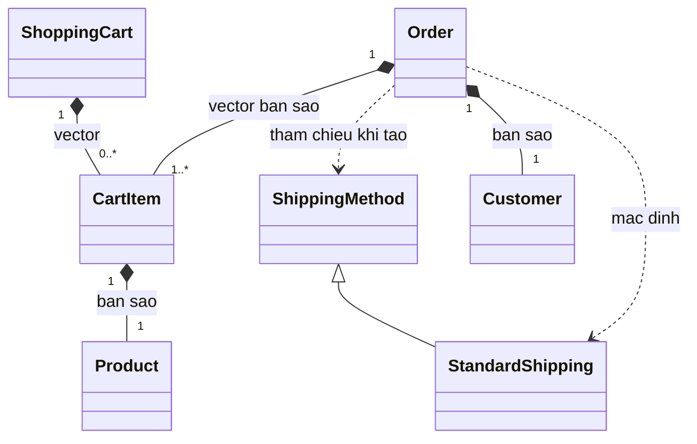

# ÔN TẬP VÀ VẤN ĐÁP OOP TỪ SOURCE MINISHOP

> Dành cho sinh viên nhập môn: đọc tình huống, mở đúng source, nói được đoạn code đang làm gì.

**Ngày đối chiếu:** 16/11/2026, Asia/Saigon. **Ngôn ngữ:** C++17, Console.
**Commit nền:** `c6239c6f0a2a768e502045a4a187afc9e5ad280e`.
**Quan trọng:** working tree đang có thay đổi chưa commit; tài liệu phân tích **bản làm việc thực tế**, không khẳng định commit nền đã chứa các bổ sung này. Bảng SHA-256 cuối tài liệu giúp nhận diện đúng phiên bản.

Tài liệu có **30 mục kiến thức có bằng chứng**, 80 câu hỏi ngay cạnh ví dụ, **30 câu ôn theo vai trò** và **18 câu tự kiểm tra có đáp án đặt cuối**. Một mục có thể gom khái niệm gần nhau; đây không phải cách đếm điểm hoặc số chương đã học hết.

**Cách học:** dùng bảng tra cứu để chọn mục → đọc A–G → mở file theo liên kết → tự trả lời trước khi xem đáp án. Các code block C++ được trích nguyên văn theo dòng từ source, không sửa tên biến hoặc chèn dấu ba chấm. Vài trích đoạn ngắn hơn 5 dòng vì chính cú pháp cần minh họa chỉ có vài dòng.

## Mục lục

- [Bảng tra cứu nhanh](#tra-cuu)
- [Phần 1 – Tổng quan MiniShop](#tong-quan)
- [Phần 2 – Source theo 7 chương](#bay-chuong)
  - [Chương 1 – Tổng quan lập trình hướng đối tượng](#chuong-1)
  - [Chương 2 – Lớp và đối tượng](#chuong-2)
  - [Chương 3 – Quá tải toán tử](#chuong-3)
  - [Chương 4 – Kế thừa](#chuong-4)
  - [Chương 5 – Đa hình](#chuong-5)
  - [Chương 6 – Khuôn mẫu (Template)](#chuong-6)
  - [Chương 7 – Thư viện khuôn mẫu STL](#chuong-7)
- [Phần 3 – Chưa áp dụng, áp dụng một phần và chỉ dùng trong test](#chua-ap-dung)
- [Phần 4 – Ôn tập theo vai trò](#vai-tro)
- [Phần 5 – Tự kiểm tra trước khi vấn đáp](#tu-kiem-tra)
- [Phần 6 – Demo, kiểm thử và phiên bản source](#kiem-chung)
- [Phần 7 – Đáp án tự kiểm tra](#dap-an)

<a id="tra-cuu"></a>
## Bảng tra cứu nhanh

| Chương | Kiến thức | File | Hàm/Class | Trạng thái |
| --- | --- | --- | --- | --- |
| 1 | [K01 – Class và object trong ứng dụng](#k01) | [main.cpp:367–380](../main.cpp#L367-L380) | main() / Hàm tự do | Đã áp dụng, có nơi sử dụng |
| 1 | [K02 – Đóng gói và phạm vi private/public](#k02) | [Product.h:8–22](../Product.h#L8-L22) | Khai báo class / Product | Đã áp dụng, có nơi sử dụng |
| 1 | [K03 – Trừu tượng hóa và kiểu dữ liệu trừu tượng ADT](#k03) | [ShoppingCart.h:12–23](../ShoppingCart.h#L12-L23) | Giao tiếp công khai / ShoppingCart | Đã áp dụng, có nơi sử dụng |
| 1 | [K04 – Quan hệ chứa đối tượng và sao chép dữ liệu đơn hàng](#k04) | [Order.h:16–22](../Order.h#L16-L22) | Các thuộc tính / Order | Đã áp dụng, có nơi sử dụng |
| 2 | [K05 – Constructor có tham số và danh sách khởi tạo](#k05) | [Product.cpp:5–17](../Product.cpp#L5-L17) | Product::Product() / Product | Đã áp dụng, có nơi sử dụng |
| 2 | [K06 – Constructor mặc định và tham số mặc định](#k06) | [CartItem.h:12–18](../CartItem.h#L12-L18) | Các constructor / CartItem; ShoppingCart; StandardShipping | Đã áp dụng, có nơi sử dụng |
| 2 | [K07 – Getter const và trả tham chiếu const](#k07) | [Product.cpp:19–29](../Product.cpp#L19-L29) | getId/getName/getPrice / Product | Đã áp dụng, có nơi sử dụng |
| 2 | [K08 – Đối tượng const và truyền tham chiếu](#k08) | [main.cpp:330–340](../main.cpp#L330-L340) | checkout() / Customer; Order | Đã áp dụng, có nơi sử dụng |
| 2 | [K09 – Con trỏ this và kiểm tra thành viên](#k09) | [Order.cpp:91–99](../Order.cpp#L91-L99) | Constructor ba tham số / Order | Đã áp dụng, có nơi sử dụng |
| 2 | [K10 – Thành phần static constexpr của class](#k10) | [ShippingMethod.h:18–20](../ShippingMethod.h#L18-L20) | FEE; DELIVERY_DAYS / StandardShipping | Đã áp dụng, có nơi sử dụng |
| 2 | [K11 – Copy constructor do compiler sinh](#k11) | [CartItem.cpp:5–9](../CartItem.cpp#L5-L9) | CartItem::CartItem() / CartItem; Product | Đã áp dụng, có nơi sử dụng |
| 2 | [K12 – Destructor mặc định, RAII và destructor ảo](#k12) | [ShippingMethod.h:9–12](../ShippingMethod.h#L9-L12) | ~ShippingMethod() / ShippingMethod; các class nghiệp vụ | Đã áp dụng, có nơi sử dụng |
| 2 | [K13 – Khai báo trong header, triển khai trong source](#k13) | [Customer.h:16–20](../Customer.h#L16-L20) | Constructor và getter / Customer | Đã áp dụng, có nơi sử dụng |
| 2 | [K14 – Quá tải và ủy quyền constructor](#k14) | [Order.cpp:80–88](../Order.cpp#L80-L88) | Hai constructor Order / Order | Đã áp dụng, có nơi sử dụng |
| 3 | [K15 – Quá tải operator== theo mã Product](#k15) | [Product.cpp:31–33](../Product.cpp#L31-L33) | operator==() / Product | Đã áp dụng, có nơi sử dụng |
| 4 | [K16 – Đơn kế thừa public và quan hệ is-a](#k16) | [ShippingMethod.h:15–17](../ShippingMethod.h#L15-L17) | Khai báo lớp dẫn xuất / StandardShipping; ShippingMethod | Đã áp dụng, có nơi sử dụng |
| 4 | [K17 – Protected constructor và thứ tự tạo/hủy lớp cha-con](#k17) | [ShippingMethod.h:5–7](../ShippingMethod.h#L5-L7) | Constructor mặc định / ShippingMethod; StandardShipping | Đã áp dụng, có nơi sử dụng |
| 5 | [K18 – Abstract class và pure virtual function](#k18) | [ShippingMethod.h:5–13](../ShippingMethod.h#L5-L13) | getFee/getDeliveryDays / ShippingMethod | Đã áp dụng, có nơi sử dụng |
| 5 | [K19 – Override thực hiện giao tiếp của lớp cha](#k19) | [ShippingMethod.h:24–30](../ShippingMethod.h#L24-L30) | getFee/getDeliveryDays / StandardShipping | Đã áp dụng, có nơi sử dụng |
| 5 | [K20 – Late binding qua tham chiếu cha và lưu bản sao kết quả](#k20) | [Order.cpp:85–90](../Order.cpp#L85-L90) | Constructor Order ba tham số / Order; ShippingMethod | Đã áp dụng, có nơi sử dụng |
| 6 | [K21 – Function template tự định nghĩa](#k21) | [ProductFile.cpp:9–21](../ProductFile.cpp#L9-L21) | parsePositiveInteger<T>() / Hàm tự do trong anonymous namespace | Đã áp dụng, có nơi sử dụng |
| 6 | [K22 – Gọi template với int và long long](#k22) | [ProductFile.cpp:43–48](../ProductFile.cpp#L43-L48) | loadProductsFromFile() / Hàm tự do | Đã áp dụng, có nơi sử dụng |
| 7 | [K23 – Vector là container và class template chuẩn](#k23) | [ShoppingCart.h:8–14](../ShoppingCart.h#L8-L14) | Thành viên items / ShoppingCart | Đã áp dụng, có nơi sử dụng |
| 7 | [K24 – Range-based for, const reference và cộng tổng an toàn](#k24) | [ShoppingCart.cpp:54–63](../ShoppingCart.cpp#L54-L63) | getSubtotal() / ShoppingCart | Đã áp dụng, có nơi sử dụng |
| 7 | [K25 – std::find_if, iterator kết quả và lambda predicate](#k25) | [ShoppingCart.cpp:6–21](../ShoppingCart.cpp#L6-L21) | addProduct() / ShoppingCart | Đã áp dụng, có nơi sử dụng |
| 7 | [K26 – Iterator và erase khi giảm số lượng về 0](#k26) | [ShoppingCart.cpp:34–43](../ShoppingCart.cpp#L34-L43) | decreaseQuantity() / ShoppingCart | Đã áp dụng, có nơi sử dụng |
| 7 | [K27 – size, reserve, push_back và move trong S05](#k27) | [main.cpp:244–253](../main.cpp#L244-L253) | addNewProduct() / Product; vector<Product> | Đã áp dụng, có nơi sử dụng |
| 7 | [K28 – empty và clear trên vector giỏ hàng](#k28) | [ShoppingCart.cpp:69–70](../ShoppingCart.cpp#L69-L70) | isEmpty/clear / ShoppingCart | Đã áp dụng, có nơi sử dụng |
| 7 | [K29 – unordered_set phát hiện mã trùng](#k29) | [ProductFile.cpp:30–33](../ProductFile.cpp#L30-L33) | loadProductsFromFile() / Hàm tự do | Đã áp dụng, có nơi sử dụng |
| 7 | [K30 – Lọc khoảng giá bằng vector, push_back và swap](#k30) | [Product.cpp:35–47](../Product.cpp#L35-L47) | filterByPriceRange() / Hàm tự do | Đã áp dụng, có nơi sử dụng |

Không coi một khai báo đơn lẻ là chức năng đã chạy. Cột trạng thái được giải thích cụ thể ở mục E của từng kiến thức. Việc hủy qua con trỏ cha được kiểm thử riêng; menu không có thao tác delete. Hai getter Order chỉ dùng trong test được nêu riêng ở Phần 3.

<a id="tong-quan"></a>
## PHẦN 1 – TỔNG QUAN MINISHOP

### 1.1. Ứng dụng làm gì?

MiniShop là ứng dụng đặt hàng trên terminal. Người dùng xem sản phẩm, tìm/lọc, thêm và chỉnh giỏ, nhập người nhận, xem trước rồi xác nhận đơn. Sau xác nhận có thể lưu hóa đơn TXT.

| Nhóm | Chức năng đang có | Vị trí/menu |
| --- | --- | --- |
| Bắt buộc | Đọc products.txt; hiển thị mã/tên/giá | Khởi động; mục 1 |
| Bắt buộc | Thêm nhiều lần, xem giỏ và thành tiền | Mục 3, 4 |
| Bắt buộc | Nhập khách/địa chỉ, xem trước, hủy/xác nhận | Mục 6 |
| Bắt buộc | Ngày thực tế, ngày giao dự kiến, phí, tổng thanh toán | Order và hóa đơn |
| S01 | Tìm một phần tên, không phân biệt hoa thường ASCII | Mục 2 |
| S02 | Tăng/giảm/xóa; giảm về 0 thì xóa dòng | Mục 5 |
| S03 | Lưu hóa đơn TXT sau xác nhận | Trong mục 6 |
| S04 | Lọc theo khoảng giá, tự đổi mốc ngược | Mục 7 |
| S05 | Thêm sản phẩm mới, lưu file, dùng ngay và đọc lại sau restart | Mục 8 |

Tiền dùng long long theo VND. Giao thường giữ phí 30.000 VND và 3 ngày lịch. Nhãn Console không dấu để hạn chế vấn đề terminal; tài liệu học dùng tiếng Việt có dấu.

### 1.2. Vai trò bảy class trong source

| Class | Vai trò | Quan hệ quan trọng |
| --- | --- | --- |
| Product | ID, tên, giá; kiểm tra lúc tạo; getter và operator== | Được sao chép vào CartItem |
| Customer | Tên, điện thoại, địa chỉ; kiểm tra dữ liệu | Được sao chép vào Order |
| CartItem | Một Product và số lượng; thành tiền | Has-a Product |
| ShoppingCart | Quản lý vector<CartItem>, thêm/sửa/xóa/tổng | Has-a nhiều CartItem |
| Order | Chụp khách/giỏ, thời gian, phí/ngày giao, hóa đơn | Has-a Customer và nhiều CartItem |
| ShippingMethod | Giao tiếp trừu tượng lấy phí và số ngày | Lớp cha |
| StandardShipping | Cài giao thường; hằng static 30000 và 3 | Is-a ShippingMethod |

ProductFile chứa **hàm tự do**, không phải một class. Các lớp TestShipping trong file test cục bộ không phải lớp nghiệp vụ của ứng dụng.

### 1.3. Sơ đồ quan hệ



Đường hình thoi diễn tả chứa/lưu theo giá trị; mũi tên tam giác diễn tả kế thừa; nét đứt diễn tả sử dụng. Đây là sơ đồ khái niệm theo cấu trúc code, không mô tả một Product catalog bị giỏ giữ bằng con trỏ.

### 1.4. Theo dõi luồng từ main

1. Mở [main.cpp:367–382](../main.cpp#L367-L382): tạo catalog/giỏ, gọi bộ đọc file thật. Tải thất bại báo lỗi và trả mã 1.
2. Mở [main.cpp:384–410](../main.cpp#L384-L410): vòng lặp đọc lựa chọn, switch gọi từng hàm; cờ tích hợp hiện là true.
3. Mục 3 đi từ addToCart tới [ShoppingCart.cpp:6–22](../ShoppingCart.cpp#L6-L22); giỏ tự gộp sản phẩm cùng ID.
4. Mục 6 đi vào [main.cpp:325–365](../main.cpp#L325-L365): kiểm tra giỏ → nhập khách → preview → hỏi → tạo Order chính thức → clear → hỏi lưu.
5. Constructor [Order.cpp:80–107](../Order.cpp#L80-L107) lấy thời gian hệ thống, gọi virtual, chụp dữ liệu và kiểm tra tiền.
6. Mục 8 đi vào [main.cpp:202–254](../main.cpp#L202-L254) rồi [ProductFile.cpp:60–131](../ProductFile.cpp#L60-L131): kiểm tra, ghi tạm/thay file, sau thành công mới cập nhật catalog.

### 1.5. Đọc/ghi file và tiền – các điểm phải nói đúng

- Định dạng [products.txt](../products.txt) là id|name|price, mỗi dòng một sản phẩm. Bản dữ liệu đối chiếu có 11 dòng; số này không phải giới hạn cố định.
- Bộ đọc dùng ifstream/getline, kiểm tra đúng ba trường, ID dương không trùng, giá dương, tên có nội dung; lỗi kèm số dòng. Template chuyển số nằm ngay trong ProductFile.cpp.
- Product constructor không kiểm tra ký tự |; riêng UI S05 và hàm appendProductToFile kiểm tra ký tự này cùng ký tự xuống dòng để bảo vệ định dạng TXT.
- S05 không nối trực tiếp vào file gốc: copy sang .tmp cùng thư mục, nối/đóng/kiểm tra rồi rename. File thiếu không tự tạo mới. File tạm đã có được giữ để kiểm tra, không ghi đè.
- Giỏ tính tiền hàng; Order cộng phí. Không dùng float/double để tính tiền hoặc lọc giá.
- Hóa đơn tạo bằng getReceiptText, được dùng chung cho Console và ghi TXT. Fstream là thư viện I/O, không phải STL container/algorithm.
- Các kỹ thuật I/O, ngoại lệ và ngày tháng hỗ trợ nghiệp vụ; không tự gán tất cả chúng thành kỹ thuật OOP của một chương.

<a id="bay-chuong"></a>
## PHẦN 2 – PHÂN TÍCH SOURCE THEO 7 CHƯƠNG

<a id="chuong-1"></a>
## Chương 1 – Tổng quan lập trình hướng đối tượng

<a id="k01"></a>
### K01 – Class và object trong ứng dụng

**A. Kiến thức thuộc chương nào?**

Chương 1 – Tổng quan lập trình hướng đối tượng; trọng tâm: class và object trong ứng dụng.

**B. Vị trí trong source**

- File: [main.cpp:367–380](../main.cpp#L367-L380).
- Class/phạm vi: Hàm tự do.
- Hàm/thành phần: `main()`.
- Dòng: 367–380 trong bản chụp source.

**C. Đoạn code minh họa – trích nguyên văn**

[main.cpp:367–380](../main.cpp#L367-L380)

```cpp
int main() {
    std::vector<Product> products;
    ShoppingCart cart;

    std::cout << "Chao mung ban den voi MiniShop!\n";
    if (!MEMBER_LOGIC_READY) {
        std::cout << "[TRANG THAI] Cac chuc nang chua duoc bat tich hop.\n";
    } else {
        try {
            products = loadProductsFromFile("products.txt");
        } catch (const std::exception& error) {
            std::cerr << "[LOI] Khong tai duoc danh sach san pham: "
                      << error.what() << "\nHay kiem tra products.txt va chay lai.\n";
            return 1;
```

**D. Giải thích từng phần**

- `std::vector<Product> products` chứa danh sách đối tượng Product; `ShoppingCart cart` là một đối tượng giỏ cụ thể.
- Class là bản thiết kế; object là một thực thể được tạo từ class. Ở đây các biến được tạo tự động, không dùng `new`.
- `main()` gọi bộ đọc để có dữ liệu thật rồi điều phối menu; lớp dữ liệu không tự hỏi người dùng.

**E. Được sử dụng trong chương trình ở đâu?**

Được thực hiện mỗi lần chạy EXE. Các nhánh menu bên dưới gọi showProducts/addToCart/checkout với các đối tượng này.

Vị trí gọi hoặc đối chiếu giao tiếp:

- [main.cpp:385](../main.cpp#L385): `showMainMenu();`
- [main.cpp:400](../main.cpp#L400): `case 3: addToCart(products, cart); break;`

**F. Câu hỏi vấn đáp**

1. **`ShoppingCart` và `cart` khác nhau thế nào?**

   ShoppingCart là kiểu/class; cart là đối tượng cụ thể trong main.

2. **Danh sách products có phải là một Product không?**

   Không. Đó là vector chứa nhiều đối tượng Product; mỗi phần tử có ID, tên và giá riêng.

**G. Ghi nhớ nhanh**

> Class định nghĩa kiểu; object là dữ liệu cụ thể đang chạy.

<a id="k02"></a>
### K02 – Đóng gói và phạm vi private/public

**A. Kiến thức thuộc chương nào?**

Chương 1 – Tổng quan lập trình hướng đối tượng; trọng tâm: đóng gói và phạm vi private/public.

**B. Vị trí trong source**

- File: [Product.h:8–22](../Product.h#L8-L22).
- Class/phạm vi: Product.
- Hàm/thành phần: `Khai báo class`.
- Dòng: 8–22 trong bản chụp source.

**C. Đoạn code minh họa – trích nguyên văn**

[Product.h:8–22](../Product.h#L8-L22)

```cpp
class Product {
private:
    int id;
    std::string name;
    long long price;

public:
    // Nem std::invalid_argument neu id/gia <= 0 hoac ten chi co khoang trang.
    Product(int id, const std::string& name, long long price);
    int getId() const;
    const std::string& getName() const;
    long long getPrice() const;
    // Hai san pham cung ma duoc xem la cung mot mat hang.
    bool operator==(const Product& other) const;
};
```

**D. Giải thích từng phần**

- Ba thuộc tính `id/name/price` nằm trong private nên main không được gán trực tiếp bằng `product.price = ...`.
- Public cung cấp constructor, getter và operator==. Người dùng class chỉ biết cách sử dụng được công bố.
- Đây là che giấu thông tin, không phải mã hóa hay một cơ chế bảo mật file. protected của lớp giao hàng được phân tích ở Chương 4.

**E. Được sử dụng trong chương trình ở đâu?**

Product được tạo khi đọc file/S05; bảng sản phẩm và bộ lọc đọc dữ liệu bằng getter.

Vị trí gọi hoặc đối chiếu giao tiếp:

- [ProductFile.cpp:48](../ProductFile.cpp#L48): `products.emplace_back(id, line.substr(first + 1, second - first - 1), price);`
- [main.cpp:152](../main.cpp#L152): `<< std::right << std::setw(28) << formatMoney(product.getPrice()) << '\n';`

**F. Câu hỏi vấn đáp**

1. **Vì sao price để private?**

   Để dữ liệu đi qua constructor và giao tiếp của Product, hạn chế gán giá không hợp lệ từ bên ngoài.

2. **Có setter để đổi giá tùy ý không?**

   Không. Source hiện tại chỉ có getter; chưa có nghiệp vụ sửa giá nên không mở thêm setter.

**G. Ghi nhớ nhanh**

> Private giữ dữ liệu; public cung cấp cách sử dụng.

<a id="k03"></a>
### K03 – Trừu tượng hóa và kiểu dữ liệu trừu tượng ADT

**A. Kiến thức thuộc chương nào?**

Chương 1 – Tổng quan lập trình hướng đối tượng; trọng tâm: trừu tượng hóa và kiểu dữ liệu trừu tượng adt.

**B. Vị trí trong source**

- File: [ShoppingCart.h:12–23](../ShoppingCart.h#L12-L23).
- Class/phạm vi: ShoppingCart.
- Hàm/thành phần: `Giao tiếp công khai`.
- Dòng: 12–23 trong bản chụp source.

**C. Đoạn code minh họa – trích nguyên văn**

[ShoppingCart.h:12–23](../ShoppingCart.h#L12-L23)

```cpp
public:
    // Them moi voi SL 1; neu trung id thi tang SL 1.
    void addProduct(const Product& product);
    // Tra false neu khong tim thay id; true khi da thay doi.
    bool increaseQuantity(int productId);
    bool decreaseQuantity(int productId);
    bool removeProduct(int productId);
    const std::vector<CartItem>& getItems() const;
    long long getSubtotal() const;
    long long getTotalQuantity() const;
    bool isEmpty() const;
    void clear();
```

**D. Giải thích từng phần**

- Main yêu cầu thêm/xóa/tính tổng qua các phương thức mà không phải tự quản lý vị trí phần tử trong vector.
- Đầu vào của thao tác là Product hoặc ID; kết quả là trạng thái giỏ, bool cho thao tác theo mã hoặc tổng tiền/số lượng.
- ADT mô tả các thao tác có ý nghĩa. Có trừu tượng hóa không đồng nghĩa mọi class phải là abstract class có `= 0`.

**E. Được sử dụng trong chương trình ở đâu?**

Menu 3/4/5/6 sử dụng giao tiếp này; không có một giỏ độc lập khác trong main.

Vị trí gọi hoặc đối chiếu giao tiếp:

- [main.cpp:269](../main.cpp#L269): `cart.addProduct(product); // ShoppingCart tu xu ly san pham trung.`
- [main.cpp:318](../main.cpp#L318): `changed = cart.removeProduct(productId);`

**F. Câu hỏi vấn đáp**

1. **Vì sao không viết toàn bộ logic giỏ trong main?**

   ShoppingCart gom dữ liệu và thao tác giỏ; main tập trung nhập/xuất và điều phối.

2. **ADT có nhất thiết là class trừu tượng C++ không?**

   Không. ShoppingCart là class tạo được object, nhưng vẫn cung cấp một giao tiếp trừu tượng cho nghiệp vụ.

**G. Ghi nhớ nhanh**

> Biết giỏ làm được gì, không cần biết vector được xử lý thế nào.

<a id="k04"></a>
### K04 – Quan hệ chứa đối tượng và sao chép dữ liệu đơn hàng

**A. Kiến thức thuộc chương nào?**

Chương 1 – Tổng quan lập trình hướng đối tượng; trọng tâm: quan hệ chứa đối tượng và sao chép dữ liệu đơn hàng.

**B. Vị trí trong source**

- File: [Order.h:16–22](../Order.h#L16-L22).
- Class/phạm vi: Order.
- Hàm/thành phần: `Các thuộc tính`.
- Dòng: 16–22 trong bản chụp source.

**C. Đoạn code minh họa – trích nguyên văn**

[Order.h:16–22](../Order.h#L16-L22)

```cpp
class Order {
private:
    Customer customer;
    std::vector<CartItem> items;
    std::time_t orderTime;
    long long shippingFee;
    int deliveryDays;
```

**D. Giải thích từng phần**

- Order chứa một Customer, một vector<CartItem>, thời gian và các giá trị giao hàng: quan hệ has-a.
- CartItem cũng chứa một Product; đây không phải kế thừa. Order không phải là Customer, CartItem không phải là Product.
- Các thành viên được lưu theo giá trị. Số ngày/phí cũng là bản sao; không lưu con trỏ đến phương thức giao hàng tạm.

**E. Được sử dụng trong chương trình ở đâu?**

checkout tạo Order từ customer và cart.getItems(); sau xác nhận xóa giỏ nhưng hóa đơn vẫn còn.

Vị trí gọi hoặc đối chiếu giao tiếp:

- [main.cpp:348](../main.cpp#L348): `const Order order(customer, cart.getItems());`
- [main.cpp:349](../main.cpp#L349): `cart.clear(); // Don da giu ban sao, xoa gio khong lam mat hoa don.`

**F. Câu hỏi vấn đáp**

1. **Order kế thừa Customer không?**

   Không. Order chứa Customer làm thành viên, xem trực tiếp Order.h.

2. **Xóa giỏ có làm Order mất mặt hàng không?**

   Không. Constructor sao chép vector, nên đơn giữ dữ liệu độc lập với giỏ gốc.

**G. Ghi nhớ nhanh**

> Has-a là chứa; is-a mới là ứng viên kế thừa.

<a id="chuong-2"></a>
## Chương 2 – Lớp và đối tượng

<a id="k05"></a>
### K05 – Constructor có tham số và danh sách khởi tạo

**A. Kiến thức thuộc chương nào?**

Chương 2 – Lớp và đối tượng; trọng tâm: constructor có tham số và danh sách khởi tạo.

**B. Vị trí trong source**

- File: [Product.cpp:5–17](../Product.cpp#L5-L17).
- Class/phạm vi: Product.
- Hàm/thành phần: `Product::Product()`.
- Dòng: 5–17 trong bản chụp source.

**C. Đoạn code minh họa – trích nguyên văn**

[Product.cpp:5–17](../Product.cpp#L5-L17)

```cpp
Product::Product(int id, const std::string& name, long long price)
    : id(id), name(name), price(price) {
    // Chi tao san pham khi ca ba thuoc tinh deu hop le.
    if (id <= 0) {
        throw std::invalid_argument("Ma san pham phai lon hon 0.");
    }
    if (name.find_first_not_of(" \t\r\n\f\v") == std::string::npos) {
        throw std::invalid_argument("Ten san pham khong duoc de trong.");
    }
    if (price <= 0) {
        throw std::invalid_argument("Gia san pham phai lon hon 0.");
    }
}
```

**D. Giải thích từng phần**

- Constructor nhận ID, tên, giá; danh sách sau dấu `:` khởi tạo các thành viên trước khi chạy thân hàm.
- Tên tham số trùng tên thành viên: trong `id(id)`, bên trái là thành viên, bên phải là tham số.
- ID/giá phải dương, tên phải có ký tự không phải khoảng trắng. Sai thì ném invalid_argument; object chưa được tạo thành công.

**E. Được sử dụng trong chương trình ở đâu?**

Được gọi qua products.emplace_back trong bộ đọc và Product product(id,name,price) trong S05.

Vị trí gọi hoặc đối chiếu giao tiếp:

- [ProductFile.cpp:48](../ProductFile.cpp#L48): `products.emplace_back(id, line.substr(first + 1, second - first - 1), price);`
- [main.cpp:244](../main.cpp#L244): `Product product(id, name, price);`

**F. Câu hỏi vấn đáp**

1. **Constructor có kiểu trả về không?**

   Không; nó dùng để khởi tạo đối tượng, không khai báo void hay Product làm kiểu trả về.

2. **Tại sao dùng danh sách khởi tạo?**

   Thành viên được khởi tạo ngay; tránh khởi tạo mặc định rồi gán lại.

3. **Tên chỉ gồm dấu cách có được không?**

   Không. find_first_not_of kiểm tra tên có nội dung; constructor ném invalid_argument nếu không có.

**G. Ghi nhớ nhanh**

> Constructor tạo ra đối tượng hợp lệ ngay từ đầu.

<a id="k06"></a>
### K06 – Constructor mặc định và tham số mặc định

**A. Kiến thức thuộc chương nào?**

Chương 2 – Lớp và đối tượng; trọng tâm: constructor mặc định và tham số mặc định.

**B. Vị trí trong source**

- File: [CartItem.h:12–18](../CartItem.h#L12-L18).
- Class/phạm vi: CartItem; ShoppingCart; StandardShipping.
- Hàm/thành phần: `Các constructor`.
- Dòng: 12–18 trong bản chụp source.
- Đối chiếu thêm: [ShippingMethod.h:22](../ShippingMethod.h#L22).

**C. Đoạn code minh họa – trích nguyên văn**

[CartItem.h:12–18](../CartItem.h#L12-L18)

```cpp
public:
    CartItem(const Product& product, int quantity = 1);
    const Product& getProduct() const;
    int getQuantity() const;
    void increaseQuantity();
    void decreaseQuantity();
    long long getTotalPrice() const;
```

[ShippingMethod.h:22](../ShippingMethod.h#L22)

```cpp
    StandardShipping() = default;
```

**D. Giải thích từng phần**

- `quantity = 1` là tham số mặc định: khi chỉ truyền Product, số lượng ban đầu là 1.
- CartItem không có default constructor không tham số, vì vẫn bắt buộc truyền Product.
- ShoppingCart không khai báo constructor, nên compiler sinh constructor mặc định; `ShoppingCart cart;` tạo vector rỗng. StandardShipping viết rõ `= default` để yêu cầu compiler sinh constructor.

**E. Được sử dụng trong chương trình ở đâu?**

Main tạo ShoppingCart không tham số; giỏ emplace_back(product) dùng số lượng 1; Order mặc định tạo StandardShipping.

Vị trí gọi hoặc đối chiếu giao tiếp:

- [main.cpp:369](../main.cpp#L369): `ShoppingCart cart;`
- [ShoppingCart.cpp:21](../ShoppingCart.cpp#L21): `items.emplace_back(product);`
- [Order.cpp:81](../Order.cpp#L81): `: Order(customer, items, StandardShipping()) {`

**F. Câu hỏi vấn đáp**

1. **`CartItem(product)` lấy quantity ở đâu?**

   Lấy giá trị mặc định 1 trong khai báo ở header.

2. **Có gọi `CartItem item;` được không?**

   Không, constructor còn yêu cầu Product.

3. **`= default` nghĩa là gì?**

   Yêu cầu compiler sinh cách thực hiện mặc định, không phải giá trị mặc định của một tham số.

**G. Ghi nhớ nhanh**

> Tham số mặc định khác constructor không tham số.

<a id="k07"></a>
### K07 – Getter const và trả tham chiếu const

**A. Kiến thức thuộc chương nào?**

Chương 2 – Lớp và đối tượng; trọng tâm: getter const và trả tham chiếu const.

**B. Vị trí trong source**

- File: [Product.cpp:19–29](../Product.cpp#L19-L29).
- Class/phạm vi: Product.
- Hàm/thành phần: `getId/getName/getPrice`.
- Dòng: 19–29 trong bản chụp source.

**C. Đoạn code minh họa – trích nguyên văn**

[Product.cpp:19–29](../Product.cpp#L19-L29)

```cpp
int Product::getId() const {
    return id;
}

const std::string& Product::getName() const {
    return name;
}

long long Product::getPrice() const {
    return price;
}
```

**D. Giải thích từng phần**

- `const` sau dấu ngoặc của phương thức cam kết không thay đổi trạng thái object qua phương thức đó.
- ID/giá nhỏ và là kiểu số nên trả theo giá trị. Tên trả `const std::string&` để tránh sao chép chuỗi và không cho sửa qua getter.
- Tham chiếu còn phụ thuộc vòng đời Product. Không giữ tham chiếu tới phần tử vector sau khi vector bị xóa hoặc cấp phát lại.

**E. Được sử dụng trong chương trình ở đâu?**

Bảng sản phẩm, tìm kiếm, lọc giá, CartItem và ghi file đều gọi getter.

Vị trí gọi hoặc đối chiếu giao tiếp:

- [main.cpp:151](../main.cpp#L151): `<< std::setw(32) << shortName(product.getName())`
- [Product.cpp:42](../Product.cpp#L42): `if (product.getPrice() >= minPrice && product.getPrice() <= maxPrice) {`

**F. Câu hỏi vấn đáp**

1. **Hai từ const trong getter chuỗi có cùng vai trò không?**

   Không. Const ở kiểu trả về bảo vệ chuỗi qua tham chiếu; const cuối hàm bảo vệ object trong phương thức.

2. **Có thể gán vào kết quả getName() không?**

   Không theo giao tiếp hiện tại vì trả tham chiếu const.

3. **Getter const có gọi trên Product const được không?**

   Có; code duyệt `const Product&` vẫn đọc được các getter.

**G. Ghi nhớ nhanh**

> Getter chỉ đọc; const & tránh copy mà vẫn giữ quyền chỉ đọc.

<a id="k08"></a>
### K08 – Đối tượng const và truyền tham chiếu

**A. Kiến thức thuộc chương nào?**

Chương 2 – Lớp và đối tượng; trọng tâm: đối tượng const và truyền tham chiếu.

**B. Vị trí trong source**

- File: [main.cpp:330–340](../main.cpp#L330-L340).
- Class/phạm vi: Customer; Order.
- Hàm/thành phần: `checkout()`.
- Dòng: 330–340 trong bản chụp source.

**C. Đoạn code minh họa – trích nguyên văn**

[main.cpp:330–340](../main.cpp#L330-L340)

```cpp
    std::string name, phone, address;
    if (!readRequiredText("Ho va ten: ", name) || !readPhone(phone)
        || !readRequiredText("Dia chi giao hang: ", address)) {
        return;
    }
    const Customer customer(name, phone, address);

    // Ban xem truoc chi hien thi: khong ghi file, khong sua gio.
    const Order preview(customer, cart.getItems());
    std::cout << "\n[XEM TRUOC - CHUA XAC NHAN DAT HANG]\n"
              << preview.getReceiptText();
```

**D. Giải thích từng phần**

- `const Customer customer` và `const Order preview` ngăn chỉnh sửa trực tiếp các đối tượng sau khi tạo.
- Đầu vào checkout là `ShoppingCart&` vì sau xác nhận cần clear; còn các hàm chỉ xem thường nhận const reference.
- Tham số const reference tránh sao chép tại lúc truyền; constructor Order vẫn chủ động sao chép vào thành viên để chụp dữ liệu đơn.

**E. Được sử dụng trong chương trình ở đâu?**

Menu 6 gọi checkout; bản preview được in trước khi hỏi xác nhận.

Vị trí gọi hoặc đối chiếu giao tiếp:

- [main.cpp:403](../main.cpp#L403): `case 6: checkout(cart); break;`
- [main.cpp:340](../main.cpp#L340): `<< preview.getReceiptText();`

**F. Câu hỏi vấn đáp**

1. **Tại sao cart của checkout không const?**

   Vì luồng xác nhận thành công phải xóa giỏ.

2. **Truyền const Customer& vào Order có nghĩa Order giữ tham chiếu không?**

   Không. Tham số là tham chiếu; thành viên Customer customer được sao chép theo giá trị.

**G. Ghi nhớ nhanh**

> Kiểu tham số và kiểu thành viên quyết định hai việc khác nhau.

<a id="k09"></a>
### K09 – Con trỏ this và kiểm tra thành viên

**A. Kiến thức thuộc chương nào?**

Chương 2 – Lớp và đối tượng; trọng tâm: con trỏ this và kiểm tra thành viên.

**B. Vị trí trong source**

- File: [Order.cpp:91–99](../Order.cpp#L91-L99).
- Class/phạm vi: Order.
- Hàm/thành phần: `Constructor ba tham số`.
- Dòng: 91–99 trong bản chụp source.

**C. Đoạn code minh họa – trích nguyên văn**

[Order.cpp:91–99](../Order.cpp#L91-L99)

```cpp
    if (this->items.empty()) {
        throw std::invalid_argument("Khong the tao don hang voi gio rong.");
    }
    if (orderTime == static_cast<std::time_t>(-1)) {
        throw std::runtime_error("Khong lay duoc thoi gian dat hang.");
    }
    if (shippingFee < 0 || deliveryDays < 0) {
        throw std::invalid_argument("Phi va so ngay giao hang khong duoc am.");
    }
```

**D. Giải thích từng phần**

- `this` trỏ tới chính object đang được tạo; `this->items` là vector thành viên, không phải vector tham số cùng tên.
- Dấu `->` truy cập thành viên qua con trỏ. Trong nhiều phương thức có thể lược this, nhưng ở đây giúp phân biệt rõ.
- Giỏ rỗng, lỗi lấy thời gian hoặc giá trị giao hàng âm đều làm tạo Order thất bại bằng exception.

**E. Được sử dụng trong chương trình ở đâu?**

Cả constructor hai tham số và luồng truyền ShippingMethod đều đi qua constructor này.

Vị trí gọi hoặc đối chiếu giao tiếp:

- [Order.cpp:81](../Order.cpp#L81): `: Order(customer, items, StandardShipping()) {`
- [main.cpp:338](../main.cpp#L338): `const Order preview(customer, cart.getItems());`

**F. Câu hỏi vấn đáp**

1. **this là kiểu gì trong constructor Order?**

   Là con trỏ tới Order hiện tại, không phải đối tượng khách hoặc giỏ.

2. **Tại sao viết this->items thay vì items?**

   Vì tham số cũng tên items; this chỉ rõ đang kiểm tra vector thành viên.

**G. Ghi nhớ nhanh**

> This là chính object đang thực hiện phương thức.

<a id="k10"></a>
### K10 – Thành phần static constexpr của class

**A. Kiến thức thuộc chương nào?**

Chương 2 – Lớp và đối tượng; trọng tâm: thành phần static constexpr của class.

**B. Vị trí trong source**

- File: [ShippingMethod.h:18–20](../ShippingMethod.h#L18-L20).
- Class/phạm vi: StandardShipping.
- Hàm/thành phần: `FEE; DELIVERY_DAYS`.
- Dòng: 18–20 trong bản chụp source.

**C. Đoạn code minh họa – trích nguyên văn**

[ShippingMethod.h:18–20](../ShippingMethod.h#L18-L20)

```cpp
    // Hang so dung chung cho moi doi tuong giao thuong.
    static constexpr long long FEE = 30000;
    static constexpr int DELIVERY_DAYS = 3;
```

**D. Giải thích từng phần**

- Static làm các hằng thuộc về class, dùng chung thay vì mỗi object có một bản dữ liệu thành viên riêng.
- Constexpr biểu thị giá trị hằng có thể dùng trong tính toán tại thời điểm biên dịch; FEE là 30000, số ngày là 3.
- Các override trả chính các hằng này. Không nhầm với MEMBER_LOGIC_READY là biến constexpr ngoài class trong main.cpp.

**E. Được sử dụng trong chương trình ở đâu?**

StandardShipping::getFee/getDeliveryDays dùng hằng; constructor Order gọi các override khi tạo đơn.

Vị trí gọi hoặc đối chiếu giao tiếp:

- [ShippingMethod.h:25](../ShippingMethod.h#L25): `return FEE;`
- [ShippingMethod.h:29](../ShippingMethod.h#L29): `return DELIVERY_DAYS;`

**F. Câu hỏi vấn đáp**

1. **Có thể đọc StandardShipping::FEE mà không tạo object không?**

   Có, vì đây là thành viên static công khai.

2. **Mỗi object giao thường có một FEE riêng không?**

   Không. Nó là hằng dùng chung ở cấp class.

**G. Ghi nhớ nhanh**

> Static thuộc class; constexpr là giá trị hằng.

<a id="k11"></a>
### K11 – Copy constructor do compiler sinh

**A. Kiến thức thuộc chương nào?**

Chương 2 – Lớp và đối tượng; trọng tâm: copy constructor do compiler sinh.

**B. Vị trí trong source**

- File: [CartItem.cpp:5–9](../CartItem.cpp#L5-L9).
- Class/phạm vi: CartItem; Product.
- Hàm/thành phần: `CartItem::CartItem()`.
- Dòng: 5–9 trong bản chụp source.

**C. Đoạn code minh họa – trích nguyên văn**

[CartItem.cpp:5–9](../CartItem.cpp#L5-L9)

```cpp
CartItem::CartItem(const Product &product, int quantity)
    : product(product), quantity(quantity) {
    if (quantity <= 0) throw std::invalid_argument("Quantity must be positive");
    (void) getTotalPrice();
}
```

**D. Giải thích từng phần**

- Trong `product(product)`, Product thành viên được sao chép từ const Product& truyền vào. Đây là lúc copy constructor của Product được dùng.
- Nhóm không tự định nghĩa copy constructor. Compiler sinh phép sao chép phù hợp vì thuộc tính là số và string; vector cũng sao chép các phần tử theo giá trị.
- Ở Order, `customer(customer), items(items)` làm việc tương tự. Không có raw pointer sở hữu bộ nhớ trong các class nghiệp vụ để phải tự viết deep copy.

**E. Được sử dụng trong chương trình ở đâu?**

ShoppingCart emplace_back(product) tạo CartItem thật; Order sao chép các CartItem để giỏ và hóa đơn độc lập.

Vị trí gọi hoặc đối chiếu giao tiếp:

- [ShoppingCart.cpp:21](../ShoppingCart.cpp#L21): `items.emplace_back(product);`
- [Order.cpp:87](../Order.cpp#L87): `: customer(customer), items(items), orderTime(std::time(nullptr)),`

**F. Câu hỏi vấn đáp**

1. **Không viết copy constructor có nghĩa là không có sao chép không?**

   Không. Compiler sinh copy constructor và code đang sử dụng nó.

2. **CartItem giữ con trỏ vào Product trong catalog không?**

   Không, Product thành viên được lưu theo giá trị.

3. **Có nên tự viết copy constructor chỉ để có từ khóa không?**

   Không cần ở thiết kế hiện tại; trước hết phải giải thích phép sao chép mặc định đang làm gì.

**G. Ghi nhớ nhanh**

> Không tự viết copy constructor vẫn có thể đang dùng copy constructor.

<a id="k12"></a>
### K12 – Destructor mặc định, RAII và destructor ảo

**A. Kiến thức thuộc chương nào?**

Chương 2 – Lớp và đối tượng; trọng tâm: destructor mặc định, raii và destructor ảo.

**B. Vị trí trong source**

- File: [ShippingMethod.h:9–12](../ShippingMethod.h#L9-L12).
- Class/phạm vi: ShippingMethod; các class nghiệp vụ.
- Hàm/thành phần: `~ShippingMethod()`.
- Dòng: 9–12 trong bản chụp source.

**C. Đoạn code minh họa – trích nguyên văn**

[ShippingMethod.h:9–12](../ShippingMethod.h#L9-L12)

```cpp
public:
    virtual ~ShippingMethod() = default;
    virtual long long getFee() const = 0;
    virtual int getDeliveryDays() const = 0;
```

**D. Giải thích từng phần**

- Dấu `~` chỉ destructor; `= default` yêu cầu compiler sinh phần thực hiện mặc định.
- String/vector/fstream tự thu hồi tài nguyên khi hết vòng đời. Năm class nghiệp vụ không cần destructor tự giải phóng con trỏ vì không sở hữu con trỏ động.
- Destructor virtual bảo đảm khi hủy qua con trỏ lớp cha, destructor lớp con vẫn được gọi. Ứng dụng tạo giao thường tự động; nhánh delete qua lớp cha được thử trong tests/oop_test.cpp, không phải một menu.

**E. Được sử dụng trong chương trình ở đâu?**

Object StandardShipping tạm bị hủy sau lời gọi tạo Order; object giỏ/khách/đơn và các stream được hủy theo scope. Không có delete đối tượng nghiệp vụ trong luồng menu.

Vị trí gọi hoặc đối chiếu giao tiếp:

- [Order.cpp:81](../Order.cpp#L81): `: Order(customer, items, StandardShipping()) {`

**F. Câu hỏi vấn đáp**

1. **Không có destructor tự viết ở Product có làm rò bộ nhớ không?**

   Không. Các thành viên string và số được hủy đúng bằng destructor compiler sinh.

2. **Vì sao lớp cha đa hình có destructor virtual?**

   Để hủy qua con trỏ cha vẫn hủy đầy đủ lớp con; test OOP đã kiểm tra trường hợp này.

3. **RAII có thay cho kiểm tra ghi file thành công không?**

   Không. Destructor giúp đóng tài nguyên, còn code vẫn close và kiểm tra trạng thái để báo lỗi ghi.

**G. Ghi nhớ nhanh**

> Tài nguyên gắn với vòng đời object; lớp cha đa hình cần hủy đúng lớp con.

<a id="k13"></a>
### K13 – Khai báo trong header, triển khai trong source

**A. Kiến thức thuộc chương nào?**

Chương 2 – Lớp và đối tượng; trọng tâm: khai báo trong header, triển khai trong source.

**B. Vị trí trong source**

- File: [Customer.h:16–20](../Customer.h#L16-L20).
- Class/phạm vi: Customer.
- Hàm/thành phần: `Constructor và getter`.
- Dòng: 16–20 trong bản chụp source.
- Đối chiếu thêm: [Customer.cpp:24–26](../Customer.cpp#L24-L26).

**C. Đoạn code minh họa – trích nguyên văn**

[Customer.h:16–20](../Customer.h#L16-L20)

```cpp
    Customer(const std::string& name, const std::string& phone,
             const std::string& address);
    const std::string& getName() const;
    const std::string& getPhone() const;
    const std::string& getAddress() const;
```

[Customer.cpp:24–26](../Customer.cpp#L24-L26)

```cpp
const std::string& Customer::getName() const {
    return name;
}
```

**D. Giải thích từng phần**

- Header công bố kiểu và chữ ký để file khác biết cách dùng; source chứa định nghĩa phương thức tương ứng.
- `Customer::getName` dùng toán tử phân giải phạm vi để chỉ đây là phương thức của Customer.
- Các phương thức ngắn định nghĩa ngay trong ShippingMethod.h là inline theo quy tắc class; vì vậy không cần ShippingMethod.cpp.

**E. Được sử dụng trong chương trình ở đâu?**

Order.h include Customer.h và Order.cpp gọi getter khi tạo hóa đơn. Build phải biên dịch Customer.cpp cùng các source khác.

Vị trí gọi hoặc đối chiếu giao tiếp:

- [Order.h:8](../Order.h#L8): `#include "Customer.h"`
- [Order.cpp:156](../Order.cpp#L156): `<< "Khach hang   : " << customer.getName() << '\n'`

**F. Câu hỏi vấn đáp**

1. **Chỉ có khai báo getter mà không có định nghĩa thì sao?**

   Khi dùng getter, thường gặp lỗi liên kết undefined reference.

2. **Vì sao file ShippingMethod.h không có .cpp đi kèm?**

   Các phương thức được định nghĩa ngay trong class ở header; đó là cách hợp lệ cho phần rất ngắn.

**G. Ghi nhớ nhanh**

> Header cho biết dùng thế nào; source cho biết làm thế nào.

<a id="k14"></a>
### K14 – Quá tải và ủy quyền constructor

**A. Kiến thức thuộc chương nào?**

Chương 2 – Lớp và đối tượng; trọng tâm: quá tải và ủy quyền constructor.

**B. Vị trí trong source**

- File: [Order.cpp:80–88](../Order.cpp#L80-L88).
- Class/phạm vi: Order.
- Hàm/thành phần: `Hai constructor Order`.
- Dòng: 80–88 trong bản chụp source.

**C. Đoạn code minh họa – trích nguyên văn**

[Order.cpp:80–88](../Order.cpp#L80-L88)

```cpp
Order::Order(const Customer& customer, const std::vector<CartItem>& items)
    : Order(customer, items, StandardShipping()) {
    // Constructor cu uy quyen cho constructor co phuong thuc giao hang.
}

Order::Order(const Customer& customer, const std::vector<CartItem>& items,
             const ShippingMethod& shipping)
    : customer(customer), items(items), orderTime(std::time(nullptr)),
      shippingFee(shipping.getFee()), deliveryDays(shipping.getDeliveryDays()) {
```

**D. Giải thích từng phần**

- Order có hai chữ ký constructor: nhận khách/giỏ, hoặc nhận thêm const ShippingMethod&. Đây là quá tải constructor.
- Constructor hai tham số gọi constructor ba tham số bằng danh sách khởi tạo; đó là constructor delegation, hợp lệ trong C++17.
- Một StandardShipping tạm cung cấp mặc định. Giá trị phí/ngày được sao chép trong constructor nên không để lại tham chiếu treo khi object tạm bị hủy.
- Quá tải constructor được chọn theo chữ ký; không nhầm việc này với đa hình động của getFee/getDeliveryDays.

**E. Được sử dụng trong chương trình ở đâu?**

checkout vẫn gọi bản hai tham số; bản ba tham số thực hiện khởi tạo và kiểm tra chung.

Vị trí gọi hoặc đối chiếu giao tiếp:

- [main.cpp:348](../main.cpp#L348): `const Order order(customer, cart.getItems());`

**F. Câu hỏi vấn đáp**

1. **Vì sao giữ constructor hai tham số?**

   Giữ cách gọi cũ của menu và chọn giao thường làm mặc định.

2. **Tại sao không copy phần kiểm tra vào cả hai constructor?**

   Ủy quyền giúp một chỗ khởi tạo/kiểm tra, tránh hai bản logic lệch nhau.

3. **Constructor overload có phải late binding không?**

   Không. Lựa chọn chữ ký constructor khác cơ chế gọi virtual qua lớp cha.

**G. Ghi nhớ nhanh**

> Hai cửa vào, một phần khởi tạo chung.

<a id="chuong-3"></a>
## Chương 3 – Quá tải toán tử

Source chỉ tự định nghĩa operator== của Product. Không tính các toán tử do string/stream cung cấp là nhóm tự viết.

<a id="k15"></a>
### K15 – Quá tải operator== theo mã Product

**A. Kiến thức thuộc chương nào?**

Chương 3 – Quá tải toán tử; trọng tâm: quá tải operator== theo mã product.

**B. Vị trí trong source**

- File: [Product.cpp:31–33](../Product.cpp#L31-L33).
- Class/phạm vi: Product.
- Hàm/thành phần: `operator==()`.
- Dòng: 31–33 trong bản chụp source.

**C. Đoạn code minh họa – trích nguyên văn**

[Product.cpp:31–33](../Product.cpp#L31-L33)

```cpp
bool Product::operator==(const Product& other) const {
    return id == other.id;
}
```

**D. Giải thích từng phần**

- Đây là toán tử do project tự định nghĩa, nhận một Product khác và trả bool. Hai sản phẩm cùng ID được xem là cùng một mặt hàng.
- Phương thức là thành viên nên được đọc private id của cả hai object Product, không cần friend.
- Tên và giá không tham gia so sánh. Đây là quy tắc nhận diện trong giỏ; bộ đọc vẫn cấm hai dòng trùng ID trong file.
- Các toán tử << dùng với stream/string không phải overload Product do nhóm viết.

**E. Được sử dụng trong chương trình ở đâu?**

Predicate của std::find_if trong addProduct gọi cartItem.getProduct() == product; vì vậy thêm cùng ID tăng SL của dòng cũ.

Vị trí gọi hoặc đối chiếu giao tiếp:

- [ShoppingCart.cpp:11](../ShoppingCart.cpp#L11): `return cartItem.getProduct() == product;`
- [main.cpp:269](../main.cpp#L269): `cart.addProduct(product); // ShoppingCart tu xu ly san pham trung.`

**F. Câu hỏi vấn đáp**

1. **Operator== đang so sánh tên, giá hay ID?**

   Chỉ ID; mở Product.cpp thấy return id == other.id.

2. **Vì sao được đọc other.id dù id private?**

   Phương thức thành viên của Product được truy cập private của các object cùng class.

3. **Phải quá tải cả operator< và << không?**

   Không. Source chỉ tự viết == và đã dùng thật; các toán tử khác không được tự nhận là đã làm.

**G. Ghi nhớ nhanh**

> Cùng mã là cùng mặt hàng trong quy tắc của giỏ.

<a id="chuong-4"></a>
## Chương 4 – Kế thừa

<a id="k16"></a>
### K16 – Đơn kế thừa public và quan hệ is-a

**A. Kiến thức thuộc chương nào?**

Chương 4 – Kế thừa; trọng tâm: đơn kế thừa public và quan hệ is-a.

**B. Vị trí trong source**

- File: [ShippingMethod.h:15–17](../ShippingMethod.h#L15-L17).
- Class/phạm vi: StandardShipping; ShippingMethod.
- Hàm/thành phần: `Khai báo lớp dẫn xuất`.
- Dòng: 15–17 trong bản chụp source.

**C. Đoạn code minh họa – trích nguyên văn**

[ShippingMethod.h:15–17](../ShippingMethod.h#L15-L17)

```cpp
// Giao thuong la mot phuong thuc giao hang (quan he is-a).
class StandardShipping : public ShippingMethod {
public:
```

**D. Giải thích từng phần**

- Sau dấu hai chấm là lớp cha: StandardShipping public kế thừa ShippingMethod.
- Giao thường là một phương thức giao hàng, đúng quan hệ is-a. Public inheritance cho phép dùng tham chiếu ShippingMethod để nhìn một StandardShipping.
- Đây là đơn kế thừa. Project không có đa kế thừa hoặc kế thừa Customer từ Product; các quan hệ chứa dữ liệu nằm ở mục Chương 1.

**E. Được sử dụng trong chương trình ở đâu?**

Constructor mặc định của Order tạo StandardShipping rồi truyền vào tham số lớp cha của constructor ba tham số.

Vị trí gọi hoặc đối chiếu giao tiếp:

- [Order.cpp:81](../Order.cpp#L81): `: Order(customer, items, StandardShipping()) {`
- [Order.cpp:86](../Order.cpp#L86): `const ShippingMethod& shipping)`

**F. Câu hỏi vấn đáp**

1. **Đâu là lớp cha và lớp con?**

   ShippingMethod là cha; StandardShipping là con.

2. **Tại sao dùng public inheritance?**

   Vì đối tượng giao thường có thể được sử dụng qua giao tiếp phương thức giao hàng.

3. **CartItem chứa Product có cùng loại quan hệ không?**

   Không. CartItem has-a Product, còn StandardShipping is-a ShippingMethod.

**G. Ghi nhớ nhanh**

> Kế thừa public nên diễn tả đúng 'là một'.

<a id="k17"></a>
### K17 – Protected constructor và thứ tự tạo/hủy lớp cha-con

**A. Kiến thức thuộc chương nào?**

Chương 4 – Kế thừa; trọng tâm: protected constructor và thứ tự tạo/hủy lớp cha-con.

**B. Vị trí trong source**

- File: [ShippingMethod.h:5–7](../ShippingMethod.h#L5-L7).
- Class/phạm vi: ShippingMethod; StandardShipping.
- Hàm/thành phần: `Constructor mặc định`.
- Dòng: 5–7 trong bản chụp source.
- Đối chiếu thêm: [ShippingMethod.h:22](../ShippingMethod.h#L22).

**C. Đoạn code minh họa – trích nguyên văn**

[ShippingMethod.h:5–7](../ShippingMethod.h#L5-L7)

```cpp
class ShippingMethod {
protected:
    ShippingMethod() = default;
```

[ShippingMethod.h:22](../ShippingMethod.h#L22)

```cpp
    StandardShipping() = default;
```

**D. Giải thích từng phần**

- Constructor ShippingMethod nằm trong protected: lớp dẫn xuất được gọi, mã bên ngoài không gọi trực tiếp như một constructor public.
- StandardShipping dùng constructor mặc định. Compiler tự gọi default constructor lớp cha trước khi tạo phần lớp con.
- Khi hủy, thứ tự ngược lại: phần lớp con rồi phần lớp cha. Source không in log thứ tự này; đây là quy tắc C++ thể hiện bằng cấu trúc kế thừa, không phải kết quả log tự bịa.
- Lớp cha còn là abstract do các hàm =0; protected không phải nguyên nhân duy nhất khiến không tạo object ShippingMethod trực tiếp được.

**E. Được sử dụng trong chương trình ở đâu?**

Được kích hoạt khi biểu thức StandardShipping() trong constructor Order tạo đối tượng giao thường tạm.

Vị trí gọi hoặc đối chiếu giao tiếp:

- [Order.cpp:81](../Order.cpp#L81): `: Order(customer, items, StandardShipping()) {`

**F. Câu hỏi vấn đáp**

1. **Ai có quyền gọi constructor protected của ShippingMethod?**

   Lớp đó và lớp dẫn xuất; bên ngoài không gọi như constructor public.

2. **Constructor cha hay con chạy trước?**

   Cha trước, rồi con; destructor hủy phần con trước rồi cha.

3. **Source có in thứ tự constructor/destructor ra màn hình không?**

   Không. Không nên nói đã có log đó; có thể giải thích từ các khai báo = default và quy tắc C++.

**G. Ghi nhớ nhanh**

> Tạo cha trước con; hủy con trước cha.

<a id="chuong-5"></a>
## Chương 5 – Đa hình

<a id="k18"></a>
### K18 – Abstract class và pure virtual function

**A. Kiến thức thuộc chương nào?**

Chương 5 – Đa hình; trọng tâm: abstract class và pure virtual function.

**B. Vị trí trong source**

- File: [ShippingMethod.h:5–13](../ShippingMethod.h#L5-L13).
- Class/phạm vi: ShippingMethod.
- Hàm/thành phần: `getFee/getDeliveryDays`.
- Dòng: 5–13 trong bản chụp source.

**C. Đoạn code minh họa – trích nguyên văn**

[ShippingMethod.h:5–13](../ShippingMethod.h#L5-L13)

```cpp
class ShippingMethod {
protected:
    ShippingMethod() = default;

public:
    virtual ~ShippingMethod() = default;
    virtual long long getFee() const = 0;
    virtual int getDeliveryDays() const = 0;
};
```

**D. Giải thích từng phần**

- `virtual ... = 0` khai báo phương thức ảo thuần túy. Class còn các hàm thuần túy là abstract nên không tạo trực tiếp object.
- ShippingMethod quy định mỗi phương thức giao hàng phải cung cấp phí và số ngày; nó không đưa ra giá trị mặc định cho hai hàm này.
- Destructor public và virtual là một phần giao tiếp hủy an toàn. Trừu tượng hóa khái niệm ở Chương 1 rộng hơn riêng abstract class này.

**E. Được sử dụng trong chương trình ở đâu?**

Order nhận const ShippingMethod&, nhưng object được cung cấp thực tế là StandardShipping trong luồng menu.

Vị trí gọi hoặc đối chiếu giao tiếp:

- [Order.h:29](../Order.h#L29): `const ShippingMethod& shipping);`
- [Order.cpp:88](../Order.cpp#L88): `shippingFee(shipping.getFee()), deliveryDays(shipping.getDeliveryDays()) {`

**F. Câu hỏi vấn đáp**

1. **=0 có nghĩa hàm trả về số 0 không?**

   Không. Đó là khai báo ảo thuần túy, không phải câu lệnh return.

2. **Có tạo ShippingMethod method; được không?**

   Không, vì ShippingMethod là abstract class.

3. **Vì sao vẫn dùng ShippingMethod& làm tham số được?**

   Tham chiếu có thể trỏ tới phần lớp cha của một đối tượng lớp con đã cài đặt đầy đủ các hàm.

**G. Ghi nhớ nhanh**

> Lớp trừu tượng đặt giao tiếp; lớp con cung cấp cách làm.

<a id="k19"></a>
### K19 – Override thực hiện giao tiếp của lớp cha

**A. Kiến thức thuộc chương nào?**

Chương 5 – Đa hình; trọng tâm: override thực hiện giao tiếp của lớp cha.

**B. Vị trí trong source**

- File: [ShippingMethod.h:24–30](../ShippingMethod.h#L24-L30).
- Class/phạm vi: StandardShipping.
- Hàm/thành phần: `getFee/getDeliveryDays`.
- Dòng: 24–30 trong bản chụp source.

**C. Đoạn code minh họa – trích nguyên văn**

[ShippingMethod.h:24–30](../ShippingMethod.h#L24-L30)

```cpp
    long long getFee() const override {
        return FEE;
    }

    int getDeliveryDays() const override {
        return DELIVERY_DAYS;
    }
```

**D. Giải thích từng phần**

- Hai phương thức có cùng chữ ký const với phương thức ảo lớp cha và dùng override để compiler kiểm tra ghi đè đúng.
- getFee trả hằng FEE=30000; getDeliveryDays trả DELIVERY_DAYS=3. Không nhập bàn phím trong class này.
- Override khác overload: overload là cùng tên nhưng chữ ký tham số khác; override thay cách thực hiện một hàm virtual đã có trong lớp cha.

**E. Được sử dụng trong chương trình ở đâu?**

Constructor Order gọi qua ShippingMethod&, dẫn tới hai override này khi đối tượng thực tế là StandardShipping.

Vị trí gọi hoặc đối chiếu giao tiếp:

- [Order.cpp:88](../Order.cpp#L88): `shippingFee(shipping.getFee()), deliveryDays(shipping.getDeliveryDays()) {`

**F. Câu hỏi vấn đáp**

1. **Từ khóa override giúp gì?**

   Compiler báo lỗi nếu hàm không ghi đè đúng một hàm virtual lớp cha, ví dụ sai const hoặc sai tham số.

2. **Số 30000 và 3 hiện nằm ở đâu?**

   Trong các hằng static constexpr của StandardShipping, được hai override trả về.

3. **Hai constructor Order có phải hai override không?**

   Không. Chúng là overload constructor; constructor không phải virtual.

**G. Ghi nhớ nhanh**

> Override là phiên bản lớp con của đúng hàm ảo lớp cha.

<a id="k20"></a>
### K20 – Late binding qua tham chiếu cha và lưu bản sao kết quả

**A. Kiến thức thuộc chương nào?**

Chương 5 – Đa hình; trọng tâm: late binding qua tham chiếu cha và lưu bản sao kết quả.

**B. Vị trí trong source**

- File: [Order.cpp:85–90](../Order.cpp#L85-L90).
- Class/phạm vi: Order; ShippingMethod.
- Hàm/thành phần: `Constructor Order ba tham số`.
- Dòng: 85–90 trong bản chụp source.

**C. Đoạn code minh họa – trích nguyên văn**

[Order.cpp:85–90](../Order.cpp#L85-L90)

```cpp
Order::Order(const Customer& customer, const std::vector<CartItem>& items,
             const ShippingMethod& shipping)
    : customer(customer), items(items), orderTime(std::time(nullptr)),
      shippingFee(shipping.getFee()), deliveryDays(shipping.getDeliveryDays()) {
    // Goi virtual qua tham chieu ShippingMethod, thuc thi override cua lop con.
    // Hai thanh vien du lieu o tren la BAN SAO, khong tham chieu gio goc.
```

**D. Giải thích từng phần**

- Kiểu tĩnh của shipping là const ShippingMethod&, còn kiểu thực tế trong menu là StandardShipping.
- Lời gọi virtual chọn phần thực hiện theo object thực tế; đây là đa hình động. Chỉ thêm virtual trong header mà không gọi qua giao tiếp chưa đủ minh chứng luồng dùng.
- Order chụp hai giá trị vào shippingFee/deliveryDays, không lưu reference đến shipping. Object giao hàng tạm bị hủy sau lời gọi cũng không làm Order bị treo tham chiếu.
- Trong tests/oop_test.cpp có lớp giao hàng khác chỉ dành cho test để xác nhận không ghi cứng kết quả. Không có lựa chọn giao nhanh trong ứng dụng.

**E. Được sử dụng trong chương trình ở đâu?**

checkout gọi constructor hai tham số; constructor này ủy quyền bằng StandardShipping() sang đoạn code dưới. Hóa đơn đọc các giá trị đã chụp.

Vị trí gọi hoặc đối chiếu giao tiếp:

- [Order.cpp:81](../Order.cpp#L81): `: Order(customer, items, StandardShipping()) {`
- [main.cpp:348](../main.cpp#L348): `const Order order(customer, cart.getItems());`
- [Order.cpp:122](../Order.cpp#L122): `return formatDateTime(addCalendarDays(orderTime, deliveryDays), "%d/%m/%Y");`

**F. Câu hỏi vấn đáp**

1. **Kiểu khai báo của tham số và kiểu object thực tế có giống nhau không?**

   Không nhất thiết. Tham số là ShippingMethod&, object mặc định là StandardShipping.

2. **Order có giữ tham chiếu đến object giao hàng không?**

   Không; chỉ giữ long long shippingFee và int deliveryDays.

3. **Menu hiện cho chọn nhiều phương thức giao hàng chưa?**

   Chưa. Chỉ giao thường, nhưng đường gọi virtual đã có và test xác minh được cơ chế đa hình.

**G. Ghi nhớ nhanh**

> Gọi qua cha, chạy phiên bản con; lưu giá trị để không phụ thuộc vòng đời policy.

<a id="chuong-6"></a>
## Chương 6 – Khuôn mẫu (Template)

Đã có function template do project viết và được gọi thật; class template tự viết chưa có. Xem thêm Phần 3 để phân biệt với STL.

<a id="k21"></a>
### K21 – Function template tự định nghĩa

**A. Kiến thức thuộc chương nào?**

Chương 6 – Khuôn mẫu (Template); trọng tâm: function template tự định nghĩa.

**B. Vị trí trong source**

- File: [ProductFile.cpp:9–21](../ProductFile.cpp#L9-L21).
- Class/phạm vi: Hàm tự do trong anonymous namespace.
- Hàm/thành phần: `parsePositiveInteger<T>()`.
- Dòng: 9–21 trong bản chụp source.

**C. Đoạn code minh họa – trích nguyên văn**

[ProductFile.cpp:9–21](../ProductFile.cpp#L9-L21)

```cpp
template <typename T>
T parsePositiveInteger(const std::string& field) {
    std::istringstream input(field);
    T value = 0;
    if (!(input >> value) || value <= 0) {
        throw std::invalid_argument("So nguyen duong khong hop le hoac vuot gioi han.");
    }
    input >> std::ws;
    if (!input.eof()) {
        throw std::invalid_argument("So nguyen co ky tu thua.");
    }
    return value;
}
```

**D. Giải thích từng phần**

- `template <typename T>` cho phép dùng cùng thân hàm với nhiều kiểu số. T value là biến có kiểu được chỉ định khi gọi.
- istringstream đọc chuỗi thành số, kiểm tra dương; std::ws bỏ khoảng trắng còn lại rồi eof phát hiện ký tự thừa.
- Hàm trả một số kiểu T hoặc ném invalid_argument. Nó nằm trong namespace không tên nên chỉ phục vụ file ProductFile.cpp.
- T ở đây cần hỗ trợ đọc từ stream và so sánh với 0; không kết luận template này hoạt động với mọi kiểu bất kỳ.

**E. Được sử dụng trong chương trình ở đâu?**

Bộ đọc gọi với int cho ID và long long cho giá trong mỗi dòng sản phẩm thật.

Vị trí gọi hoặc đối chiếu giao tiếp:

- [ProductFile.cpp:43](../ProductFile.cpp#L43): `const int id = parsePositiveInteger<int>(line.substr(0, first));`
- [ProductFile.cpp:44](../ProductFile.cpp#L44): `const long long price = parsePositiveInteger<long long>(line.substr(second + 1));`

**F. Câu hỏi vấn đáp**

1. **Template này do nhóm viết hay STL cung cấp?**

   Nhóm tự viết parsePositiveInteger; các lớp stream được dùng bên trong là của thư viện.

2. **T có giá trị gì khi đọc giá?**

   T được thay bằng kiểu long long, không phải một giá trị số.

3. **Nếu chuỗi là 12abc thì sao?**

   Đọc được phần số nhưng không hết chuỗi sau std::ws, nên ném invalid_argument.

**G. Ghi nhớ nhanh**

> Một thân hàm, nhiều kiểu số phù hợp.

<a id="k22"></a>
### K22 – Gọi template với int và long long

**A. Kiến thức thuộc chương nào?**

Chương 6 – Khuôn mẫu (Template); trọng tâm: gọi template với int và long long.

**B. Vị trí trong source**

- File: [ProductFile.cpp:43–48](../ProductFile.cpp#L43-L48).
- Class/phạm vi: Hàm tự do.
- Hàm/thành phần: `loadProductsFromFile()`.
- Dòng: 43–48 trong bản chụp source.

**C. Đoạn code minh họa – trích nguyên văn**

[ProductFile.cpp:43–48](../ProductFile.cpp#L43-L48)

```cpp
            const int id = parsePositiveInteger<int>(line.substr(0, first));
            const long long price = parsePositiveInteger<long long>(line.substr(second + 1));
            if (!ids.insert(id).second) {
                throw std::invalid_argument("Ma san pham bi trung: " + std::to_string(id));
            }
            products.emplace_back(id, line.substr(first + 1, second - first - 1), price);
```

**D. Giải thích từng phần**

- Cặp dấu <...> chỉ kiểu dùng để tạo phiên bản hàm: int phù hợp với ID, long long phù hợp với tiền.
- Sau khi có hai số và tên, emplace_back tạo Product thật; constructor kiểm tra tiếp tên và giá trị.
- Đây là sử dụng function template tự viết. vector<Product> và unordered_set<int> là dùng class template của thư viện chuẩn, không phải nhóm tự cài container.
- Project chưa tự định nghĩa class template; không cần bịa thêm minh chứng cho nội dung đó.

**E. Được sử dụng trong chương trình ở đâu?**

main gọi loadProductsFromFile lúc khởi động; appendProductToFile cũng gọi lại để kiểm tra file trước khi lưu.

Vị trí gọi hoặc đối chiếu giao tiếp:

- [main.cpp:376](../main.cpp#L376): `products = loadProductsFromFile("products.txt");`
- [ProductFile.cpp:65](../ProductFile.cpp#L65): `const std::vector<Product> existing = loadProductsFromFile(filename);`

**F. Câu hỏi vấn đáp**

1. **Vì sao không dùng int cho cả giá?**

   Giá có thể vượt giới hạn int; tiền trong project thống nhất long long.

2. **Hai lời gọi có dùng chung nội dung kiểm tra không?**

   Có cùng mẫu hàm, compiler tạo phiên bản thích hợp cho từng kiểu.

3. **Có std::vector nghĩa là đã tự viết class template chưa?**

   Không; đó là dùng một class template có sẵn của STL.

**G. Ghi nhớ nhanh**

> Kiểu trong dấu <...> quyết định phiên bản template.

<a id="chuong-7"></a>
## Chương 7 – Thư viện khuôn mẫu STL

Source có find_if trong <algorithm>, nhưng không có std::find/std::sort/std::map. Lọc giá không phải sắp xếp.

<a id="k23"></a>
### K23 – Vector là container và class template chuẩn

**A. Kiến thức thuộc chương nào?**

Chương 7 – Thư viện khuôn mẫu STL; trọng tâm: vector là container và class template chuẩn.

**B. Vị trí trong source**

- File: [ShoppingCart.h:8–14](../ShoppingCart.h#L8-L14).
- Class/phạm vi: ShoppingCart.
- Hàm/thành phần: `Thành viên items`.
- Dòng: 8–14 trong bản chụp source.

**C. Đoạn code minh họa – trích nguyên văn**

[ShoppingCart.h:8–14](../ShoppingCart.h#L8-L14)

```cpp
class ShoppingCart {
private:
    std::vector<CartItem> items;

public:
    // Them moi voi SL 1; neu trung id thi tang SL 1.
    void addProduct(const Product& product);
```

**D. Giải thích từng phần**

- vector<CartItem> là dãy phần tử có thể tăng/giảm kích thước; mỗi phần tử là một CartItem thật.
- Vector thành viên private được quản lý qua các phương thức giỏ. Danh sách catalog là vector<Product>; Order cũng giữ vector<CartItem> theo giá trị.
- Vector là class template thư viện chuẩn. Dùng vector không có nghĩa nhóm đã tự viết lại cấu trúc này.

**E. Được sử dụng trong chương trình ở đâu?**

Main tạo giỏ, thêm mặt hàng bằng emplace_back; các hàm tính tổng và sửa giỏ duyệt chính vector này.

Vị trí gọi hoặc đối chiếu giao tiếp:

- [ShoppingCart.cpp:21](../ShoppingCart.cpp#L21): `items.emplace_back(product);`
- [ShoppingCart.cpp:53](../ShoppingCart.cpp#L53): `const std::vector<CartItem>& ShoppingCart::getItems() const { return items; }`

**F. Câu hỏi vấn đáp**

1. **Vì sao dùng vector thay vì mảng cố định?**

   Số mặt hàng thay đổi khi thêm/xóa; vector quản lý kích thước và tài nguyên sẵn.

2. **Có bao nhiêu giỏ trong main?**

   Một ShoppingCart. Các vector kết quả tìm/lọc là danh sách sản phẩm, không phải giỏ thứ hai.

**G. Ghi nhớ nhanh**

> Vector giữ nhiều object và tự quản lý bộ nhớ của dãy.

<a id="k24"></a>
### K24 – Range-based for, const reference và cộng tổng an toàn

**A. Kiến thức thuộc chương nào?**

Chương 7 – Thư viện khuôn mẫu STL; trọng tâm: range-based for, const reference và cộng tổng an toàn.

**B. Vị trí trong source**

- File: [ShoppingCart.cpp:54–63](../ShoppingCart.cpp#L54-L63).
- Class/phạm vi: ShoppingCart.
- Hàm/thành phần: `getSubtotal()`.
- Dòng: 54–63 trong bản chụp source.

**C. Đoạn code minh họa – trích nguyên văn**

[ShoppingCart.cpp:54–63](../ShoppingCart.cpp#L54-L63)

```cpp
long long ShoppingCart::getSubtotal() const {
    long long sum = 0;
    for (const CartItem& item : items) {
        const long long value = item.getTotalPrice();
        if (value > std::numeric_limits<long long>::max() - sum)
            throw std::overflow_error("Cart subtotal overflow");
        sum += value;
    }
    return sum;
}
```

**D. Giải thích từng phần**

- `for (const CartItem& item : items)` lần lượt đọc từng dòng, không copy và không cho sửa item qua tham chiếu đó.
- Thành tiền dòng lấy từ getTotalPrice. Trước khi cộng, kiểm tra value có vượt phần còn lại của long long không.
- Đầu ra là tổng tiền hàng, chưa cộng vận chuyển. Order cộng phí ở bước tính tổng thanh toán.

**E. Được sử dụng trong chương trình ở đâu?**

showCart in tổng; addProduct/increaseQuantity kiểm tra tổng trước khi tăng để lỗi không làm hỏng trạng thái giỏ.

Vị trí gọi hoặc đối chiếu giao tiếp:

- [main.cpp:285](../main.cpp#L285): `<< "Tong tien hang: " << formatMoney(cart.getSubtotal()) << '\n';`
- [ShoppingCart.cpp:14](../ShoppingCart.cpp#L14): `if (item->getProduct().getPrice() > std::numeric_limits<long long>::max() - getSubtotal())`

**F. Câu hỏi vấn đáp**

1. **Vì sao vòng for dùng const CartItem&?**

   Tránh copy và thể hiện chỉ đọc dòng giỏ.

2. **getSubtotal có gồm phí vận chuyển không?**

   Không. Phí nằm ở Order; giỏ chỉ tính tiền hàng.

3. **Tại sao kiểm tra trước phép cộng?**

   Nếu cộng tràn signed integer rồi mới kiểm tra thì đã quá muộn; phép tính có thể không còn hợp lệ.

**G. Ghi nhớ nhanh**

> Cộng tiền từng dòng, kiểm tra giới hạn trước khi cộng.

<a id="k25"></a>
### K25 – std::find_if, iterator kết quả và lambda predicate

**A. Kiến thức thuộc chương nào?**

Chương 7 – Thư viện khuôn mẫu STL; trọng tâm: std::find_if, iterator kết quả và lambda predicate.

**B. Vị trí trong source**

- File: [ShoppingCart.cpp:6–21](../ShoppingCart.cpp#L6-L21).
- Class/phạm vi: ShoppingCart.
- Hàm/thành phần: `addProduct()`.
- Dòng: 6–21 trong bản chụp source.

**C. Đoạn code minh họa – trích nguyên văn**

[ShoppingCart.cpp:6–21](../ShoppingCart.cpp#L6-L21)

```cpp
void ShoppingCart::addProduct(const Product& product) {
    // find_if tra iterator den dong dau tien thoa dieu kien.
    // Lambda dung operator== cua Product de kiem tra trung ma.
    auto item = std::find_if(items.begin(), items.end(),
        [&product](const CartItem& cartItem) {
            return cartItem.getProduct() == product;
        });
    if (item != items.end()) {
        if (item->getProduct().getPrice() > std::numeric_limits<long long>::max() - getSubtotal())
            throw std::overflow_error("Cart subtotal overflow");
        item->increaseQuantity();
        return;
    }
    if (product.getPrice() > std::numeric_limits<long long>::max() - getSubtotal())
        throw std::overflow_error("Cart subtotal overflow");
    items.emplace_back(product);
```

**D. Giải thích từng phần**

- find_if duyệt từ begin đến end và trả iterator tới phần tử đầu tiên có predicate trả true; không thấy thì trả end.
- Lambda nhận const CartItem&, bắt product bằng tham chiếu qua [&product] và gọi Product::operator== để nhận diện ID trùng.
- Khi tìm thấy, dùng -> để tăng số lượng sau khi kiểm tra tràn. Không thấy thì emplace_back một dòng mới.
- Lambda chỉ dùng trong lời gọi find_if tại đây; không được lưu để dùng sau khi product tham số hết vòng đời.

**E. Được sử dụng trong chương trình ở đâu?**

Menu 3 gọi addToCart rồi cart.addProduct. Thêm cùng mã hai lần kích hoạt nhánh tìm thấy.

Vị trí gọi hoặc đối chiếu giao tiếp:

- [main.cpp:269](../main.cpp#L269): `cart.addProduct(product); // ShoppingCart tu xu ly san pham trung.`

**F. Câu hỏi vấn đáp**

1. **find_if khác find ở điểm nào?**

   find_if nhận một điều kiện/predicate; source đang dùng nó với lambda, không gọi std::find.

2. **Vì sao so với items.end()?**

   Để biết có tìm thấy không; không được dereference end.

3. **Trong lambda, == đang gọi gì?**

   Product::operator== do nhóm định nghĩa, so sánh ID.

**G. Ghi nhớ nhanh**

> Find_if trả vị trí đầu tiên đúng điều kiện, không thấy thì end.

<a id="k26"></a>
### K26 – Iterator và erase khi giảm số lượng về 0

**A. Kiến thức thuộc chương nào?**

Chương 7 – Thư viện khuôn mẫu STL; trọng tâm: iterator và erase khi giảm số lượng về 0.

**B. Vị trí trong source**

- File: [ShoppingCart.cpp:34–43](../ShoppingCart.cpp#L34-L43).
- Class/phạm vi: ShoppingCart.
- Hàm/thành phần: `decreaseQuantity()`.
- Dòng: 34–43 trong bản chụp source.

**C. Đoạn code minh họa – trích nguyên văn**

[ShoppingCart.cpp:34–43](../ShoppingCart.cpp#L34-L43)

```cpp
bool ShoppingCart::decreaseQuantity(int productId) {
    for (auto it = items.begin(); it != items.end(); ++it) {
        if (it->getProduct().getId() == productId) {
            it->decreaseQuantity();
            if (it->getQuantity() == 0) items.erase(it);
            return true;
        }
    }
    return false;
}
```

**D. Giải thích từng phần**

- Iterator it duyệt các dòng giỏ. Dấu -> truy cập CartItem tại vị trí đó.
- Giảm từ 1 về 0 thì xóa hẳn dòng bằng erase, không để một mặt hàng số lượng 0 trong giỏ.
- Erase làm iterator tại vị trí xóa mất hiệu lực; hàm return ngay nên không tiếp tục ++it hoặc dùng iterator cũ.
- Nếu không tìm thấy ID thì trả false; main hiển thị thông báo tương ứng.

**E. Được sử dụng trong chương trình ở đâu?**

editCart nhánh giảm gọi cart.decreaseQuantity(productId); removeProduct dùng kiểu duyệt/xóa tương tự.

Vị trí gọi hoặc đối chiếu giao tiếp:

- [main.cpp:316](../main.cpp#L316): `changed = cart.decreaseQuantity(productId);`
- [main.cpp:318](../main.cpp#L318): `changed = cart.removeProduct(productId);`

**F. Câu hỏi vấn đáp**

1. **Vì sao giảm về 0 lại xóa dòng?**

   Giỏ chỉ giữ các mặt hàng thực sự có số lượng mua; đúng yêu cầu nghiệp vụ.

2. **Vì sao xóa rồi return ngay?**

   Iterator cũ đã không còn dùng an toàn tại vị trí bị xóa.

3. **Không tìm thấy ID có tự tạo mặt hàng không?**

   Không. Hàm trả false và giữ nguyên giỏ.

**G. Ghi nhớ nhanh**

> Erase xóa dòng và làm iterator cũ mất hiệu lực.

<a id="k27"></a>
### K27 – size, reserve, push_back và move trong S05

**A. Kiến thức thuộc chương nào?**

Chương 7 – Thư viện khuôn mẫu STL; trọng tâm: size, reserve, push_back và move trong s05.

**B. Vị trí trong source**

- File: [main.cpp:244–253](../main.cpp#L244-L253).
- Class/phạm vi: Product; vector<Product>.
- Hàm/thành phần: `addNewProduct()`.
- Dòng: 244–253 trong bản chụp source.

**C. Đoạn code minh họa – trích nguyên văn**

[main.cpp:244–253](../main.cpp#L244-L253)

```cpp
    Product product(id, name, price);
    // Du bo nho truoc khi ghi. Sau khi luu, move Product khong cap phat chuoi lai.
    products.reserve(products.size() + 1);
    appendProductToFile("products.txt", product);
    products.push_back(std::move(product));
    const Product& saved = products.back();
    std::cout << "[THANH CONG] Da them san pham moi vao shop.\n"
              << "Ma SP : " << saved.getId() << '\n'
              << "Ten SP: " << saved.getName() << '\n'
              << "Gia   : " << formatMoney(saved.getPrice()) << '\n';
```

**D. Giải thích từng phần**

- Tạo Product hợp lệ trước. products.size() là số phần tử hiện có; reserve chuẩn bị sức chứa cho thêm một phần tử nhưng không tăng size.
- Ghi file thành công rồi mới push_back vào chính catalog của main. Nếu ghi ném lỗi thì chưa thêm phần tử.
- std::move cho phép chuyển Product thay vì copy chuỗi lại. Product hiện có move constructor không ném lỗi; test kiểm tra tính chất này. Sau reserve, bước thêm không cần cấp phát vùng dãy mới.
- Reserve có thể làm tham chiếu/iterator cũ vào catalog mất hiệu lực. Giỏ lưu bản sao Product nên không phụ thuộc các vị trí đó.

**E. Được sử dụng trong chương trình ở đâu?**

Menu 8 gọi addNewProduct(products) bằng tham chiếu; xem/tìm/lọc/thêm giỏ sau đó nhìn thấy danh sách vừa cập nhật.

Vị trí gọi hoặc đối chiếu giao tiếp:

- [main.cpp:405](../main.cpp#L405): `case 8: addNewProduct(products); break;`
- [ProductFile.cpp:60](../ProductFile.cpp#L60): `void appendProductToFile(const std::string& filename, const Product& product) {`

**F. Câu hỏi vấn đáp**

1. **Reserve có tạo thêm sản phẩm rỗng không?**

   Không; reserve đổi sức chứa, push_back mới tăng số phần tử.

2. **Vì sao không push_back trước khi ghi?**

   Ghi có thể thất bại; thêm trước sẽ khiến bộ nhớ báo có sản phẩm chưa lưu.

3. **std::move có tự xóa object không?**

   Không. Nó cho phép chọn cách chuyển dữ liệu; biến nguồn vẫn tồn tại và không dùng tên nguồn để in nữa.

**G. Ghi nhớ nhanh**

> Chuẩn bị bộ nhớ trước, lưu file trước, thêm phần tử sau.

<a id="k28"></a>
### K28 – empty và clear trên vector giỏ hàng

**A. Kiến thức thuộc chương nào?**

Chương 7 – Thư viện khuôn mẫu STL; trọng tâm: empty và clear trên vector giỏ hàng.

**B. Vị trí trong source**

- File: [ShoppingCart.cpp:69–70](../ShoppingCart.cpp#L69-L70).
- Class/phạm vi: ShoppingCart.
- Hàm/thành phần: `isEmpty/clear`.
- Dòng: 69–70 trong bản chụp source.

**C. Đoạn code minh họa – trích nguyên văn**

[ShoppingCart.cpp:69–70](../ShoppingCart.cpp#L69-L70)

```cpp
bool ShoppingCart::isEmpty() const { return items.empty(); }
void ShoppingCart::clear() { items.clear(); }
```

**D. Giải thích từng phần**

- isEmpty bọc items.empty() để main hỏi giỏ có rỗng không mà không sửa vector trực tiếp.
- Clear hủy các phần tử, đưa size về 0; không nhất thiết trả toàn bộ capacity về 0.
- Order đã giữ bản sao trước khi clear nên hóa đơn không mất dữ liệu. Nhánh hủy xác nhận return trước dòng clear.

**E. Được sử dụng trong chương trình ở đâu?**

checkout chặn giỏ rỗng và chỉ clear sau khi tạo Order chính thức.

Vị trí gọi hoặc đối chiếu giao tiếp:

- [main.cpp:278](../main.cpp#L278): `if (cart.isEmpty()) {`
- [main.cpp:349](../main.cpp#L349): `cart.clear(); // Don da giu ban sao, xoa gio khong lam mat hoa don.`

**F. Câu hỏi vấn đáp**

1. **Clear khác kiểm tra empty thế nào?**

   Empty chỉ hỏi; clear làm rỗng giỏ.

2. **Hủy xác nhận có gọi clear không?**

   Không. Checkout return ở nhánh từ chối trước khi tới dòng clear.

3. **Giỏ rỗng có được đặt không?**

   Không; checkout kiểm tra isEmpty ngay đầu hàm.

**G. Ghi nhớ nhanh**

> Empty hỏi trạng thái; clear thay đổi trạng thái.

<a id="k29"></a>
### K29 – unordered_set phát hiện mã trùng

**A. Kiến thức thuộc chương nào?**

Chương 7 – Thư viện khuôn mẫu STL; trọng tâm: unordered_set phát hiện mã trùng.

**B. Vị trí trong source**

- File: [ProductFile.cpp:30–33](../ProductFile.cpp#L30-L33).
- Class/phạm vi: Hàm tự do.
- Hàm/thành phần: `loadProductsFromFile()`.
- Dòng: 30–33 trong bản chụp source.

**C. Đoạn code minh họa – trích nguyên văn**

[ProductFile.cpp:30–33](../ProductFile.cpp#L30-L33)

```cpp
    std::vector<Product> products;
    std::unordered_set<int> ids;
    std::string line;
    std::size_t lineNumber = 0;
```

**D. Giải thích từng phần**

- Bộ đọc dùng vector để giữ thứ tự sản phẩm và unordered_set<int> để nhớ ID đã gặp.
- Ở dòng insert(id).second, phần second là bool: true nếu vừa chèn mới, false nếu ID đã có; khi false ném lỗi.
- Đây là container chuẩn khác vector. Source không dùng std::map; không gán nhãn unordered_set thành map.

**E. Được sử dụng trong chương trình ở đâu?**

Được tạo và dùng trong mỗi lần tải danh sách sản phẩm, kể cả kiểm tra lại file khi lưu S05.

Vị trí gọi hoặc đối chiếu giao tiếp:

- [ProductFile.cpp:45](../ProductFile.cpp#L45): `if (!ids.insert(id).second) {`
- [main.cpp:376](../main.cpp#L376): `products = loadProductsFromFile("products.txt");`

**F. Câu hỏi vấn đáp**

1. **Vì sao vẫn cần vector khi đã có set?**

   Set chỉ kiểm tra ID trùng; vector giữ các Product và thứ tự để hiển thị.

2. **Insert gặp ID trùng thì source làm gì?**

   Second là false, ném invalid_argument rồi được đổi thành runtime_error kèm số dòng.

**G. Ghi nhớ nhanh**

> Vector giữ sản phẩm; set nhớ mã đã gặp.

<a id="k30"></a>
### K30 – Lọc khoảng giá bằng vector, push_back và swap

**A. Kiến thức thuộc chương nào?**

Chương 7 – Thư viện khuôn mẫu STL; trọng tâm: lọc khoảng giá bằng vector, push_back và swap.

**B. Vị trí trong source**

- File: [Product.cpp:35–47](../Product.cpp#L35-L47).
- Class/phạm vi: Hàm tự do.
- Hàm/thành phần: `filterByPriceRange()`.
- Dòng: 35–47 trong bản chụp source.

**C. Đoạn code minh họa – trích nguyên văn**

[Product.cpp:35–47](../Product.cpp#L35-L47)

```cpp
std::vector<Product> filterByPriceRange(const std::vector<Product>& products,
                                       long long minPrice, long long maxPrice) {
    std::vector<Product> result;
    if (minPrice > maxPrice) {
        std::swap(minPrice, maxPrice);
    }
    for (const Product& product : products) {
        if (product.getPrice() >= minPrice && product.getPrice() <= maxPrice) {
            result.push_back(product);
        }
    }
    return result;
}
```

**D. Giải thích từng phần**

- Nhận catalog bằng const reference nên không sửa dữ liệu nguồn; trả một vector kết quả theo giá trị.
- Nếu min > max thì std::swap hai biến mốc cục bộ. Mỗi Product có giá nằm trong khoảng đóng được push_back vào kết quả.
- Duyệt từ đầu đến cuối nên giữ thứ tự gốc; không phải thao tác sắp xếp. Hai mốc dùng long long để không làm tròn số tiền lớn như double.
- Std::swap là tiện ích chuẩn; thuật toán trong <algorithm> được minh họa bằng find_if ở mục trước, không tự nhận có sort.

**E. Được sử dụng trong chương trình ở đâu?**

Menu 7 gọi showProductsByPrice, đọc hai mốc rồi gọi filterByPriceRange và in kết quả.

Vị trí gọi hoặc đối chiếu giao tiếp:

- [main.cpp:194](../main.cpp#L194): `const std::vector<Product> matches = filterByPriceRange(products, minPrice, maxPrice);`
- [main.cpp:404](../main.cpp#L404): `case 7: showProductsByPrice(products); break;`

**F. Câu hỏi vấn đáp**

1. **Nhập hai mốc ngược nhau có lỗi không?**

   Hàm tự đổi chỗ hai mốc rồi lọc.

2. **Có lấy sản phẩm đúng bằng hai đầu mút không?**

   Có, dùng >= min và <= max.

3. **Lọc có đổi thứ tự catalog hoặc sửa giỏ không?**

   Không. Kết quả là vector riêng dùng để hiển thị, không phải một giỏ độc lập.

**G. Ghi nhớ nhanh**

> Lọc tạo danh sách kết quả, không đổi catalog gốc.

<a id="chua-ap-dung"></a>
## PHẦN 3 – CHƯA ÁP DỤNG, ÁP DỤNG MỘT PHẦN VÀ CHỈ DÙNG TRONG TEST

### 3.1. Các kỹ thuật không được tự nhận là đã có

| Kiến thức / chương | Trạng thái thực tế | Có cần thêm không? Nếu bị yêu cầu riêng thì nơi cân nhắc |
| --- | --- | --- |
| Setter – Chương 2 | Chưa có setter tổng quát cho Product/Customer; giỏ đổi qua thao tác nghiệp vụ | Chưa cần. Chỉ thêm vào Product/Customer khi có nghiệp vụ sửa và giữ kiểm tra dữ liệu. |
| Friend function/friend class – Chương 2 | Chưa áp dụng; operator== hiện là thành viên, không phải friend | Không cần cho giao tiếp hiện tại. Nếu rubric bắt buộc friend, một toán tử xuất Product dùng thật là chỗ cân nhắc ở Product.h/.cpp và bảng hiển thị; chưa làm. |
| Copy constructor tự định nghĩa – Chương 2 | Chưa tự định nghĩa; bản compiler sinh đang được dùng thật | Không cần thêm thủ công với số/string/vector. Phải nói 'dùng copy mặc định', không nói 'không có copy'. |
| Destructor có thân xử lý tài nguyên riêng – Chương 2 | Class nghiệp vụ dùng bản compiler sinh; ShippingMethod khai báo virtual destructor = default | Không cần thêm thân rỗng hoặc delete giả. Nếu có tài nguyên sở hữu trực tiếp mới cần đánh giá lại. |
| Static method – Chương 2 | Chưa có. Static data FEE/DELIVERY_DAYS đã có | Không nhầm các getter virtual là static. Không cần thêm một hàm chỉ để đủ từ khóa. |
| Thuộc tính const theo từng object – Chương 2 | Chưa có const data member theo từng instance; có static constexpr và object/parameter/method const | Không cần khóa thêm thuộc tính nếu không có yêu cầu bất biến riêng. |
| Default constructor ở Product/Customer/CartItem/Order – Chương 2 | Chưa có cách tạo bốn kiểu này mà không cung cấp dữ liệu cần thiết | Hợp lý. Không tạo Product ID=0 hoặc Order rỗng giả để minh họa. ShoppingCart/StandardShipping đã có ví dụ mặc định. |
| Các operator khác của nhóm – Chương 3 | Chưa tự viết operator<, operator<<, operator>> hoặc toán tử số học cho class nghiệp vụ | Operator== đã có ý nghĩa và dùng thật. Không cần thêm toàn bộ. |
| Đa kế thừa, protected/private inheritance – Chương 4 | Chưa áp dụng; chỉ có public single inheritance | Không cần, không có quan hệ nghiệp vụ hợp lý buộc dùng. |
| Downcast – Chương 5 | Chưa áp dụng. Có chuyển nhìn object lớp con qua const ShippingMethod& khi tạo Order | Không cần ép kiểu xuống để lấy phí, vì virtual đã giải quyết qua giao tiếp cha. |
| Class template tự xây dựng – Chương 6 | Chưa có; function template tự viết đã có và dùng hai kiểu | Không cần viết lại vector. Nếu cô yêu cầu riêng class template, phải chốt yêu cầu bổ sung; một Range<T> dùng thật cho lọc là ví dụ nhỏ có thể cân nhắc, chưa triển khai. |
| Friend của template – Chương 6 | Chưa áp dụng | Không cần với hàm chuyển số nội bộ hiện tại; không thêm quyền truy cập private không có nhu cầu. |
| std::find/std::sort/std::map – Chương 7 | Chưa dùng các tên này; có std::find_if, vector và unordered_set | Đã có container, iterator và algorithm. Không gọi lọc giá là sort, không gọi unordered_set là map. |

Đây là đối chiếu theo danh mục học, không tự khẳng định từng kỹ thuật phụ là một tiêu chí bắt buộc để có điểm. Trong source hiện tại **cả bảy chương đều có minh chứng trọng tâm chạy thật**; không cần tự sửa code để làm tài liệu trông đủ hơn.

### 3.2. Phân biệt dùng trong ứng dụng và dùng trong test

| Thành phần | Mức sử dụng | Nói đúng khi vấn đáp |
| --- | --- | --- |
| Order::getCustomer và Order::getItems | Đã có định nghĩa; không có lời gọi hai getter này trong main hiện tại; kiểm thử dùng để xem snapshot | Có API và có test, nhưng menu in hóa đơn bằng getReceiptText. |
| Order constructor ba tham số | Luồng thật đi vào thông qua constructor ủy quyền hai tham số | Không phải constructor chỉ khai báo hoặc chỉ test. |
| TestShipping và delete qua ShippingMethod* | Chỉ trong tests/oop_test.cpp cục bộ | Để kiểm chứng dispatch/destructor; ứng dụng không cho chọn lớp test. |
| Nhánh MEMBER_LOGIC_READY=false | Hiện không chạy vì cờ true | Đây là nhánh bảo vệ cũ, không phải TODO còn chặn chương trình. |
| appendProductToFile | Luồng thật menu 8; test thêm các nhánh thất bại | Không chỉ là ví dụ I/O ngoài ứng dụng. |
| saveReceiptToFile với filename truyền cụ thể | Menu dùng đối số mặc định; kiểm thử có gọi tên cụ thể để xác minh không ghi đè | Không nói menu đang cho nhập tên file nếu source chưa có giao diện đó. |

### 3.3. Những giới hạn cần biết

- Cột Console cố định; tên Unicode hoặc số tiền rất dài có thể căn không đẹp. Không đánh đồng giới hạn trình bày với sai giá trị tiền.
- S05 dành cho một tiến trình ghi; chưa có khóa nhiều ứng dụng cùng sửa. Ghi tạm/thay file không có nghĩa đã kiểm thử mất điện hoặc mọi tình huống đĩa đầy.
- File tạm cũ được giữ lại để kiểm tra, không tự ghi đè. Không tự xóa dữ liệu thật để làm demo.
- Đã chạy kiểm thử tự động; nhóm vẫn phải tự chạy trên máy mình và tự giải thích, không thể suy ra năng lực vấn đáp chỉ từ PASS.

<a id="vai-tro"></a>
## PHẦN 4 – ÔN TẬP THEO VAI TRÒ

Phân công đã được xác nhận: **Lâm** phụ trách menu, đặt hàng, hóa đơn và **S05 – thêm sản phẩm mới**; **Quốc Vĩ** phụ trách đọc file và giỏ hàng; **Bích** phụ trách thông tin sản phẩm/khách và lọc giá. Phần này hướng dẫn mỗi người ôn các chức năng đó; cả nhóm vẫn cần hiểu luồng mua hàng chung.

<a id="lam"></a>
### Lâm

**File cần đọc:** [main.cpp](../main.cpp), [Order.h](../Order.h), [Order.cpp](../Order.cpp), [ShippingMethod.h](../ShippingMethod.h).

**Phần cần hiểu:** Cách mở menu, nhập thông tin khách, xem trước, hủy/xác nhận đơn, tính tiền, ngày giao, lưu hóa đơn và thêm sản phẩm mới. Lâm cần giải thích vì sao hủy giữ nguyên giỏ và vì sao chỉ thêm vào danh sách sau khi lưu file thành công.

**Những hàm cần tự mở và giải thích:**

- [main.cpp:367](../main.cpp#L367): `int main()`.
- [main.cpp:325](../main.cpp#L325): `void checkout(`.
- [main.cpp:202](../main.cpp#L202): `void addNewProduct(`.
- [Order.cpp:80](../Order.cpp#L80): `Order::Order(`.
- [Order.cpp:141](../Order.cpp#L141): `long long Order::getTotalPayment()`.
- [Order.cpp:173](../Order.cpp#L173): `std::string Order::saveReceiptToFile(`.

**10 câu hỏi quan trọng và đáp án tham khảo:**

| STT | Câu hỏi | Đáp án gắn source |
| --- | --- | --- |
| 1 | Chương trình bắt đầu và tải catalog ở đâu? | main tạo products/cart, gọi loadProductsFromFile rồi chạy switch menu; lỗi tải file trả mã 1. [main.cpp:367](../main.cpp#L367) |
| 2 | Vì sao preview không phải đơn chính thức? | Checkout in preview trước khi hỏi; sau đồng ý mới tạo Order khác lấy thời gian hệ thống lúc xác nhận. [main.cpp:335](../main.cpp#L335) |
| 3 | Từ chối xác nhận có làm mất giỏ không? | Không. Nhánh đó return trước cart.clear(). [main.cpp:342](../main.cpp#L342) |
| 4 | Phí 30.000 và 3 ngày được lấy từ đâu? | StandardShipping trả các hằng static constexpr; Order gọi qua ShippingMethod& rồi lưu giá trị. [ShippingMethod.h:19](../ShippingMethod.h#L19) |
| 5 | Tại sao Order không giữ ShippingMethod& làm thành viên? | Phương thức giao hàng mặc định là object tạm. Lưu giá trị giúp đơn không phụ thuộc vòng đời object đó. [Order.cpp:85](../Order.cpp#L85) |
| 6 | Tổng thanh toán được tính như thế nào? | Order.getSubtotal cộng thành tiền từng dòng; getTotalPayment cộng shippingFee và kiểm tra tràn. [Order.cpp:141](../Order.cpp#L141) |
| 7 | Ngày giao vượt tháng hoặc năm được xử lý ra sao? | Cộng deliveryDays vào tm_mday, mktime chuẩn hóa ngày; không tự tính số ngày từng tháng. [Order.cpp:25](../Order.cpp#L25) |
| 8 | Order đã chụp dữ liệu nên clear giỏ có ảnh hưởng hóa đơn không? | Không. Customer và vector<CartItem> là bản sao theo giá trị. [Order.cpp:87](../Order.cpp#L87) |
| 9 | Hóa đơn TXT được ghi ở bước nào? | Sau xác nhận, người dùng chọn lưu thì gọi saveReceiptToFile; getReceiptText dùng chung nội dung in và ghi. [main.cpp:353](../main.cpp#L353) |
| 10 | Lưu S05 thất bại thì danh sách trên màn hình có thêm không? | Không. appendProductToFile đứng trước push_back; exception đi ra nhánh bắt lỗi menu. [main.cpp:244](../main.cpp#L244) |

**Cách tự ôn:** che cột đáp án, chỉ mở file và mô tả đầu vào → kiểm tra → thay đổi dữ liệu → kết quả. Sau đó giải thích tại sao dùng kiểu dữ liệu/const/vector ở đúng vị trí.

<a id="quoc-vi"></a>
### Quốc Vĩ

**File cần đọc:** [CartItem.h](../CartItem.h), [CartItem.cpp](../CartItem.cpp), [ShoppingCart.h](../ShoppingCart.h), [ShoppingCart.cpp](../ShoppingCart.cpp), [ProductFile.h](../ProductFile.h), [ProductFile.cpp](../ProductFile.cpp), [ShippingMethod.h](../ShippingMethod.h).

**Phần cần hiểu:** Cách đọc danh sách sản phẩm từ file; thêm, tăng/giảm, xóa và tính tiền giỏ; báo lỗi khi dữ liệu sai hoặc số tiền quá lớn; cung cấp phí và số ngày giao. Quốc Vĩ đọc thêm phần ghi S05 để hiểu luồng đọc/ghi chung, nhưng S05 do Lâm phụ trách.

**Những hàm cần tự mở và giải thích:**

- [CartItem.cpp:14](../CartItem.cpp#L14): `void CartItem::increaseQuantity()`.
- [CartItem.cpp:28](../CartItem.cpp#L28): `long long CartItem::getTotalPrice()`.
- [ShoppingCart.cpp:6](../ShoppingCart.cpp#L6): `void ShoppingCart::addProduct(`.
- [ShoppingCart.cpp:34](../ShoppingCart.cpp#L34): `bool ShoppingCart::decreaseQuantity(`.
- [ProductFile.cpp:10](../ProductFile.cpp#L10): `T parsePositiveInteger(`.
- [ProductFile.cpp:60](../ProductFile.cpp#L60): `void appendProductToFile(`.

**10 câu hỏi quan trọng và đáp án tham khảo:**

| STT | Câu hỏi | Đáp án gắn source |
| --- | --- | --- |
| 1 | Một CartItem lưu những gì? | Một Product theo giá trị và số lượng int; getTotalPrice nhân giá với số lượng sau kiểm tra tràn. [CartItem.h:7](../CartItem.h#L7) |
| 2 | Vì sao constructor CartItem cấm quantity=0 nhưng decrease có thể đưa về 0? | Không tạo dòng mua rỗng ban đầu; khi giảm về 0, ShoppingCart xóa dòng đó. [CartItem.cpp:5](../CartItem.cpp#L5) |
| 3 | Thêm trùng sản phẩm có tạo dòng mới không? | Không. find_if tìm bằng Product::operator==, tăng số lượng dòng đã có. [ShoppingCart.cpp:6](../ShoppingCart.cpp#L6) |
| 4 | Predicate của find_if là gì? | Lambda kiểm tra cartItem.getProduct() == product; trả bool để thuật toán quyết định có khớp. [ShoppingCart.cpp:9](../ShoppingCart.cpp#L9) |
| 5 | Vì sao sau erase phải cẩn thận iterator? | Iterator tại vị trí xóa mất hiệu lực; code return ngay nên không tiếp tục dùng nó. [ShoppingCart.cpp:34](../ShoppingCart.cpp#L34) |
| 6 | Tại sao kiểm tra tổng trước increaseQuantity? | Nếu tăng xong mới phát hiện tràn, giỏ đã bị thay đổi và có thể không xem/sửa được. [ShoppingCart.cpp:23](../ShoppingCart.cpp#L23) |
| 7 | Hàm template đọc số được gọi cho những kiểu nào? | int cho ID và long long cho giá trong loadProductsFromFile. [ProductFile.cpp:43](../ProductFile.cpp#L43) |
| 8 | Mã trùng trong file được phát hiện thế nào? | unordered_set<int>; insert(id).second=false nghĩa ID đã tồn tại, báo lỗi kèm dòng. [ProductFile.cpp:45](../ProductFile.cpp#L45) |
| 9 | S05 xử lý file không có newline cuối bằng cách nào? | Đọc byte cuối; nếu chưa là newline, thêm newline vào bản sao tạm trước bản ghi mới. [ProductFile.cpp:83](../ProductFile.cpp#L83) |
| 10 | Nếu ghi hoặc rename file tạm thất bại thì sao? | Ném lỗi; không ghi dở vào file gốc trước rename. Temp do lần gọi tạo sẽ được cố gắng dọn; main chưa push_back. [ProductFile.cpp:104](../ProductFile.cpp#L104) |

**Cách tự ôn:** che cột đáp án, chỉ mở file và mô tả đầu vào → kiểm tra → thay đổi dữ liệu → kết quả. Sau đó giải thích tại sao dùng kiểu dữ liệu/const/vector ở đúng vị trí.

<a id="bich"></a>
### Bích

**File cần đọc:** [Product.h](../Product.h), [Product.cpp](../Product.cpp), [Customer.h](../Customer.h), [Customer.cpp](../Customer.cpp), [products.txt](../products.txt), [ProductFile.h](../ProductFile.h), [main.cpp](../main.cpp).

**Phần cần hiểu:** Mỗi sản phẩm và khách hàng lưu thông tin gì; dữ liệu sai bị từ chối thế nào; cách đọc thông tin, lọc theo giá và so sánh mã sản phẩm. Bích đọc thêm S05 để hiểu cách dùng Product; phần thêm sản phẩm mới do Lâm làm.

**Những hàm cần tự mở và giải thích:**

- [Product.cpp:5](../Product.cpp#L5): `Product::Product(`.
- [Product.cpp:31](../Product.cpp#L31): `bool Product::operator==(`.
- [Product.cpp:35](../Product.cpp#L35): `std::vector<Product> filterByPriceRange(`.
- [Customer.cpp:4](../Customer.cpp#L4): `Customer::Customer(`.
- [main.cpp:185](../main.cpp#L185): `void showProductsByPrice(`.
- [main.cpp:202](../main.cpp#L202): `void addNewProduct(`.

**10 câu hỏi quan trọng và đáp án tham khảo:**

| STT | Câu hỏi | Đáp án gắn source |
| --- | --- | --- |
| 1 | Product có thuộc tính nào và ai được sửa trực tiếp? | ID, tên, giá đều private; bên ngoài dùng constructor/getter, không gán trực tiếp price. [Product.h:8](../Product.h#L8) |
| 2 | ID hoặc giá bằng 0 khi tạo Product thì sao? | Constructor ném invalid_argument; không tạo object hợp lệ. [Product.cpp:5](../Product.cpp#L5) |
| 3 | Tên chỉ toàn khoảng trắng được kiểm tra thế nào? | find_first_not_of trả npos nếu không có ký tự nội dung; constructor từ chối. [Product.cpp:11](../Product.cpp#L11) |
| 4 | Vì sao số điện thoại dùng string? | Để giữ số 0 đầu và kiểm tra đúng 10 chữ số; nó không phải đại lượng dùng để cộng/trừ. [Customer.cpp:14](../Customer.cpp#L14) |
| 5 | Getter const std::string& có lợi ích gì? | Không copy chuỗi khi đọc; người gọi không được sửa qua tham chiếu đó; object phải còn sống. [Product.cpp:23](../Product.cpp#L23) |
| 6 | Vì sao Product::operator== đọc được other.id private? | Nó là phương thức thành viên Product nên được truy cập private của object cùng class, không cần friend. [Product.cpp:31](../Product.cpp#L31) |
| 7 | Lọc hai mốc ngược hoặc bằng nhau ra sao? | Ngược thì swap, bằng nhau thì chỉ nhận đúng giá đó; lấy cả hai đầu mút. [Product.cpp:35](../Product.cpp#L35) |
| 8 | Lọc giá có sửa vector gốc không? | Không, nhận const reference và push_back vào vector kết quả theo thứ tự gốc. [Product.cpp:35](../Product.cpp#L35) |
| 9 | Tên chứa dấu \| bị cấm ở đâu trong S05? | addNewProduct và appendProductToFile chặn ký tự phân cách; không nhận nhầm là Product constructor đã chặn \|. [main.cpp:229](../main.cpp#L229) |
| 10 | Thêm mới xong vì sao có thể mua ngay và mở lại vẫn thấy? | Cùng vector products được cập nhật sau khi products.txt lưu thành công; lần mở sau bộ đọc tải lại file. [main.cpp:244](../main.cpp#L244) |

**Cách tự ôn:** che cột đáp án, chỉ mở file và mô tả đầu vào → kiểm tra → thay đổi dữ liệu → kết quả. Sau đó giải thích tại sao dùng kiểu dữ liệu/const/vector ở đúng vị trí.

<a id="tu-kiem-tra"></a>
## PHẦN 5 – TỰ KIỂM TRA TRƯỚC KHI VẤN ĐÁP

Tự trả lời bằng lời trước, rồi mở source chỉ đúng dòng. Đáp án nằm ở phần cuối, không đặt ngay dưới câu hỏi. Đây là 18 câu thực hành, không phải kết quả kiểm thử phần mềm.

### Mức Dễ

1. Phân biệt class Product và object product được tạo trong S05.
2. Ba thuộc tính Product nằm trong vùng truy cập nào? Vì sao?
3. Tạo Product có giá 0 có thành công không? Chỉ đúng dòng xử lý.
4. Muốn đọc giá Product từ main phải gọi gì?
5. Vì sao Customer.phone không dùng int?
6. Khai báo Customer::getName và định nghĩa hàm nằm ở đâu?

### Mức Vừa

7. CartItem(product) và CartItem() khác nhau thế nào? Source cho phép cách nào?
8. Giải thích const ở kiểu trả về tham chiếu và const cuối getName().
9. Hai Product cùng ID nhưng khác tên/giá thì == trả gì?
10. Vì sao Order vẫn có mặt hàng sau cart.clear()?
11. reserve có làm tăng products.size() không? Khi nào size tăng?
12. Chỉ ra function template tự viết và hai kiểu dùng thật.

### Mức Khó hơn

13. Khi Order nhận ShippingMethod&, phiên bản getFee nào chạy trong menu?
14. Vì sao không thể tạo ShippingMethod trực tiếp dù destructor public?
15. StandardShipping() tạm bị hủy có làm Order giữ tham chiếu treo không?
16. Sau items.erase(it), vì sao đoạn decreaseQuantity hiện tại vẫn hợp lệ?
17. S05 thất bại khi thay file: vector và file gốc có được báo thêm thành công không?
18. Giải thích toàn luồng hủy/xác nhận và ngày đặt đơn chính thức.

<a id="kiem-chung"></a>
## PHẦN 6 – DEMO, KIỂM THỬ VÀ PHIÊN BẢN SOURCE

### 6.1. Bài demo ngắn để thấy kiến thức chạy thật

Thực hành trên bản sao thư mục project hoặc bản sao products.txt, đặc biệt khi dùng S05. Không xóa/reset catalog thật.

| Bước | Thao tác | Kiến thức chỉ ra ngay trong source |
| --- | --- | --- |
| 1 | Khởi động; xem danh sách ở menu 1 | Class/object, vector, template int/long long của bộ đọc |
| 2 | Menu 3 thêm cùng mã 1 hai lần, nhấn Enter theo lời nhắc | Product::operator==, find_if/lambda, tăng số lượng |
| 3 | Menu 4 xem giỏ; menu 5 giảm/xóa một mặt hàng | Range-based for, tổng tiền, iterator/erase và empty |
| 4 | Menu 7 nhập hai mốc ngược; xem kết quả | const reference, vector kết quả, swap và khoảng đóng |
| 5 | Menu 6 xem trước rồi chọn 0 để hủy | Order snapshot, object const, return trước clear |
| 6 | Đặt lại và chọn 1 xác nhận; chọn lưu TXT | Constructor delegation, inheritance, virtual/override, ngày/phí/tổng và ghi file |
| 7 | Menu 8 nhập một ID chưa có; thử tên có \| rồi tên hợp lệ | Constructor, kiểm tra đầu vào, file tạm, size/reserve/push_back |
| 8 | Xem/tìm sản phẩm mới; đóng và mở lại bản thử | Cùng catalog được cập nhật; dữ liệu đã lưu được tải lại |

Không nhập một ID cố định rồi khẳng định luôn còn trống: catalog hiện đã có sản phẩm người dùng bổ sung. Không nhầm mục 7 lọc giá với mục 8 thêm sản phẩm.

### 6.2. Hai đoạn nghiệp vụ nên đọc thêm

Đây là đoạn áp dụng kiến thức đã phân tích, không đếm thành các kỹ thuật OOP mới.

**Tổng thanh toán và bảo vệ tràn số – Order::getTotalPayment:**

[Order.cpp:141–147](../Order.cpp#L141-L147)

```cpp
long long Order::getTotalPayment() const {
    const long long subtotal = getSubtotal();
    if (subtotal > std::numeric_limits<long long>::max() - shippingFee) {
        throw std::overflow_error("Tong thanh toan vuot gioi han long long.");
    }
    return subtotal + shippingFee;
}
```

Đọc subtotal từ các dòng trước, kiểm tra phần còn lại của long long, rồi cộng phí đã chụp qua ShippingMethod. Với Chuot Logitech SL 2 và Ban phim AKKO SL 1: tiền hàng 1.350.000, phí 30.000, tổng 1.380.000 VND. Chương trình không dùng số thực để tính tiền.

**Ghi S05 qua file tạm – appendProductToFile:**

[ProductFile.cpp:104–123](../ProductFile.cpp#L104-L123)

```cpp
    try {
        // copy_file khong ghi de file tam co san; giu nguyen tung byte du lieu cu.
        std::filesystem::copy_file(original, temporary);
        copied = true;
        std::ofstream output(temporary, std::ios::binary | std::ios::app);
        if (!output.is_open()) {
            throw std::runtime_error("Khong mo duoc file tam de ghi san pham.");
        }
        if (needsNewline) {
            output << '\n';
        }
        output << product.getId() << '|' << product.getName()
               << '|' << product.getPrice() << '\n';
        output.close();
        if (!output) {
            throw std::runtime_error("Ghi/dong file tam that bai. File goc duoc giu nguyen.");
        }
        // Kiem tra lai ca file truoc khi thay the, tranh luu dong sai/trung ma.
        loadProductsFromFile(temporary.string());
        std::filesystem::rename(temporary, original);
```

Copy giữ dữ liệu cũ; app chỉ nối vào bản tạm. Close/check trước rename, rồi mới tới push_back ở main. Nhánh catch ngay sau đoạn trích cố gắng dọn temp do lần gọi tạo. Đây là kiểm soát thứ tự lỗi, không phải class kế thừa mới.

### 6.3. Kết quả kiểm thử được xác minh khi soạn tài liệu

| Bộ kiểm tra | Kết quả chạy lại | Phạm vi |
| --- | --- | --- |
| Build ứng dụng C++17 -Wall -Wextra | Thành công, không cảnh báo | Build vào thư mục tạm ngoài repo |
| Product/Customer/lọc giá | 42 PASS, 0 FAIL | Constructor/getter, bản sao, dữ liệu sai, khoảng giá và biên số |
| OOP bổ sung | 23 PASS, 0 FAIL | Operator, find_if, abstract/inheritance/static, virtual dispatch, destructor và snapshot |
| Logic/file/Order | 59 PASS, 0 FAIL | Bộ đọc thật, mã trùng, tràn số, tổng, ngày giao, hóa đơn và lỗi ghi |
| Menu chức năng cũ | 18 PASS, 0 FAIL | Xem/tìm/lọc, giỏ, thông tin khách, hủy/xác nhận/lưu và lỗi tải |
| S05 ghi file | 16 PASS, 0 FAIL | Giữ dữ liệu cũ, tên sai, file thiếu/sai/chỉ đọc, newline và temp cũ |
| S05 menu | 18 PASS, 0 FAIL | Nhập sai, hủy/EOF, dùng ngay, restart, lỗi lưu không thêm vector |

Các bộ có thể kiểm tra trùng hành vi; không cộng thành số tính năng hoặc số kiến thức. Không báo PASS cho mất điện, đĩa đầy, ghi nhiều tiến trình hoặc phần thuyết trình thực tế vì chưa xác minh những điều đó.

Các file test nằm cục bộ trong tests/ và được Git bỏ qua. Khi clone repo có thể không có chúng. Không dùng sự hiện diện của lớp test để nhận là ứng dụng có thêm lựa chọn giao hàng.

### 6.4. Build và mở source trong buổi ôn

```bash
g++ -std=c++17 -Wall -Wextra main.cpp Product.cpp Customer.cpp CartItem.cpp ShoppingCart.cpp Order.cpp ProductFile.cpp -o minishop.exe
./minishop.exe
```

ShippingMethod là header có định nghĩa ngắn trong class, không cần thêm ShippingMethod.cpp vào lệnh build. Chạy tại thư mục có products.txt.

Trong VS Code, mở docs/ON_TAP_OOP.md và nhấn Ctrl+Shift+V để xem Markdown Preview. Bấm link file tương đối; nếu trình xem không đưa tới dòng, mở file rồi Ctrl+G nhập số dòng ghi ở mục B. Phím này giúp tránh học theo số dòng đã thay đổi sau một lần sửa source.

Nếu trình xem chưa hỗ trợ Mermaid, đọc bảng vai trò class và mã sơ đồ tương ứng; không coi thiếu phần render là thiếu quan hệ trong code.

### 6.5. Phiên bản và cách kiểm tra tài liệu

- Commit nền: `c6239c6f0a2a768e502045a4a187afc9e5ad280e`.
- Nguồn chính là file trên đĩa trong working tree tại lúc đọc, có thay đổi chưa commit như danh sách dưới.
- Trích đoạn giữ nguyên nội dung/indentation của source; chỉ chuẩn hóa xuống dòng trong Markdown. Số dòng là số dòng source, không phải số dòng tài liệu.
- Mọi link source đều tương đối từ thư mục docs. Nếu source đổi, kiểm tra lại hash, snippet và số dòng; không tự sửa source để khớp tài liệu cũ.
- Tài liệu được soạn từ source thật và danh mục chương học người dùng cung cấp; không trích nguyên một giáo trình PDF.

```text
 M Order.cpp
 M Order.h
 M Product.cpp
 M Product.h
 M ProductFile.cpp
 M ProductFile.h
 M README.md
 M ShoppingCart.cpp
 M TASKS.md
 M main.cpp
 M products.txt
?? ShippingMethod.h
```

**SHA-256 bản nguồn đã đối chiếu:**

| File | SHA-256 |
| --- | --- |
| [CartItem.cpp](../CartItem.cpp) | `85D469F85341CF3D3D3799F582984F6DD0106C9A7432D768902A2DBFDE76EEB9` |
| [CartItem.h](../CartItem.h) | `52A8D97611288ACD127EC7834D0914B2BA99441758B20098434D9790C0121480` |
| [Customer.cpp](../Customer.cpp) | `DA6D4B1D157392F86AE251A62E3CFD6F9FC35B8B66FC563220B50DD034F2682A` |
| [Customer.h](../Customer.h) | `A9F0A2472F6C3DE5D644F06C2EEFEB8CB11F04318A4C05E31E4191248606DF9C` |
| [Order.cpp](../Order.cpp) | `BE7E06D368A07FB976C2FF0E25F33F3276F90D218A12A70A5F6940EA73CBCDC5` |
| [Order.h](../Order.h) | `9791051768084D0209F000A2D80C0A2E6843624041B8CEDEDF5FA40CD8C21DBE` |
| [Product.cpp](../Product.cpp) | `E7522C8B3896E1DB2AE47CB659210BADCD659A4C674360493ECCB7C0A0C0E4F8` |
| [Product.h](../Product.h) | `C8596D49639AC9DBD7C8ABA7AFB72E3B051BDDA9F6AB9F7D5A56ED85CD360C0B` |
| [ProductFile.cpp](../ProductFile.cpp) | `C93E309EBA4B93903C742799B887159932D72FFE054ADE6C692AC25C4BAA16BF` |
| [ProductFile.h](../ProductFile.h) | `80FFF66944D7D7F65708DC90638BDF435BB192F1BF072190E949B7CC275DC67D` |
| [ShippingMethod.h](../ShippingMethod.h) | `2767B21D26B7A7A72714C5EF8A423782AD852670A9D65F61932C46779292C4B9` |
| [ShoppingCart.cpp](../ShoppingCart.cpp) | `433AF158C9304D0050DF8FEA3FF371DA6473A6F9487FAD433411EB5C91F48CC0` |
| [ShoppingCart.h](../ShoppingCart.h) | `B1C7842096293DE5D0C39D29A0EE496B8397B3708A4A9F04D91241CBBBD1022E` |
| [main.cpp](../main.cpp) | `40D2DB0E5EE47ABBA88F94E91546BF48EC7162FB6CDB3C72F366CE750A5AA972` |
| [products.txt](../products.txt) | `15F1F4FD9848C2A249C4E2699F8BBADEBD7FE6B29B0406C475DCDFEA5F577534` |

<a id="dap-an"></a>
## PHẦN 7 – ĐÁP ÁN TỰ KIỂM TRA

Chỉ đọc sau khi đã trả lời Phần 5. Đáp án ngắn để nhớ ý; khi nói với cô phải mở đúng source và chỉ được luồng gọi.

### Câu 1 – Dễ

**Đáp án:** Product là kiểu/class; product là object cụ thể được tạo bằng Product product(id,name,price).

**Mở source:** [main.cpp:244](../main.cpp#L244).

### Câu 2 – Dễ

**Đáp án:** Private, để bên ngoài không tự gán dữ liệu tùy ý; public cung cấp constructor/getter/operator.

**Mở source:** [Product.h:8](../Product.h#L8).

### Câu 3 – Dễ

**Đáp án:** Không. Constructor kiểm tra price <= 0 rồi ném invalid_argument.

**Mở source:** [Product.cpp:14](../Product.cpp#L14).

### Câu 4 – Dễ

**Đáp án:** Gọi getPrice(); getter là const và trả long long theo giá trị.

**Mở source:** [Product.cpp:27](../Product.cpp#L27).

### Câu 5 – Dễ

**Đáp án:** String giữ số 0 đầu và cho kiểm tra chuỗi gồm 10 chữ số; không cần tính toán số học với số điện thoại.

**Mở source:** [Customer.cpp:14](../Customer.cpp#L14).

### Câu 6 – Dễ

**Đáp án:** Khai báo trong Customer.h; định nghĩa trả name trong Customer.cpp.

**Mở source:** [Customer.cpp:24](../Customer.cpp#L24).

### Câu 7 – Vừa

**Đáp án:** Cách đầu truyền Product và dùng quantity mặc định 1; cách không tham số không hợp lệ vì thiếu Product.

**Mở source:** [CartItem.h:13](../CartItem.h#L13).

### Câu 8 – Vừa

**Đáp án:** Const ở kiểu trả về không cho sửa chuỗi qua reference; const cuối hàm cam kết không sửa trạng thái object qua phương thức.

**Mở source:** [Product.h:18](../Product.h#L18).

### Câu 9 – Vừa

**Đáp án:** True vì operator== chỉ so sánh ID; khi gộp, giỏ giữ Product đã có.

**Mở source:** [Product.cpp:31](../Product.cpp#L31).

### Câu 10 – Vừa

**Đáp án:** Order.items là vector lưu theo giá trị, constructor copy dữ liệu từ giỏ; không tham chiếu vector gốc.

**Mở source:** [Order.cpp:87](../Order.cpp#L87).

### Câu 11 – Vừa

**Đáp án:** Không. Reserve chuẩn bị capacity; push_back sau khi lưu file thành công mới thêm phần tử và tăng size.

**Mở source:** [main.cpp:244](../main.cpp#L244).

### Câu 12 – Vừa

**Đáp án:** parsePositiveInteger<T> trong ProductFile.cpp; gọi với int cho ID và long long cho giá. Vector là template thư viện, không phải nhóm tự cài.

**Mở source:** [ProductFile.cpp:43](../ProductFile.cpp#L43).

### Câu 13 – Khó hơn

**Đáp án:** StandardShipping::getFee, vì object thực tế là StandardShipping và getFee virtual; Order chụp giá trị phí.

**Mở source:** [Order.cpp:85](../Order.cpp#L85).

### Câu 14 – Khó hơn

**Đáp án:** Class có getFee/getDeliveryDays ảo thuần túy =0 nên abstract; constructor còn nằm ở protected.

**Mở source:** [ShippingMethod.h:5](../ShippingMethod.h#L5).

### Câu 15 – Khó hơn

**Đáp án:** Không. Tham chiếu chỉ dùng trong constructor; các thành viên shippingFee/deliveryDays lưu giá trị, không giữ shipping.

**Mở source:** [Order.cpp:80](../Order.cpp#L80).

### Câu 16 – Khó hơn

**Đáp án:** Hàm return ngay, không dùng lại iterator đã mất hiệu lực hoặc ++it sau erase.

**Mở source:** [ShoppingCart.cpp:34](../ShoppingCart.cpp#L34).

### Câu 17 – Khó hơn

**Đáp án:** Không. Ghi tạm/rename ném lỗi, main chưa tới push_back; file gốc chưa bị ghi dở. Dung lượng vector có thể đã reserve nhưng phần tử không tăng.

**Mở source:** [main.cpp:244](../main.cpp#L244).

### Câu 18 – Khó hơn

**Đáp án:** Tạo preview để xem; từ chối/EOF return giữ giỏ. Đồng ý tạo Order mới lấy thời gian hệ thống, clear giỏ, in hóa đơn và hỏi lưu TXT.

**Mở source:** [main.cpp:325](../main.cpp#L325).
